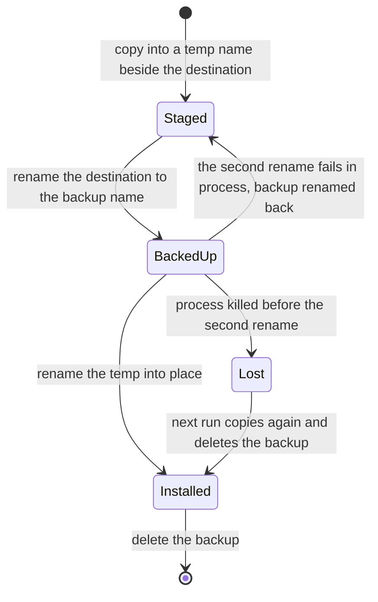

# An atomic replace

A file or a tree swapped into place by rename, so a reader sees the old one or the new one. For
a tree the swap is two renames with a backup between them, and a kill between the renames is a
state the code has to name.

The rules that go wrong in practice:

- **A kill between the two renames leaves the destination missing**, with the old tree under the
  backup name. No code restores it by renaming back on the next run (the plugin output tree is the
  exception: its recovery restores `.mars-old` over a missing output). The next run deletes the
  backup and writes again. That is safe only for a destination nothing reads between runs.
- **The temp sits beside the destination, on the same filesystem**, because a rename across
  filesystems is a copy. A publish that copies instead of renaming loses the all-or-nothing.
- **The backup name must be free before the swap.** A leftover backup is removed or refused first;
  two backups leave recovery unable to tell which is newer.
- **A single file is simpler**: `atomic_write` writes a temp file and persists it over the target,
  so a kill leaves the old file. It leaves a `.tmpXXXXXX` file in the parent if killed between
  write and persist, and only `.mars/skills` temp directories are ever swept, not temp files.
- **`install_prepared_temp_dir` (`src/fs/mod.rs`) and `replace_generated_dir`
  (`src/platform/fs.rs`) are the same sequence written twice.** Only the second clears a read-only
  attribute on Windows. Change the sequence in both.

## Instances

| Machine | What is swapped |
|---|---|
| [Plugin output tree](../../src/build/.context/state-machines.md) | the output directory, with `.mars-new` and `.mars-old` siblings |
| [Staging generation](../../src/platform/.context/state-machines.md) | `.mars/.staging.pending` over `.mars/staging`, with `.staging.old`; and skill installs through `.tmpXXXXXX` |
| [Archive cache entry](../../src/source/.context/state-machines.md) | a tarball extracted to `<key>.tmp.<pid>`, renamed in only if the path is absent |
