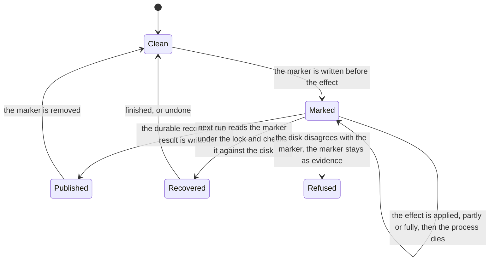

# A marker a crash leaves

Mars is killed mid-write all the time. Where a change takes more than one atomic step, the first
step leaves a journal or marker on disk, and the next run reads it to tell "done" from "half
done" and then finishes, undoes or refuses.

The rules that go wrong in practice:

- **The marker goes down before the effect, and the durable record before the marker is
  removed.** Swap either and a kill leaves an unowned file or a lost claim.
- **A marker cannot look like a finished state.** `pending` is never a digest Mars computes, and a
  `.mars-plugin.json` counts only if it validates, so a half-written one claims nothing.
- **Recovery runs at startup, under the lock**, and either finishes, deletes or refuses. It does not
  resume work from a half-built tree: a leftover `.staging.pending` is deleted, not reused.
- **Recovery fails closed.** Changed bytes, a changed lock or an unsafe path stop the run with the
  marker left in place.
- **A marker records what the dead run intended and could touch**, so recovery has authority over
  exactly that and nothing else (the provided lock's pre-record lists planned and previous names).

Machines with a crash window and no marker, so recovery is a later run that notices:

- Native target outputs and config entries are not in the canonical write journal; an interrupted
  copy leaves files the next run reads as unowned.
- `mars link` and `mars unlink` write files, config and lock in separate steps; a kill between
  leaves settings and lock disagreeing.
- `mars adopt` renames the user's file into `.mars-src` with no record before the sync.
- A hook config file killed after its save and before `mars.lock`: the lock still records the
  old entry, so the next sync warns `config-divergence`, finds nothing to remove, and appends
  the new entry again, a duplicate. Known gap: the config-entry journal (step 3 of the decision)
  closes it, because recovery would fold the saved entry into the old lock first. Matching
  content in the file is not proof Mars wrote it, so the sync does not guess.
- A git cache entry has no marker for a completed clone.

## Instances

| Machine | The marker |
|---|---|
| [Canonical write journal](../../src/sync/.context/state-machines.md) | `.mars/pending-canonical.json` |
| [Staging generation](../../src/platform/.context/state-machines.md) | `.mars/.staging.pending` |
| [Generated-tree marker](../../crates/mars-schema/.context/state-machines.md) and [generated root files](../../src/build/.context/state-machines.md) | `.mars-plugin.json`, with `root_files_previous` |
| [Plugin output tree](../../src/build/.context/state-machines.md) | `.mars-new` and `.mars-old` siblings |
| [Provided lock record](../../src/provided/.context/state-machines.md) | the digest `pending` inside `.mars/provided.lock` |
| [Release](../../src/cli/.context/state-machines.md) | the plugin staging tree only |
