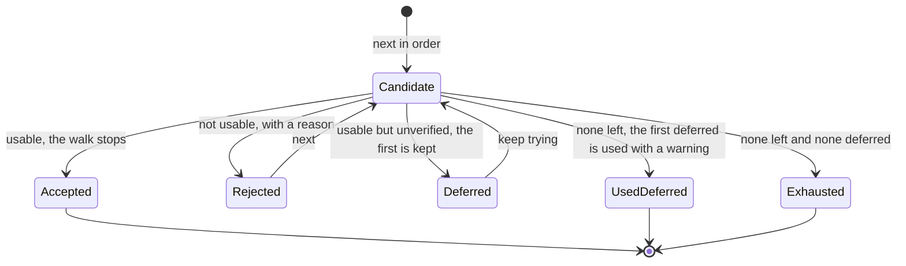

# An ordered fallback walk

A list of candidates tried in a documented order until one is accepted. What matters is the order,
what counts as a rejection, and what the walk does when it runs out.

The rules that go wrong in practice:

- **Order is the contract.** Reordering the candidates, or iterating a hash map instead of the
  declared order, changes what gets installed without changing any type.
- **Order is preference, never permission.** A harness that is first in the list but blocked is
  skipped; being named first does not make it allowed.
- **A fallback is a warning, and under `--frozen` an error.** Replaying a lock that cannot be
  replayed re-resolves to a new commit when not frozen, and refuses when frozen.
- **Exhaustion is an outcome with a reason.** Nothing is substituted unassessed. Harness routing
  marks exhaustion with an empty `trace.harness`, so each consumer has to test for it.
- **Fall back only on a failure that means "this candidate is unusable".** The locked-commit
  fallback treats any git or HTTP failure as "unreachable", so an outage moves a package forward.

## Instances

| Machine | The candidates |
|---|---|
| [Version choice](../../crates/mars-schema/.context/state-machines.md) | a pin, the locked version, the newest allowed tag |
| [Skill ref resolution](../../crates/mars-schema/.context/state-machines.md) | own package, direct dependencies breadth first, then any package |
| [Source version and commit](../../src/resolve/.context/state-machines.md) | locked commit, tag scan, HEAD |
| [Engine-requirement fallback](../../src/resolve/.context/state-machines.md) | versions, each refused until one meets `requires-*` |
| [Native model decision](../../src/compiler/.context/state-machines.md) | `profile.model`, then each model-policy entry |
| [Launch policy](../../src/build/policy/.context/state-machines.md) | model candidates, each over harness routes |
| [Harness routing scan](../../src/routing/.context/state-machines.md) | harnesses in preference order |
