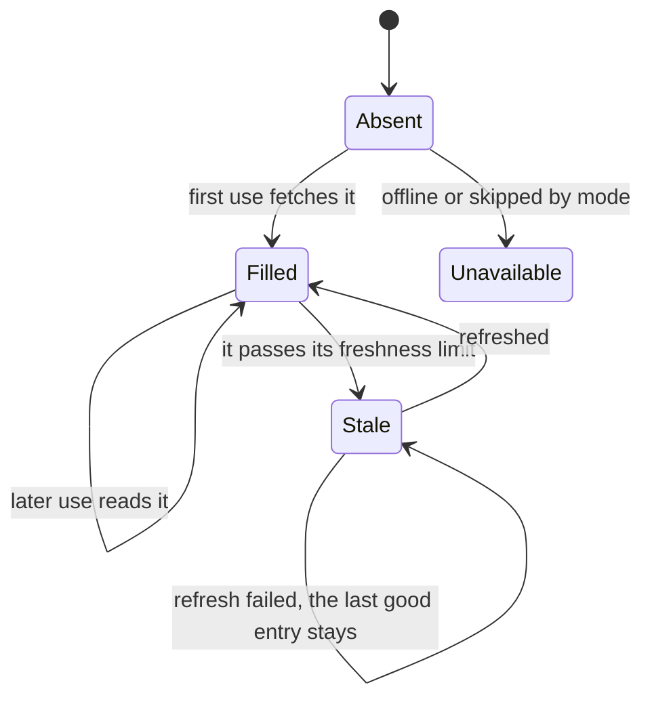

# A lazy cache entry

Something fetched or built the first time it is needed and kept for later runs. The entry's
presence on disk, or in a session's memory, is the state.

The rules that go wrong in practice:

- **A failed refresh never replaces a good entry.** It records that an attempt failed and when, so
  readers can see the failure without losing the last good value.
- **Presence is validity unless the entry carries a marker.** A git clone killed halfway leaves a
  directory that looks cached. Entries written by one atomic write do not have this problem.
- **A read of a damaged entry is a miss, not an error.** Cache files are written whole and read
  tolerantly, so a truncated file is refetched.
- **A diagnostic must not trigger the fetch.** Provider knowledge answers "unknown" for a harness
  that was never probed instead of probing it.
- **A per-command memo caches "unknown" too**, so a slow probe is not retried for every alias.

## Instances

| Machine | The entry |
|---|---|
| [Git cache entry](../../src/source/.context/state-machines.md) | a cloned repository |
| [Archive cache entry](../../src/source/.context/state-machines.md) | an extracted tarball |
| [Probe cache](../../src/models/probes/.context/state-machines.md) | one harness's model listing |
| [Model catalog snapshot](../../src/models/.context/state-machines.md) | the per-user catalog snapshot in the Mars cache root |
| [Probe loading](../../src/harness/.context/state-machines.md) | each probe outcome in one command's session |
