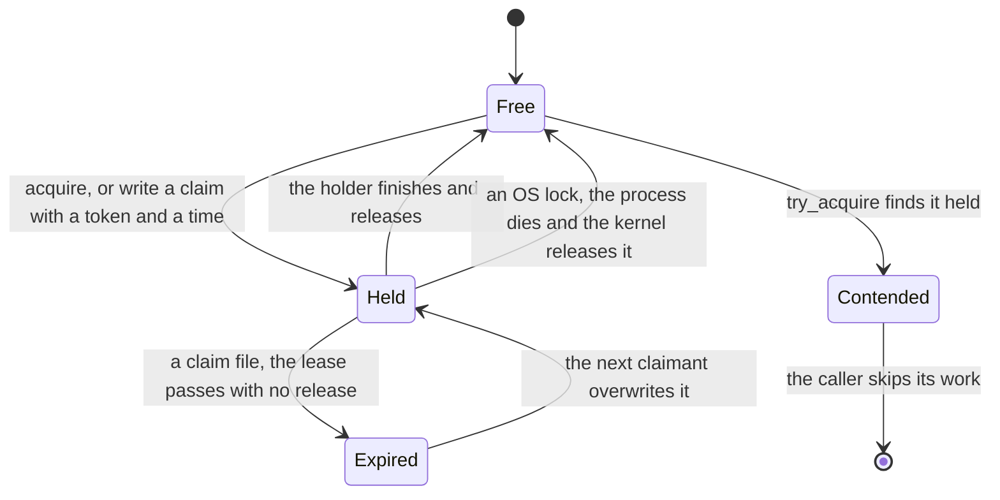

# A lease or lock

Work that one process at a time may do, where the holder can die. There are two kinds, and the
difference is who notices the death: the kernel, for an OS lock, or the clock, for a claim written
into a file.

The rules that go wrong in practice:

- **An OS lock needs no recovery code.** The lock file is never deleted, and "the file exists" does
  not mean the lock is held. A read-only open can make NFS refuse the lock, so the file is opened
  read and write.
- **A claim file needs a lease that outlasts the work it guards.** The catalog refresh lease (120s)
  is longer than the HTTP deadline (60s), asserted at compile time. Shorten the lease below the
  work and two refreshers run; drop it and a dead process holds the claim forever.
- **A claim is owned by token, not by file existence.** A worker that outlived its lease must not
  delete its successor's claim.
- **A non-blocking acquire must be able to tell "held" from "cannot open".** Reporting an unopenable
  file as contention skips the work forever.
- **A preview takes an existing lock and never creates one**, so a dry run in a project never
  synced sees no writer and leaves no file.
- **A lock is named by what it protects.** The git cache lock name swaps the text after the last `.`,
  so entries on one host can share a lock; correct, but it serializes more than it needs to.

## Instances

| Machine | The lock |
|---|---|
| [`.mars/sync.lock`](../../src/fs/.context/state-machines.md) | OS lock for the whole sync, held by a keepalive field |
| [Plugin output tree](../../src/build/.context/state-machines.md) | OS lock per output identity, in the global cache |
| [Model catalog refresh claim](../../src/models/.context/state-machines.md) | claim file with a token and a 120s lease |
| [Probe cache](../../src/models/probes/.context/state-machines.md) | one OS lock per harness, taken with `try_acquire` by the background trigger |
| [Git cache entry](../../src/source/.context/state-machines.md) | OS lock beside the cache entry |
