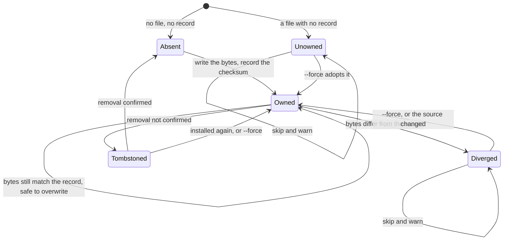

# An ownership record

Mars overwrites or deletes only what it installed and recorded; people keep their own files in the
same directories. So before touching a file or a config entry Mars asks what proves it wrote
it, and the proof is a record: a lock output record with a checksum, the exact JSON it emitted
for a config entry, or a hash in the plugin marker.

The rules that go wrong in practice:

- **Bytes are written before the record, so a kill leaves an unowned file.** The next run reads it
  as someone else's, skips it and warns; the user has to `--force` to adopt files they never
  wrote. The reverse half-write, a record with no file, heals: an absent recorded path counts as a
  confirmed deletion.
- **A tombstone grants deletion only.** It never authorizes an overwrite, or bytes that appeared
  after a failed removal would be replaced.
- **The record is scoped by `(target_root, dest_path)`.** A `.mars` record never authorizes a
  `.claude` change.
- **Three predicates count different proofs** (`LockIndex`, `sync::ownership::Ownership`,
  `surface_ownership`): journal-narrow, lock-or-provided, lock-only. Do not merge them; see
  [invariants](../invariants.md).
- **Divergence is judged against what Mars would write now or wrote before.** A file matching
  either is current. A file matching neither is the user's edit, kept until the source changes.
- **Config entries are matched by content, not by name**, so a user edit of one entry is a
  divergence and the rest of the file is untouched.

## Instances

| Machine | The proof |
|---|---|
| [Lock output record](../../src/lock/.context/state-machines.md) | `OutputState` with an installed checksum |
| [Managed target output](../../src/target_sync/.context/state-machines.md) | the lock's installed checksum for `(target, dest)` |
| [Native agent files](../../src/compiler/.context/state-machines.md) | the lock's per-output checksum, outside target sync |
| [Hook and MCP config entries](../../src/compiler/.context/state-machines.md), [MCP server entry](../../src/target/.context/state-machines.md), [hook entry](../../src/target/.context/state-machines.md) | `emitted_json` per entry |
| [Generated root files](../../src/build/.context/state-machines.md) | hashes in the plugin marker |
| [Target claim](../../src/cli/.context/state-machines.md) | outputs recorded before `settings.targets` |
