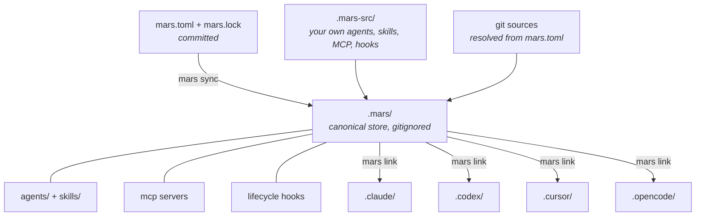

# mars

A package manager for AI agent profiles and skills. Install agents and skills from git sources into Claude Code, Codex, OpenCode, Cursor, and other agent harness config directories.

## Target Status

Mars materializes harness-native artifacts for multiple targets:

| Target | Status | Notes |
|---|---|---|
| `.claude` | First-class | Claude Code agents, skills, MCP, hooks, and settings surfaces. |
| `.codex` | First-class | Codex project instruction and agent-facing surfaces. |
| `.opencode` | First-class | OpenCode agent and permission surfaces. |
| `.cursor` | Unmaintained | Cursor CLI/config support still ships but is no longer tested or extended; it may break without notice. |
| `.pi` | Future first-class | Meridian-owned Pi flavor and extension surface; under active design/development. |

## Plugin Distribution

Packages can commit installable plugin artifacts for Claude, Codex, Grok, Cursor, and
OpenCode. See [Authoring harness plugins](docs/plugin-authoring.md) for configuration,
build, verification, and release guidance.

**supported** means the component ships and loads. **impossible** means the harness's
plugin system has no slot for it. Verification is evidence from real binaries except
where a cell explicitly says docs-only.

<!-- BEGIN GENERATED PLUGIN SUPPORT -->
### Component support

| | Claude | Codex | Grok | Cursor | OpenCode |
|---|---|---|---|---|---|
| Tree | claude | claude | claude | cursor | opencode |
| Skills | supported | supported | supported | supported | supported (registered by `index.mjs`) |
| Agents | supported; `hooks`, `mcpServers`, `permissionMode`, `initialPrompt` dropped with warning | **impossible**: Codex plugins don't load agents | supported; `hooks`, `mcpServers`, `permissionMode`, `initialPrompt` dropped with warning (same file as Claude) | supported | **impossible**: OpenCode plugins don't load agents |
| Hooks | supported for hooks with a `claude` fragment; others dropped with warning | supported for hooks with a `claude` fragment; others dropped with warning (reads the Claude tree's `hooks/hooks.json`) | supported for hooks with a `claude` fragment; others dropped with warning (as Claude) | supported for hooks with a `cursor` fragment; others dropped with warning | supported for hooks with an `opencode` fragment; others dropped with warning (each fragment needs a default `{id, setup}` export) |
| MCP | supported | supported (same file as Claude) | supported (same file as Claude) | supported | supported (registered by `index.mjs`) |
| Bootstrap docs | impossible | impossible | impossible | impossible | impossible |

### Verification level

| | Claude | Codex | Grok | Cursor | OpenCode |
|---|---|---|---|---|---|
| Install from catalog | live (local marketplace) | live (local marketplace) | live (local marketplace) | docs-only (account required) | live (`git+file://`) |
| Skills | live (own and dependency skills) | live (own and dependency skills) | live, with `resources/` | docs-only (schema validation only) | live, with `resources/` |
| Agents | live (subagent preload) | n/a (impossible) | live (subagent with native skill preload) | docs-only (schema validation only) | n/a (impossible) |
| Hooks | live (`${CLAUDE_PLUGIN_ROOT}`, CommonJS script) | live (built tree, CommonJS script) | live (`CLAUDE_PLUGIN_ROOT`) | docs-only (schema validation only) | live (git install, CommonJS script) |
| MCP | live (`env_vars` pass-through) | live (`env_vars` pass-through) | live (`env_vars` pass-through) | docs-only (schema validation only) | live (`<plugin>:<server>`) |
<!-- END GENERATED PLUGIN SUPPORT -->

### Install commands

`<owner>/<repo>` is the package repository; `<name>` and `<marketplace>` come from
`[plugin]`.

| Harness | Command | Source forms verified |
|---|---|---|
| Claude | `claude plugin marketplace add <owner>/<repo>` then `claude plugin install <name>@<marketplace>` | Local directory and local Git checkout. GitHub shorthand is documented, not run pending a pushed plugin release. |
| Codex | `codex plugin marketplace add <owner>/<repo>` then `codex plugin add <name>@<marketplace>` | Local directory; Codex selects the Claude catalog. GitHub shorthand is documented, not run pending a pushed plugin release. |
| Grok | `grok plugin marketplace add <repo-url>` then `grok plugin install <name> --trust` | Local directory and `file://` Git. |
| Cursor | `agent plugin marketplace add <repo-git-url>`, then install from Cursor's Customize UI; local development: `agent --plugin-dir <checkout>/<dir>/cursor` | Documented only; an account is required. |
| OpenCode | `opencode plugin add git+https://github.com/<owner>/<repo>.git` | `git+file://` verified. `git+https` is documented, not run pending a pushed plugin release. |

## Install

| Method | Command |
|---|---|
| Cargo | `cargo install mars-agents` |
| pip / uv | `uv tool install mars-agents` or `pip install mars-agents` |
| npm | `npm install -g @meridian-flow/mars-agents` |
| Prebuilt binaries | [GitHub Releases](https://github.com/haowjy/mars-agents/releases) |

## Quick Start

```bash
mars init
mars add meridian-flow/meridian-dev-workflow
mars link .claude
mars link .codex
```

Your agents and skills are now installed and available in both Claude Code and Codex. Update them with `mars upgrade`, check for drift with `mars doctor`.

## Adding Sources

```bash
# From GitHub
mars add meridian-flow/meridian-base
mars add acme/security-agents --only-agents

# From a local directory
mars add ../my-team-agents

# Pin a version
mars add meridian-flow/meridian-base@^1.0
```

## Model Aliases

Packages can distribute model routing — short names that resolve to concrete models across harnesses:

```bash
mars models list
mars models resolve opus
```

```toml
# In mars.toml — override any alias
[models.opus]
harness = "claude"
provider = "Anthropic"
match = ["*opus*"]
```

## How It Works



Mars resolves the full dependency graph before touching any files. Writes are atomic. The lock file tracks what mars manages so it never touches your files. Each linked target gets harness-native artifacts — agents, skills, MCP servers, and hooks compiled to match what that tool expects.

Published packages can declare `requires-mars` and `requires-meridian` under
`[package]`. Mars automatically falls back to the newest compatible package
release; see the [`mars.toml` reference](docs/config/mars-toml.md#package-optional).

Use `mars adopt` to bring an existing unmanaged file into `.mars-src/` in one step.

## Docs

- [Config](docs/config/) — `mars.toml`, agent profiles, compilation, MCP/hooks
- [Plugin authoring](docs/plugin-authoring.md) — build and release multi-harness plugins
- [CLI](docs/cli/commands.md) — every command with flags and examples
- [Internals](docs/internals/) — sync pipeline, lock file, conflicts
- [Dev](docs/dev/) — local development, troubleshooting, smoke testing

## License

MIT
