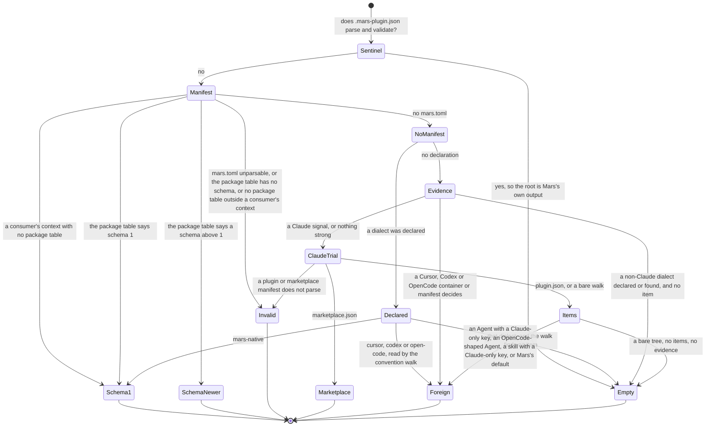
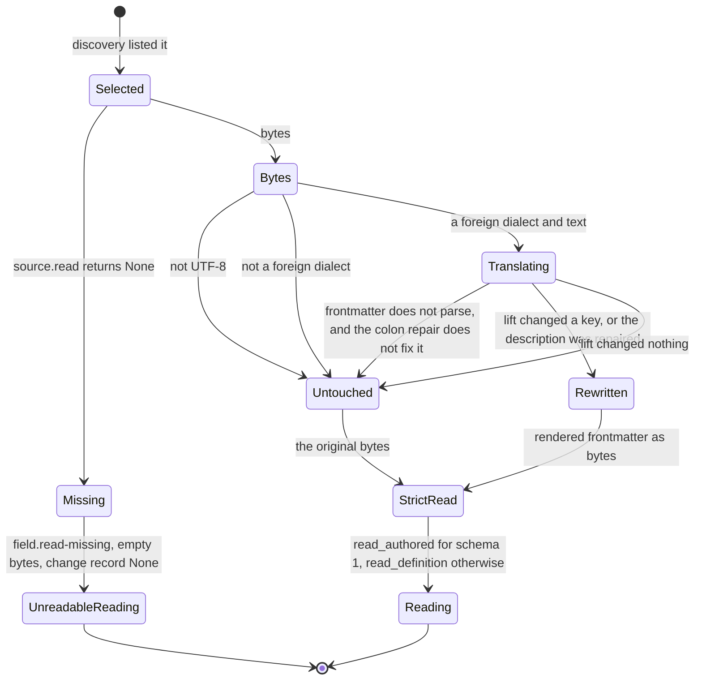
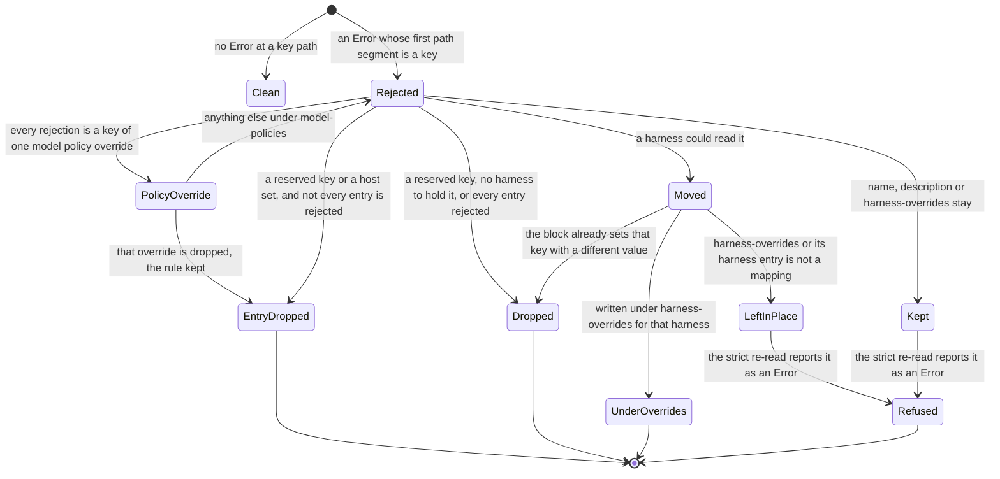
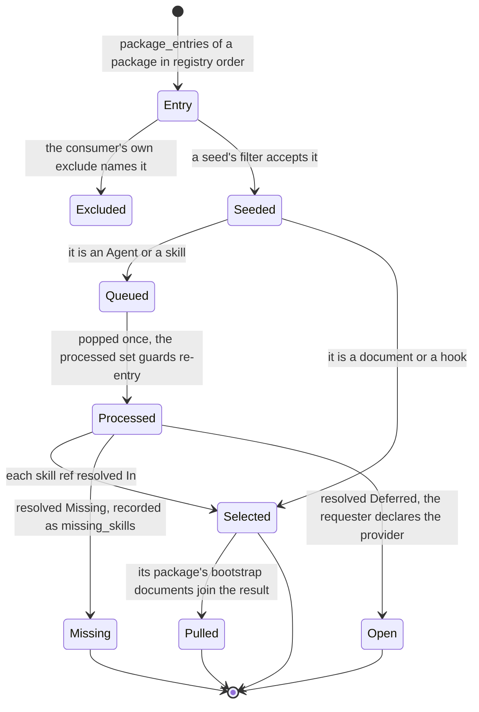
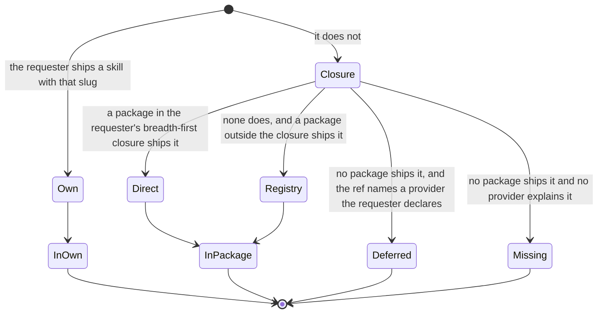
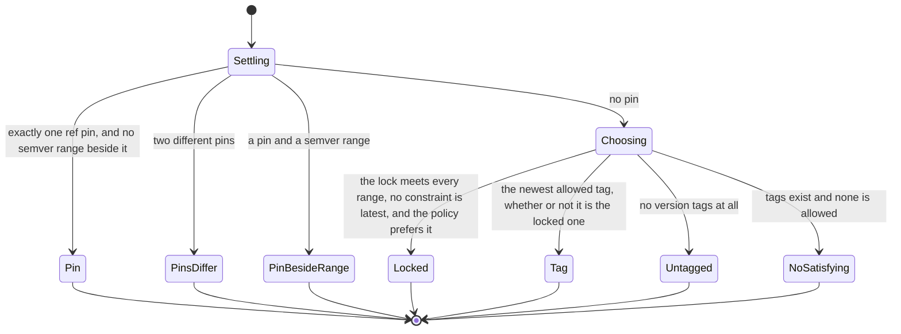
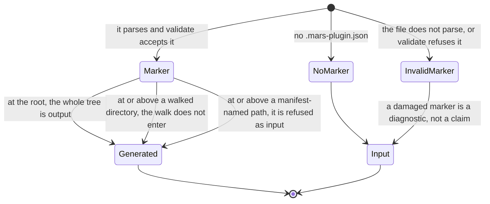
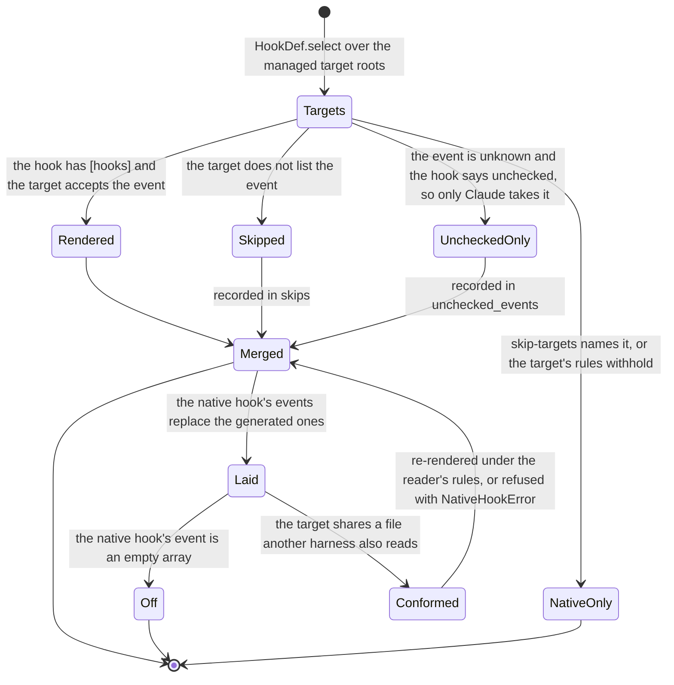
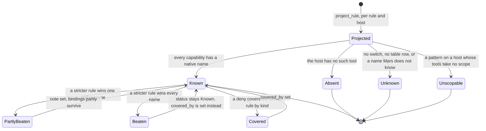
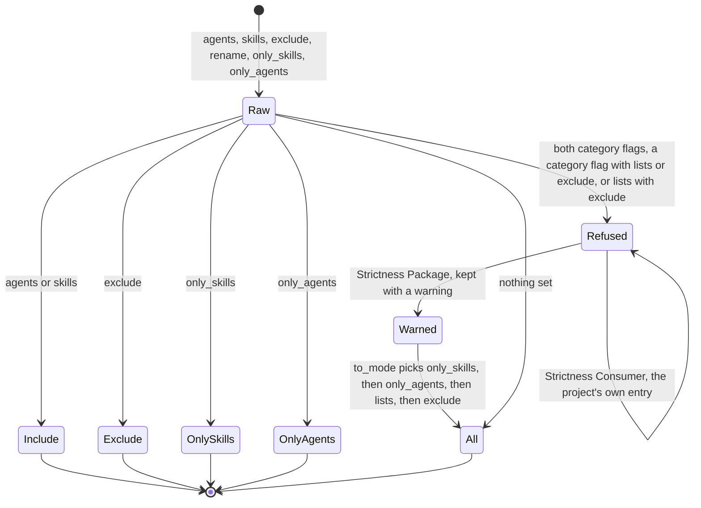

# Schema crate state machines

`mars-schema` writes nothing: it reads a `TreeSource` (`read`, `is_file`, `is_dir`, `children`),
decides, and returns values: bytes for the binary to write, diagnostics, a selection. So every
"what is on disk" state here is read state, and the write side lives in `src/sync` and
`src/compiler`. Two rules follow for every machine below: a reader must not depend on anything a
writer only sometimes leaves behind, and a value the crate reports as decided must be
recomputable from the tree alone. The one disk state it interprets is `.mars-plugin.json`
(generated-tree marker). The index of all machines is
[state-machines/index.md](../../../.context/state-machines/index.md).

## Root classification

What one package root is, from the bytes in it to a `Classification` and a `Layout`. `dispatch`
runs `classify`, then `claude_layout` and `predict_from_items`; `Dispatched::kind()` projects the
pair to `Kind`. `prepare_root` reads `Classification` again for `can_read_definitions` and
`authored`.

- **Order is the contract.** Sentinel, then manifest, then declaration, then evidence, with a
  Claude layout tried before item prediction. Checking the sentinel after the manifest makes
  Mars read its own output as input, and `prepare` has no other guard.
- **Two types answer "what is this root".** `Classification` carries the dialect choice and the
  newer schema number. `Kind` carries neither and adds `Plugin` and `SkillTree` from `Layout`. It
  is derived in `Dispatched::kind()` and travels to `inspect`, `normalize` and the binary. A
  branch that changes classification must change the projection; nothing checks that it does.
- **`Empty` means two things**: Mars's generated output (`Discovery::generated_root()` adds an
  Info) and "nothing here". Both arrive as `Classification::Empty` with `Layout::None`; only the
  diagnostics in `Discovery` tell them apart.
- `Dispatched::kind()` has no arm for a foreign classification with a marketplace layout. `classify`
  cannot build that pair, but the fallthrough arm would call it `SkillTree` if it could.

## Prepared definition

One file on its way into a `PreparedDefinition`: selected, read, translated, read again. This is
the crate's main pipeline, and the one place a value changes shape and is read twice.
`prepare_definition` runs it; `translate_foreign` does the foreign dialect step
(`Frontmatter::parse`, then `lift_frontmatter`); the strict read is `read_authored` for schema 1
and `read_definition` otherwise.

- **The re-read is not redundant.** `set_aside_rejected_keys` runs inside `lift_frontmatter`, so
  the bytes handed to the reader are already the moved ones. What the reader still rejects after
  that is what no routing could save, and it is reported as an Error. Deleting the second read
  to avoid parsing twice deletes the check that a set-aside worked.
- **`ChangeRecord` is what the caller writes with.** `FullyRewritten` means "write
  `normalized_bytes`", `None` means "the file's own bytes". `FullyRewritten` with the original
  bytes makes the binary rewrite a file with itself; the reverse leaves a user's file in a foreign
  dialect and never says so.
- **The reading can disagree with the bytes.** `add_package_tools` pushes the manifest's
  `[package.tools]` into the Agent's fields and leaves `normalized_bytes` as the file's. Anything
  that re-reads the bytes instead of using the reading loses those rules and drops the package's
  deny list.
- A definition with an error stays in `definitions` with `fields: Some`; the crate refuses
  nothing. Whether the package or only the definition is refused is the sync lane's decision (the
  manifest's `first_error` is what refuses the package).
- "Unreadable" is spread over four fields: `fields: None`, `body: None`, `normalized_bytes`
  empty and `ChangeRecord::None`, plus the Error in `diagnostics` that says why. `into_valid`
  turns a reading with none of them into an `unreachable!`, and `DefinitionRead::unread` accepts
  any diagnostics.

## Where a rejected key goes

Each frontmatter key of a translated definition, from "the strict reader refuses it" to a
destination. `set_aside_rejected_keys` drives it with `rejected_keys`, `drop_policy_overrides`
and `drop_entries`; `move_keys_under` (in `harness_overrides`) returns a `Moved`.

- **Routing is per key and per entry, and losing a restriction is a different report.**
  `restriction_lost` decides the code: a deny or ask tool entry, `permission`, `sandbox`,
  `approval`, `network` and a `network-deny` host lose a restriction, so they are
  `field.restriction-lost` and printed on every sync. Everything else is `field.set-aside` and
  only counted. A key added to `RESTRICTION_KEYS` but not to `restriction_lost`'s nested cases
  reports a lost `network-allow` entry as an ordinary change.
- **`reserved` exists because Mars lowers those keys itself on some harness.** An override would
  keep Mars's value and drop the user's. Setting `KEPT_KEYS` without that clause moves `name` and
  `description` into `harness-overrides.claude`, and every other harness stops seeing the agent's
  identity.
- **`LeftInPlace` is a real, quiet outcome.** On `Moved::Blocked` nothing moves, this function
  reports nothing, and the key stays. Only the re-read (see the prepared definition) catches it. A
  caller that used `lift_frontmatter`'s result without re-reading would ship a file with the
  rejected key and no error.
- `Moved::Done { moved, displaced }` puts a key that was copied and a key that already sat in the
  override with the same value in the same `moved` list, so the report says "moved" for both.
- The crate persists nothing here; the outcome is bytes plus `changes`, and the binary writes
  the bytes.

## Item selection

Each Agent, skill, document and hook across the dependency graph: considered, accepted by a
request, pulled in by a skill ref, or excluded. `select` holds `selected`, `queue` and
`processed` as locals; `SelectedItem` and `Requester` are the results. The phases are `seeds`,
the exclusion map, the seed loop, the closure loop, the bootstrap pull and the ordered output.

- **A dependency's manifest must not widen what the consumer asked for.** `seeds` walks only
  unfiltered `All` entries, and only from packages reached through unfiltered entries. Accepting
  a filtered dependency edge adds items the consumer never requested, through a package it does
  not own.
- **Exclusion is checked in three places with three inputs**: at seeding, at a skill ref's landing
  package, and at the bootstrap pull. Dropping any one reinstates an excluded item by a different
  route. `is_excluded` ignores every filter that is not `Exclude`.
- **`processed` is the only thing stopping a skill-ref cycle from looping.** The queue holds
  `(package, kind, slug)`, and a cycle re-enqueues the same key.
- **Everything is by identity, so the result must not depend on `packages`' hash order.**
  `Graph::new` builds `order` by a depth-first walk from the root, and the output loop iterates
  that. Iterating `packages` directly makes install order, and so collision suffixes, depend on
  hash order.

## Skill ref resolution

One `skills:` ref of one Agent, inside the selection closure. `resolve_skill` returns a
`Resolved`; the caller's match records a `MissingSkill` when there is none.

- **Order is the rule**: own package, then breadth-first so a direct dependency beats a transitive
  one, then registry order. Sorting the closure alphabetically lets a transitive package supply a
  skill its direct dependency also ships.
- **`Deferred` is not `Missing`.** A `<skill>__<provider>` ref to a provider the requester
  declares is left for the caller to fill in. Reporting it as missing makes every
  provider-using package fail to check.
- `resolve_skill` reads `entries` built from the prepared graph, and the caller then `expect`s that
  a package which has the skill lists it. That holds only because both read the same map; a
  resolver that searched definitions instead of entries would panic.

## Version choice

One package's ref, from every constraint on it and the tags the repository has. `choose` calls
`settle`, then `keeps_lock`, then `select`, which uses `allows`. This is the crate's only state
that reaches a network, through the caller. The resolver's use of it is in
[resolve](../../../src/resolve/.context/state-machines.md).

- **`keeps_lock` answers without asking the repository.** It checks the constraints and the policy
  and never asks whether the tag still exists, so a tag deleted upstream keeps a locked install
  working. A tag-existence check there turns every replay of a lock into a fetch.
- **`Chosen::Locked` can name a version that is not in `available`.** A caller that indexes
  `available` with it panics or picks the wrong commit.
- **`latest` beside a pin is deliberate.** `settle` returns the pin and the `latest` constraint
  "holds but drifts". `keeps_lock` refuses to keep the lock when any constraint is `latest`, so
  `choose` and `select` agree only because of that one check.
- `Tag` silently ignores a tag that is not a version (`nightly`). The binary uses the same rule
  when it lists tags, and the two must stay in step.
- `select` breaks ties toward the later of two equal versions, which keeps the choice stable when
  a repository lists a tag twice.
- `mars-schema-wasm` re-encodes `Chosen` as `Choice`. If `Chosen` changes, that mapping must
  follow.

## Generated-tree marker

One directory in the tree: input, or generated output that nothing reads. The marker is
`SENTINEL_FILE` (`.mars-plugin.json`), parsed by `PluginSentinel` and accepted by `validate`.
The root check is in `classify`; `Boundary::of` reads `[plugin].dir`, `Boundary::admits` runs per
directory the walk enters, and `enclosing_generated_dir` runs per manifest-named path. The
writing side is the [plugin output tree](../../../src/build/.context/state-machines.md).

- **Validity is the whole point.** `is_valid_sentinel` requires the schema version, non-empty
  identity fields, at least one file, and package-relative paths with sha256 hashes. Accepting a
  marker that merely parses lets a half-written `.mars-plugin.json` (the file a killed build
  leaves) claim the tree and hide the user's own content.
- **`root_files_previous` exists for the crash itself.** Publishing the tree and the root files is
  two steps, so the record says which root files the dead build left. Dropping it makes the next
  build mistake its own earlier write for a hand edit.
- **Two rules answer "is this directory generated"**: `Boundary::admits` refuses to look for a
  marker inside a hidden directory (a dot-prefixed directory can be authored content), while
  `enclosing_generated_dir` checks every prefix, hidden or not. `walk` never offers `admits` a
  hidden directory, so the hidden clause only affects the payload walk.
- A marker under a skill's payload stops that payload file being copied. The marker is reported
  once per walk (`report_generated`), deduplicated by code string.

## Hook on one target

One event of one hook on one target: rendered, skipped, overridden by the native hook, turned
off, or unchecked. Defined by `Rules` and `Placement` and `Profile` (`hooks/targets.rs`),
`Output` and `Skip` (`hooks/render.rs`), `HookOutput` (`hooks/output.rs`) and `Origin`. The path
runs through `HookDef::select`, `generates_for`, `HookDef::output`, `PortableHooks::render`,
`lay_native_hook` and `conform_to_codex`.

- **A shared file is read by two harnesses.** `PLUGIN_CLAUDE_TREE` is Claude's event list under
  Codex's rules, because Claude, Codex and Grok all read `hooks/hooks.json` and Codex rejects the
  whole file over one handler it cannot parse. `conform_to_codex` re-renders what is already
  there; a `[hooks]` entry that skips it makes the plugin's hook file unloadable on Codex.
- **`Origin::Dependency` is what makes an author's slip a warning instead of a failed sync.** A new
  strictness has to be threaded from there, not from the renderers.
- **Two switches decide whether `[hooks]` renders on a target**: the hook's `skip-targets` and the
  target's `Rules::Withheld`. A native hook still installs on a skipped target; only the
  generated entries stop. Reading `skip-targets` as "install nothing here" silently drops a
  dependency's native hook.
- **`conform_to_codex` is idempotent** ("entries `[hooks]` already rendered pass unchanged"), which
  is what lets it consume its own output. An edit that makes one pass change the input makes
  repeated `mars sync` non-convergent.
- `MergeOutput` carries `skipped_events`, `unchecked_events`, `overrides`, `skips` and
  `answer_limits`; three of them can be derived from `events`. They reach the launch bundle JSON,
  so none can be removed without a bundle change.

## Tool rule on one harness

One `tools:` rule on one harness: a native name, a gap, absent, or left out because a stricter
rule wins. `NativeStatus`, `ProjectedRule`, `NativeBinding` and `CoveredBy` are the types.
`project_rule` sets the status, `keep_strictest_per_native` lets a stricter rule beat bindings,
and `project` marks coverage (`beat`).

- **`status` never becomes "not applied".** A rule whose every native name is beaten keeps
  `NativeStatus::Known`; the "left out" fact lives in `note` and `covered_by`. Anything that
  reports the rule by `as_str()` alone says a rule is applied when it applies nothing: a deny that
  never lands.
- **`available()` and `natives()` differ on purpose.** The allowlist must keep names that a deny
  beats, or writing the list empties a permission set.
- `Capability::Any` projects with `status: None`, a fourth unnamed state that every reader must
  handle as "not a concrete rule".
- **Two phases, and order matters.** A coverage pass before `keep_strictest_per_native` changes
  which rule wins, because coverage is computed by kind and strictness by native name.
- The status, note and `covered_by` cross to JS in the launch bundle (`native_status`), so their
  wire spelling is fixed.

## Dependency filter

One dependency entry's filter fields before they become a mode: six independent fields
(`agents`, `skills`, `exclude`, `rename`, `only_skills`, `only_agents`), five legal combinations.
`FilterConfig::validate` and `to_mode` decide; `Entry::read` in `dependency.rs` picks strict or
lenient by `Strictness`.

- **`to_mode`'s priority order is the behaviour a lenient package gets** ("picks the mode it always
  has"). Reordering its `if` chain changes what a broken dependency installs, silently, under a
  warning nobody reads.
- **`Strictness` decides refuse or warn, and it is decided by who reads the entry, not by the
  entry.** A new entry reader must pass it; defaulting to `Consumer` breaks every package whose
  dependency has a sloppy filter.
- `has_any_filter` keeps its own list of the six fields; a new field must be added there too.
