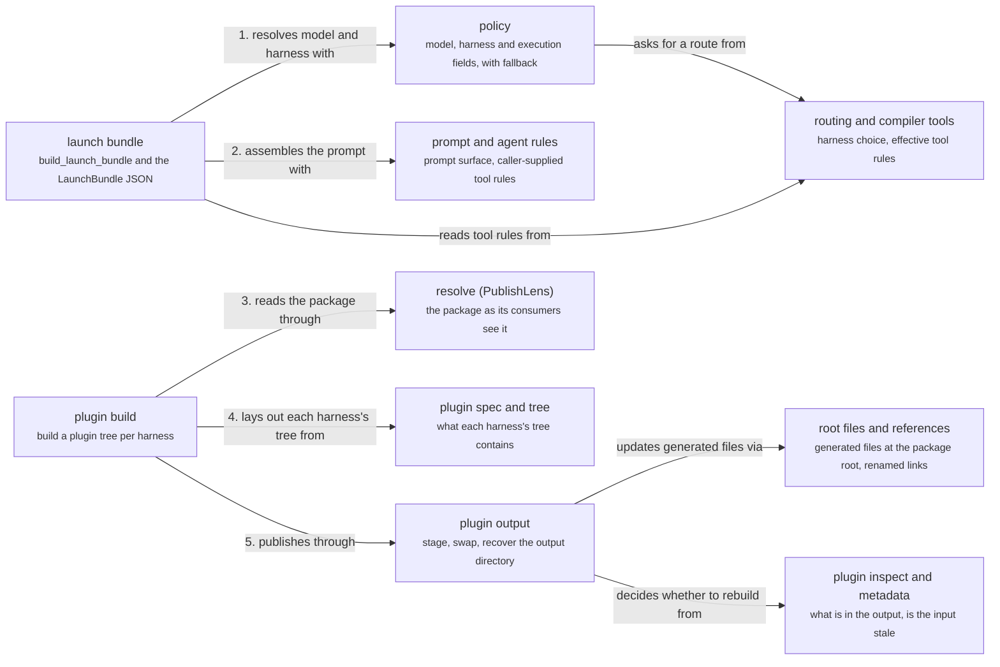

# build

`src/build/` produces outputs from a package without installing it into a project: harness plugin trees for publishing, and launch bundles that tell a launcher which harness, model and tools to use.

## bundle

`mars build launch-bundle`: one JSON document describing how to launch an agent, or an ad-hoc request, in a harness.

- Kind: module
- Paths: `src/build/mod.rs`, `src/build/bundle.rs`
- Docs: [build context](../../src/build/.context/CONTEXT.md)

Ad-hoc mode works with no project or profile, so a caller can route without a sync. Consumers launch with `routing.harness_model` exactly as given (Cursor may already have encoded effort in it); candidate slugs are diagnostic only. Route facts such as passthrough belong in routing fields, tool gaps in rule status, and `warnings` only for states a user can act on, because launchers may show every warning on every launch.

## policy

Resolves model, harness and execution fields independently, then walks the fallback chain.

- Kind: module
- Paths: `src/build/policy`
- Docs: [launch policy](../../src/build/policy/.context/CONTEXT.md)

A CLI model pin disables model backups and a CLI harness pin restricts every attempt to that harness; profile, overlay and alias harnesses are ordered preferences. Never clear a requested model to make a harness work. Try the primary model, then the profile's policy entries in order, deferring unverified routes until candidates run out; exhaustion is an error, not a reason to substitute an unassessed harness.

## prompt

The prompt surface of a bundle, and tool rules a caller supplies in place of the agent's own.

- Kind: module
- Paths: `src/build/prompt.rs`, `src/build/agent_rules.rs`

`--agent-tool-rules` goes through `effective_tools_for_rules` so a stored set of rules is shaped like a live one.

## plugin

`mars build plugin`: a tree per harness plus the generated root files.

- Kind: module
- Paths: `src/build/plugin/mod.rs`
- Docs: [plugin authoring](../plugin-authoring.md)

It resolves as a consumer of the package, with no local or user config, project lock, installed targets, model caches or installed harnesses, so the tree is the same on every machine. It shares target selection and renaming with sync. OpenCode loads no agent files from a plugin, so its generated plugin registers agents through `ctx.agent`.

## spec

The declarative description of each harness's plugin tree and the code that generates it.

- Kind: module
- Paths: `src/build/plugin/spec.rs`, `src/build/plugin/tree`, `src/build/plugin/model.rs`, `src/build/plugin/support.rs`

`tree/claude.rs`, `tree/opencode.rs` and `tree/cursor.rs` are the per-harness generators; `tree/mod.rs` is the shared walk. Adding a harness here is a spec row and a generator file.

## output

Publishes the output directory safely.

- Kind: module
- Paths: `src/build/plugin/output.rs`

Staging happens under a lock. It refuses to replace a nonempty directory without a valid Mars sentinel, swaps the tree before updating root files, and the sentinel records previous root hashes so an interrupted publication recovers. A retired path is removed only while its bytes match the recorded evidence.

## root

Generated files at the package root, and rewriting of references inside renamed items.

- Kind: module
- Paths: `src/build/plugin/root_files.rs`, `src/build/plugin/references.rs`

An explicit `--out` build does not write package-root files.

## inspect

Reads the state of the output directory and the inputs, and validates package metadata.

- Kind: module
- Paths: `src/build/plugin/inspect.rs`, `src/build/plugin/metadata.rs`
- Docs: [plugin metadata](../../crates/mars-schema/src/plugin_metadata.rs)

The input fingerprint is computed after recovery and under the output lock, so crash leftovers cannot make a clean package look stale. It covers authored inventory and relevant manifest tables, not resolved dependencies (the sentinel records those separately).

## routing

Harness choice and tool rules come from other modules.

- Kind: context
- See: [models](models.md#routing)

## resolve

Plugin builds see the package as a consumer would.

- Kind: context
- See: [sources](sources.md#resolve)
