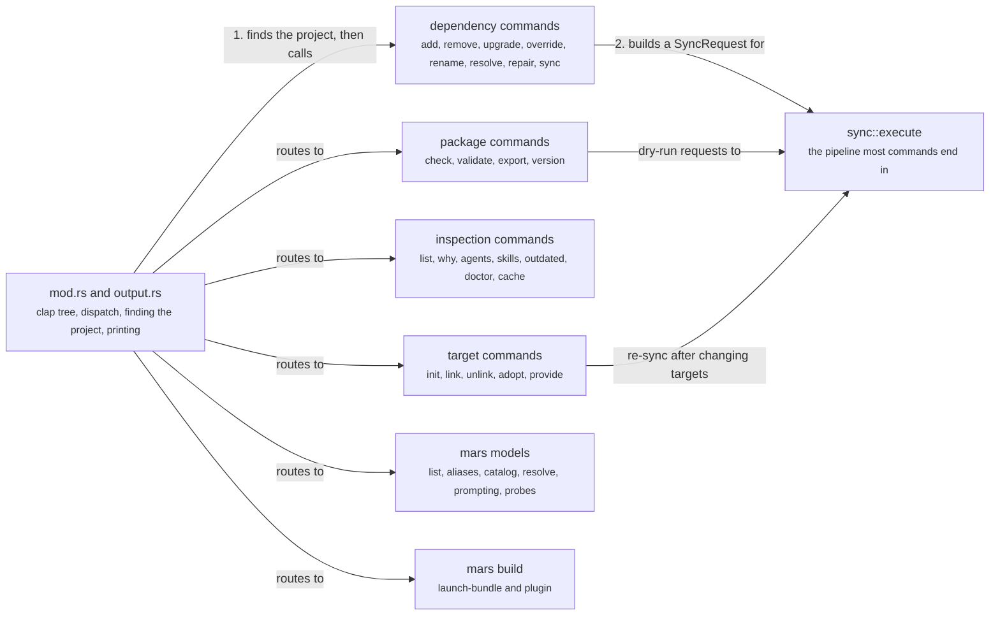

# cli

`src/cli/` is one module per `mars` subcommand plus the clap definitions and shared output; most commands build a `SyncRequest` and call `sync::execute`.

## entry

`Cli`, the `Command` enum, `dispatch` and the output helpers every command prints through.

- Kind: module
- Paths: `src/cli/mod.rs`, `src/cli/output.rs`, `src/main.rs`
- Docs: [commands](../cli/commands.md)

`dispatch_result` finds the project root (`find_agents_root`) and auto-initializes a project for `add`. `init`, `check`, `cache`, `provide` and `models refresh-catalog` run without one. Under `--json` stdout carries exactly one JSON document: print status through the `output` helpers, never `println!`, or a script that parses the output breaks. `main.rs` only adds the hint for removed `models list` flags.

## deps

The commands that change `mars.toml` or the lock, each a thin builder of a `SyncRequest` with a mutation.

- Kind: module
- Paths: `src/cli/add.rs`, `src/cli/remove.rs`, `src/cli/upgrade.rs`, `src/cli/override_cmd.rs`, `src/cli/rename.rs`, `src/cli/resolve_cmd.rs`, `src/cli/repair.rs`, `src/cli/sync.rs`, `src/cli/conflict_markers.rs`

A new command of this kind is one module and one `Command` variant. The mutation itself lives in `sync/mutation.rs`, not here. `resolve_cmd.rs` marks conflicts resolved and uses `conflict_markers.rs` to refuse files that still contain markers. `repair` leaves a corrupt lock untouched until a full sync can replace it.

## targets

Commands that create a project or change which directories receive content.

- Kind: module
- Paths: `src/cli/init.rs`, `src/cli/link.rs`, `src/cli/unlink.rs`, `src/cli/target.rs`, `src/cli/adopt.rs`, `src/cli/provide.rs`

`link` and `unlink` share target-name validation and the ownership claim in `target.rs`. `unlink` removes only what the lock says Mars owns there. `adopt` moves existing target content into `.mars-src/` and syncs. `provide` is `mars provide <provider>@<version>=<dir>`, the host-installs-its-skills path, which lives in the `provided` module.

## inspect

Read-only views over the canonical store, the lock and the cache.

- Kind: module
- Paths: `src/cli/list.rs`, `src/cli/why.rs`, `src/cli/agents.rs`, `src/cli/skills.rs`, `src/cli/outdated.rs`, `src/cli/doctor.rs`, `src/cli/cache.rs`

`doctor` checks state consistency (lock against disk, conflict markers). `outdated` reads tags only and never classifies a package.

## verify

Commands about a package and its release rather than a project's installed state.

- Kind: module
- Paths: `src/cli/check.rs`, `src/cli/validate.rs`, `src/cli/export.rs`, `src/cli/version.rs`

`check` runs `mars_schema::check` over a package's own files and adds what only the binary knows (what a harness cannot express, the `requires-mars` floor). `validate` and `export` run the sync pipeline as a dry run and return schema errors as report data. `version` bumps, commits and tags; at about 1,500 lines it is release tooling living in the command layer.

## models

`mars models` and its subcommands.

- Kind: module
- Paths: `src/cli/models.rs`, `src/cli/models_inventory.rs`, `src/cli/models_prompting.rs`, `src/cli/models_common.rs`
- See: [models](models.md)

The handlers format; routing and eligibility decisions belong to `src/routing/` and `src/models/`, so a command and a launch bundle cannot disagree about which harness runs a model. Curation applies only to the display command (`models_inventory.rs`).

## build

`mars build launch-bundle` and `mars build plugin`.

- Kind: module
- Paths: `src/cli/build.rs`
- See: [build](build.md)

## sync

The pipeline most commands end in.

- Kind: context
- See: [sync](sync.md#mod)
