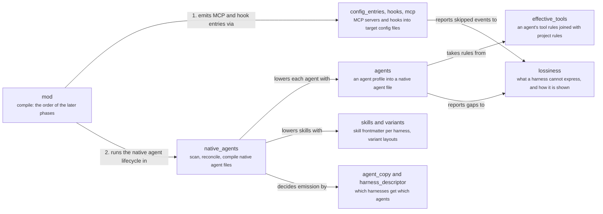

# compiler

`src/compiler/` drives the middle of a sync (target, plan, apply, copy, config entries, native agents) and lowers each agent, skill, hook and MCP server into what one harness reads.

## driver

`compile`: target, plan, apply, publish staging, then config entries and native agents, then finalize.

- Kind: module
- Paths: `src/compiler/mod.rs`
- Docs: [sync pipeline](../internals/sync-pipeline.md)

`compile` and `compile_reporting` differ only in whether error diagnostics fail the run (`mars validate` and `export` want them as data). The gate runs after the target is built and again after the hook preflight, so those errors fail before apply. The models catalog is refreshed once here, before any model or effort is resolved against it. `AgentSurfacePolicy` (emit all, emit selective, suppress all) decides what happens to agent files on target surfaces.

## agents

Lowers an agent profile into a harness's native file.

- Kind: module
- Paths: `src/compiler/agents`

`lower_policy.rs` is a declarative per-harness table plus one shared pipeline; a field a harness cannot express is reported, never silently dropped. `opencode_permission.rs` builds OpenCode's `permission` map, which must never be looser than the agent's rules; `tool_loss.rs` says which tool rules a native file cannot carry. Harness overrides cannot replace fields lowering owns.

## skills

Lowers skill frontmatter per harness and projects skill variants.

- Kind: module
- Paths: `src/compiler/skills`, `src/compiler/variants.rs`
- Docs: [skill compilation](../config/skill-compilation.md)

Variants live beside the skill under `variants/<harness>/`; a target that selects none gets the base skill.

## tools

An agent's effective tool rules.

- Kind: module
- Paths: `src/compiler/effective_tools.rs`

The launch bundle, native files and the plugin build all call it, so they cannot disagree: do not copy its shaping. A project-wide `allow` or `ask` is shaped by the agent's `*` rule, and a project `allow` must never remove or weaken an agent rule. A rule's `origin` stays outside equality, and `tool_cover::relation` returning `Unknown` is deliberate.

## native

Scans native agent surfaces, reconciles them with prior claims, compiles the desired set and records outputs.

- Kind: module
- Paths: `src/compiler/native_agents.rs`, `src/compiler/native_agents`, `src/compiler/native_agent_manifest.rs`

Reconciliation compares prior claims with the exact desired output set, including removed dependencies and renamed agents: current source names alone cannot identify stale outputs. It writes `.mars/native-agents.json`, a projection of the lock. At about 1,400 lines it is the largest module here and holds model routing for native agents (`NativeModelRoutingRuntime`).

## config_entries

MCP servers and hooks lowered from the selected target state into each target's config files.

- Kind: module
- Paths: `src/compiler/config_entries`, `src/compiler/hooks`, `src/compiler/mcp`
- Docs: [MCP and hooks](../config/mcp-and-hooks.md)

`render.rs` preflights every hook once before any mutation and `mod.rs` compiles after target copy, so an entry that names a directory is withheld when that directory was not installed. `resolve.rs` settles name collisions (`_self` wins, then declaration order). `file_hooks.rs` writes the hook files OpenCode and Pi need. The adapters in `src/target/` do the actual file edits. Codex hook trust depends on entry positions: do not rewrite an unchanged merge file.

## loss

What a harness cannot express and how it reaches the user.

- Kind: module
- Paths: `src/compiler/lossiness.rs`, `src/compiler/lossiness_preview.rs`, `src/compiler/tool_notices.rs`

A lost restriction shows by default; every other lost field shows under `--verbose`. `lossiness_preview.rs` computes the same for source trees without a sync.

## emit

Which agents are written to which harnesses.

- Kind: module
- Paths: `src/compiler/agent_copy.rs`, `src/compiler/harness_descriptor.rs`

`agent_copy` builds the selective-emission spec from `settings.meridian.agent_copy`; `harness_descriptor` are the typed per-harness descriptors the lowering tables use. They sit beside `src/harness/registry.rs`, which describes the same harnesses for routing.
