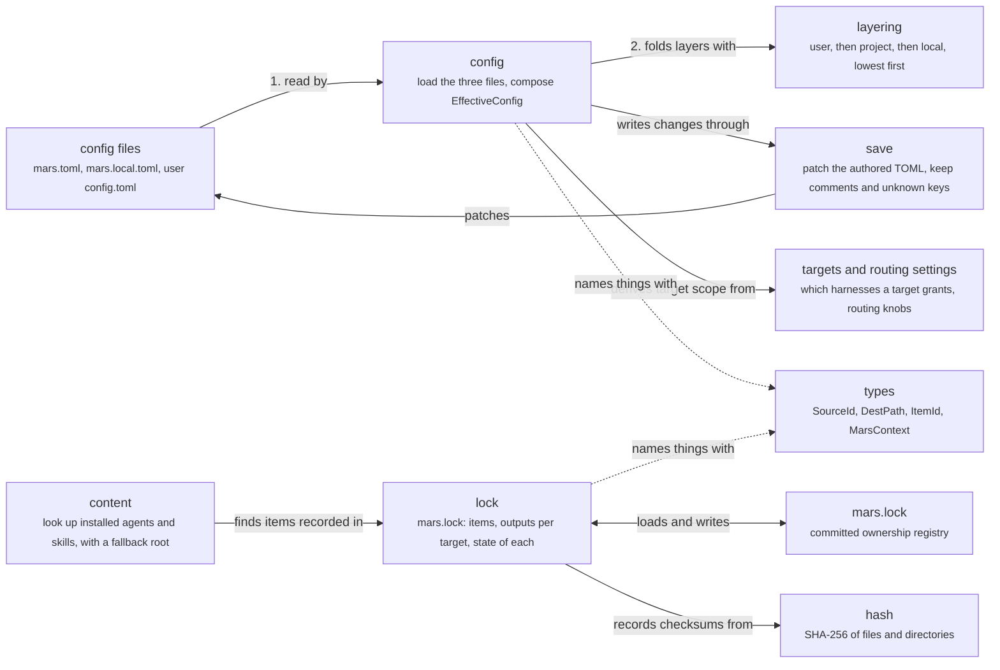

# Config and lock

The user asked for things in `mars.toml`; the lock records what Mars installed and owns. Config is layered into one `EffectiveConfig`; the lock is the authority for what Mars may overwrite or delete.

## files

The three files a project's settings come from.

- Kind: files
- Paths: `mars.toml`
- Docs: [mars.toml](../config/mars-toml.md), [local development](../dev/local-development.md)

`mars.toml` is committed; `mars.local.toml` holds developer-only overrides (gitignored); the user `config.toml` lives in `$MARS_CONFIG_DIR` or the platform config directory (`platform/config.rs` finds it). A `mars.toml` without `[package]` is consumer configuration, not a package manifest. The `mars.toml` listed in Paths is this repository's own.

## config

Loads the three files and defines `EffectiveConfig`, the only configuration the rest of Mars reads.

- Kind: module
- Paths: `src/config/mod.rs`, `src/config/user.rs`, `src/config/migrations`
- Docs: [mars.toml](../config/mars-toml.md)

The TOML shapes (`Config`, `Settings`, overlays, `ModelAlias`) are `mars_schema` types re-exported here; a new key goes in the schema crate. This module loads files, words parse errors as `failed to parse <path>: …` and turns each unread key into one `field.unknown` Info. Consume `EffectiveConfig` rather than recomposing files. `migrations/link.rs` is a thin wrapper over `targets::normalize_link` kept for the old `managed_root` spelling.

## layering

Composes the layers: user `config.toml`, then `mars.toml`, then `mars.local.toml`, lowest first.

- Kind: module
- Paths: `src/config/layering.rs`

Model aliases and skill and agent overlays replace by key; an agent's network host sets compose across layers; tool rules merge by key. Keep "absent" distinct from "explicitly empty".

## save

The one save path for `mars.toml` and `mars.local.toml`.

- Kind: module
- Paths: `src/config/save.rs`

It applies the base-to-next change to the authored document and verifies the result, so comments and unknown keys survive. Never write an `EffectiveConfig` back to a file.

## scope

`settings.targets` links and the harness scope they grant, and the routing settings.

- Kind: module
- Paths: `src/config/targets.rs`, `src/config/routing_settings.rs`

Only known harness targets grant routing permission. A generic target path materializes content without granting a harness; an explicitly empty scope must not become unrestricted. `targets.rs` needs the harness registry, which is why target links stay in the binary.

## lock

Reads and writes `mars.lock` (version 3) and answers every ownership question about outputs.

- Kind: module
- Paths: `src/lock/mod.rs`
- Docs: [lock file](../internals/lock-file.md)

Items are keyed by name; each carries `OutputRecord`s keyed by `(target_root, dest_path)` with a state (`Installed`, `PendingDeletion`), so ownership of `.claude/agents/x.md` is independent of `.mars/agents/x.md`. `LockIndex` is the read index: change lookup behavior there, not in the persisted schema. A failed deletion keeps retry authority without claiming installed content. State that cannot prove ownership is dropped with a warning, never inferred. At 2,400 lines it also holds `build`, the `apply_*_outcomes_to_lock` functions and `ConfigEntryRecord` and `CompiledNativeOutput`.

## lockfile

The committed file: dependencies with resolved commit and version, items with checksums, per-target outputs, dependency model aliases.

- Kind: files
- Docs: [lock file](../internals/lock-file.md)

Keys are sorted so diffs are clean. It is written whatever the target sync did, so it matches `.mars/`.

## types

Shared newtypes and the context every command runs in.

- Kind: module
- Paths: `src/types.rs`, `src/lib.rs`

`MarsContext` (project root, managed root, whether Meridian manages it), `SourceId`, `DestPath` (rejects empty, absolute and escaping paths), `ItemId`, `ContentHash` and `CommitHash`.

## hash

SHA-256 of one file or a directory tree, as the lock records it.

- Kind: module
- Paths: `src/hash/mod.rs`

A bootstrap doc hashes as its directory, whether the caller holds the directory or its `BOOTSTRAP.md`.

## content

Layered lookup of installed agent and skill content: the project's `.mars/`, then an optional fallback root.

- Kind: module
- Paths: `src/content.rs`

Files under `.mars/` were installed by some Mars version, so readers parse them with the compatibility readers, not as authored files. Skill variants resolve beside the chosen skill, including from the fallback root.
