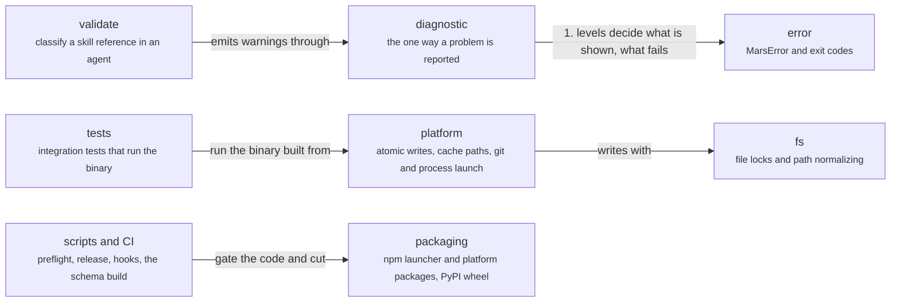

# foundation

The plumbing every part shares, and the scripts, tests and packaging around the code.

## diag

`Diagnostic`, its collector and the whole policy for what users see.

- Kind: module
- Paths: `src/diagnostic.rs`

A problem is built as a `Diagnostic` and nothing else. Its level says what the user loses: `Error` fails the command, `Warning` means something was lost, `Info` means nothing was and prints only for `validate`, `check` and `--verbose`. `Diagnostic::shown` and `output::print_diagnostics` are the whole policy; library code never prints. Reducing noise means demoting a site to `Info` or deleting it.

## error

`MarsError` and its exit codes.

- Kind: module
- Paths: `src/error.rs`

`Selection` errors carry a route report, and the CLI's JSON error shape maps `Config` and `Selection` errors to their own codes.

## platform

Everything that differs by OS or must be durable.

- Kind: module
- Paths: `src/platform/mod.rs`, `src/platform/fs.rs`, `src/platform/cache.rs`, `src/platform/config.rs`, `src/platform/path_syntax.rs`, `src/platform/process.rs`, `src/platform/process`

`platform::fs` has the atomic write (tmp and rename), directory replacement and the staging-generation publish; use it for any write that must survive a kill. `process` launches git and detached background workers without inheriting the caller's pipes. `cache.rs` names the global cache root. Windows branches stay but no new ones.

## fs

File locks and path helpers.

- Kind: module
- Paths: `src/fs/mod.rs`
- Docs: [fs state machines](../../src/fs/.context/state-machines.md)

`FileLock` is the cross-process lock behind `.mars/sync.lock` and the probe caches. It sits beside `platform::fs`, which the platform module's own doc says should own cross-process locks.

## validate

Classifies a skill reference found in an agent: present, missing with a suggestion, or provided by a host.

- Kind: module
- Paths: `src/validate/mod.rs`

Used by `sync/validate.rs`; it is not the code behind `mars validate`.

## scripts

The gate, the release machinery and the repo's tooling.

- Kind: module
- Paths: `scripts`, `src/.context`, `tools/atlas`, `docs/atlas`, `.github/workflows`
- Docs: [releasing](../dev/releasing.md)

`scripts/preflight.sh fast|full` is the gate (format, clippy, tests, schema tests, release build, this atlas's check). CI tags and publishes: never tag or edit versions by hand. `tools/atlas` is a copy of the atlas engine; fix the engine at its source and recopy, never here.

## tests

Integration tests that run the `mars` binary, plus the in-crate unit tests.

- Kind: module
- Paths: `tests`
- Docs: [tests](../../tests/AGENTS.md)

Use `common::offline_mars(root)` for local CLI fixtures; a bare `mars()` inherits the environment. Catalog and probe tests need local servers and fake executables, never a live model. The crate's own fixtures are under `crates/mars-schema/fixtures`.

## dist

How the binary reaches users.

- Kind: package
- Paths: `npm/@meridian-flow/mars-agents`, `npm/@meridian-flow/mars-agents-darwin-arm64`, `npm/@meridian-flow/mars-agents-darwin-x64`, `npm/@meridian-flow/mars-agents-linux-arm64`, `npm/@meridian-flow/mars-agents-linux-x64`, `npm/@meridian-flow/mars-agents-win32-x64`, `pyproject.toml`, `Cargo.toml`

`mars-agents` is a launcher that picks the per-platform package; the crate also publishes to crates.io and a maturin wheel to PyPI. The `mars-schema` npm package is under [schema](schema.md#wasm).
