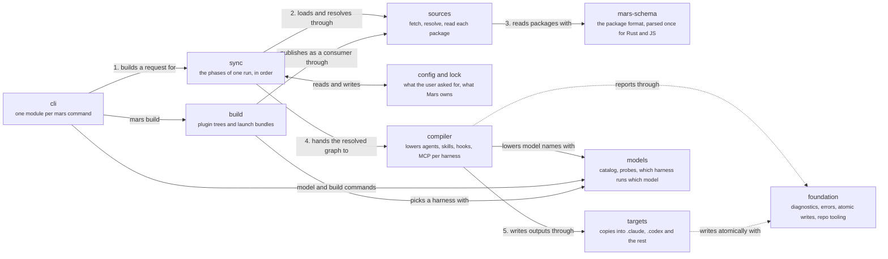

# Mars

Mars installs agents, skills, hooks and MCP servers from git and local sources into each harness's own directories, through a canonical store in `.mars/`.

## cli

One clap module per `mars` subcommand; it builds a request and prints the result.

- Kind: module
- Opens: [cli](cli.md)
- Docs: [commands](../cli/commands.md)

## sync

The phases of one run and what each hands the next.

- Kind: module
- Opens: [sync](sync.md)
- Docs: [sync pipeline](../internals/sync-pipeline.md)

## sources

Fetches git and path sources, picks versions, and reads each package into a prepared form.

- Kind: module
- Opens: [sources](sources.md)

## schema

The `mars-schema` crate: package vocabulary, parsing, validation and the resolver core, with no file or network access, so the CLI and the npm WASM package read the same way.

- Kind: package
- Opens: [schema](schema.md)
- Docs: [schema v1](../config/schema-v1.md)

## state

`mars.toml`, `mars.local.toml`, the user config and `mars.lock`: what was asked for and what Mars installed and owns.

- Kind: module
- Opens: [config and lock](config-lock.md)
- Docs: [lock file](../internals/lock-file.md), [mars.toml](../config/mars-toml.md)

## compiler

Turns the selected packages into what each harness reads: native agent files, skills, hook and MCP config entries.

- Kind: module
- Opens: [compiler](compiler.md)
- Docs: [agent compilation](../config/agent-compilation.md), [MCP and hooks](../config/mcp-and-hooks.md)

## targets

Per-harness adapters and the copy from `.mars/` into each linked target, gated by who owns each path.

- Kind: module
- Opens: [targets](targets.md)

## models

The models.dev catalog, aliases, harness probes and the routing that chooses a harness for a model.

- Kind: module
- Opens: [models](models.md)

## build

`mars build plugin` and `mars build launch-bundle`: outputs built from a package without a sync into a project.

- Kind: module
- Opens: [build](build.md)
- Docs: [plugin authoring](../plugin-authoring.md)

## base

Shared plumbing every other part uses, plus the scripts, tests and CI around the code.

- Kind: module
- Opens: [foundation](foundation.md)
