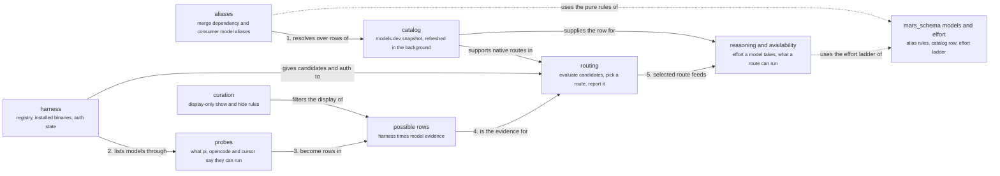

# models

Mars turns a model alias into a model ID and decides which installed, authenticated harness can run it. The catalog says what exists, the probes say what a harness lists, routing decides.

## aliases

Aliases map short names (`opus`, `sonnet`) to model IDs, pinned or auto-resolved against the catalog.

- Kind: module
- Paths: `src/models/mod.rs`, `src/models/dependencies.rs`, `src/models/harness_model.rs`
- Docs: [mars.toml](../config/mars-toml.md), [curated models](../config/mars-curated.md)

Consumer aliases beat dependencies, which merge in declaration order; builtins appear only when neither provides any. `harness_model.rs` projects the selected routing assessment into the launch ID, so availability and bundle construction never select a slug again. Resolve model identity before assessing routes inside the configured harness scope: an unrestricted early assessment could run an excluded harness's auth command.

## catalog

The shared models.dev snapshot with stale-while-revalidate refresh.

- Kind: module
- Paths: `src/models/catalog.rs`, `src/models/catalog_api.rs`, `src/models/catalog_cache.rs`

One snapshot per user, in the cache root, shared across projects and Mars builds (its file name carries a schema number). A usable catalog stays last-good after a refresh failure; a cold cache fetches synchronously; offline mode never fetches. Every failed fetch writes a fail marker so the cooldown holds. A project's `catalog_providers` narrows what it reads; take rows by provider, never by flattening the raw snapshot.

## harness

The harness registry, the installed-executable and auth facts, and the providers Mars has seen.

- Kind: module
- Paths: `src/harness/mod.rs`, `src/harness/registry.rs`, `src/harness/host.rs`, `src/harness/known_providers.rs`, `src/models/harness.rs`
- Docs: [harness contracts](../../src/harness/.context/CONTEXT.md)

`registry.rs` has one `HarnessDescriptor` per harness: its name, binary, default target and class (`Native` serving one provider, or `ProbeBacked` with a gated or ungated listing). It is the place to edit when a harness is added or removed, with `src/target/`, `src/compiler/harness_descriptor.rs` and `crates/mars-schema/src/harness.rs`. `host.rs` runs the capability session: one lazy `CapabilitySession` and `NativeAuthCache` per command, shared across candidate evaluations. Installation facts stay separate from routing permission, and an excluded harness is never probed. Authentication has an unknown state and never proves quota.

## probes

Per-harness model listings, cached on disk.

- Kind: module
- Paths: `src/models/probes`
- Docs: [probe contracts](../../src/models/probes/.context/CONTEXT.md)

`pi.rs`, `opencode.rs` and `cursor.rs` run each harness's own list command; `cache.rs` is the on-disk cache they share and `probe_refresh.rs` its refresh modes. `MARS_OFFLINE` suppresses probes entirely; `--no-refresh-models` only permits reading existing caches. Do not conflate them. Cursor and Pi listings imply configured auth only while the latest gated listing succeeded; OpenCode's never does.

## possible

Derived rows of harness times model that a listing supports.

- Kind: module
- Paths: `src/models/possible.rs`

No file or alias creates a row; rows come from probes and catalog evidence only.

## routing

Candidate evaluation shared by `mars models`, launch bundles and native compilation.

- Kind: module
- Paths: `src/routing/mod.rs`, `src/routing/acceptance.rs`, `src/routing/evidence.rs`, `src/routing/probe_match.rs`, `src/routing/report.rs`, `src/routing/slug.rs`
- Docs: [routing contracts](../../src/routing/.context/CONTEXT.md)

Target scope and caller exclusions apply before any probe. Support, authentication and selection are separate facts, and selection kind (auto or fixed) is separate from match evidence. A fixed harness is assessed without fallback; profile and alias harnesses are ordered preferences. Native compilation assesses support without probing accounts. The serialized `RouteDecisionReport` is the stable output; the internal trace is not.

## reasoning

What effort a model's row allows and what a selected route can run.

- Kind: module
- Paths: `src/models/reasoning.rs`, `src/models/availability.rs`

`reasoning::catalog_identity` is the one mapping from a launch ID to its catalog model, and launch, sync, the listing and Cursor's tiers all use it. Reasoning data comes from the provider the harness calls, never from the project's `catalog_providers` view.

## curation

Display-only show and hide rules for `mars models list`, from `mars.curated.toml` files.

- Kind: module
- Paths: `src/curation/mod.rs`
- Docs: [curated models](../config/mars-curated.md)

Nothing in routing, build or alias resolution may import it. Rules fold user, project, local; a glob `show` cannot undo a lower-tier `hide`, a literal one can; `inherit = false` drops lower tiers.

## schema

The pure parts live in the schema crate.

- Kind: context
- See: [schema](schema.md#models)
