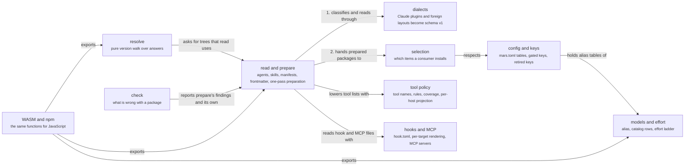

# mars-schema

`crates/mars-schema` holds everything that decides what a package means (vocabulary, parsing, validation, version resolution, tool and hook rules) with no host I/O, so the binary and the npm WASM package behave the same.

## read

Reads one package root strictly into typed definitions; this is the single reader for authored files.

- Kind: module
- Paths: `crates/mars-schema/src/prepare.rs`, `crates/mars-schema/src/dispatch.rs`, `crates/mars-schema/src/normalize.rs`, `crates/mars-schema/src/read.rs`, `crates/mars-schema/src/agent.rs`, `crates/mars-schema/src/skill.rs`, `crates/mars-schema/src/frontmatter.rs`, `crates/mars-schema/src/manifest.rs`, `crates/mars-schema/src/package.rs`, `crates/mars-schema/src/discover.rs`, `crates/mars-schema/src/inspect.rs`, `crates/mars-schema/src/tree.rs`, `crates/mars-schema/src/edit.rs`, `crates/mars-schema/src/links.rs`, `crates/mars-schema/src/markdown.rs`, `crates/mars-schema/src/ordered.rs`, `crates/mars-schema/src/item.rs`, `crates/mars-schema/src/names.rs`, `crates/mars-schema/src/dependency.rs`, `crates/mars-schema/src/filter.rs`, `crates/mars-schema/src/invocability.rs`, `crates/mars-schema/src/package_tools.rs`, `crates/mars-schema/src/plugin_metadata.rs`, `crates/mars-schema/src/visibility.rs`, `crates/mars-schema/src/git_url.rs`, `crates/mars-schema/src/diagnostic.rs`, `crates/mars-schema/src/lib.rs`
- Docs: [schema v1](../config/schema-v1.md)

`prepare` classifies a root (`dispatch`), translates foreign layouts (`normalize`), then reads strictly. It never touches the host: the binary gives it a `TreeSource` (`src/package_prepare/`). A schema-v1 file is read as written; only foreign definitions are rewritten. Keep `serde_json/preserve_order` off and use `OrderedValue` where authored order matters. Frontmatter has size and nesting limits because YAML scanning grows quadratically.

## dialects

Foreign formats lifted into schema v1: the Claude dialect and the per-dialect field tables.

- Kind: module
- Paths: `crates/mars-schema/src/claude`, `crates/mars-schema/src/dialect.rs`, `crates/mars-schema/src/lift.rs`, `crates/mars-schema/src/set_aside.rs`, `crates/mars-schema/src/harness_overrides.rs`

`set_aside` drops whatever translation could not carry so an uneditable dependency still installs; the deny-list and restriction fields must survive it. `claude/`, `harness_overrides` and `set_aside` are the only code that names a key from another format.

## resolve

The pure version resolver: a function over an `Answers` lookup that decides versions and never fetches.

- Kind: module
- Paths: `crates/mars-schema/src/resolve`, `crates/mars-schema/src/version.rs`

`package.rs` is the walk, restarted when a later constraint changes an earlier choice; `version.rs` (in the crate root) holds the lock-replay rules and the two version grammars (a dependency's `0.20` is a caret, a requirement's is a minimum: keep the parsers distinct); `plugin.rs` picks one plugin out of a marketplace; `wire.rs` is the JSON surface Meridian Flow calls. Nothing whose iteration order reaches the result may be a `HashMap`. A new failure kind needs its message in `Failure::message`, a mapping in the CLI's `resolve/answers.rs`, a `FailureBody` variant in `wire.rs`, a type in `index.d.ts` and a fixture.

## select

Chooses the agents, skills and bootstrap documents of a settled graph that the consumer installs.

- Kind: module
- Paths: `crates/mars-schema/src/selection.rs`

Callers use its `SelectionResult` instead of reapplying filters, so the CLI and Flow agree.

## config

The consumer tables of `mars.toml` and the keys a release gates.

- Kind: module
- Paths: `crates/mars-schema/src/config.rs`, `crates/mars-schema/src/keys.rs`, `crates/mars-schema/src/retired.rs`, `crates/mars-schema/src/model_policy.rs`, `crates/mars-schema/src/network.rs`, `crates/mars-schema/src/permission_set.rs`, `crates/mars-schema/src/provider.rs`
- Docs: [retired keys](../config/retired-keys.md)

`config::read_consumer` is the one reader of `mars.toml`; a new table goes on `Config`, in `read_tables` and `read_all`, with a `read` fixture. Do not use `#[serde(flatten)]` there: unknown-key reporting stops seeing inside it. `keys.rs::GATED` is the table of keys an older Mars would misread, with the release that first read each. `retired.rs` is the one place a removed key is named.

## tools

The tool-rule vocabulary: names, actions, which rule covers which, and the projection onto each host's native names.

- Kind: module
- Paths: `crates/mars-schema/src/tool_names.rs`, `crates/mars-schema/src/tool_policy.rs`, `crates/mars-schema/src/tool_rule_map.rs`, `crates/mars-schema/src/tool_cover.rs`, `crates/mars-schema/src/tool_natives.rs`, `crates/mars-schema/src/tool_project.rs`, `crates/mars-schema/src/mcp.rs`

`tool_cover::relation` returns `Unknown` for anything it cannot prove: a wrong `Equal` or `Covers` marks an allow as never applying. `tool_natives::FLOW_CONNECTION_TOOLS` is the list Flow's MCP rules lower onto. A restriction a host cannot carry is recorded as `field.restriction-lost`, never dropped.

## hookmcp

`hook.toml`, its per-target rendering, and the MCP server definition.

- Kind: module
- Paths: `crates/mars-schema/src/hooks`, `crates/mars-schema/src/mcp_server.rs`, `crates/mars-schema/src/mcp_servers.rs`
- Docs: [MCP and hooks](../config/mcp-and-hooks.md)

`hooks/targets.rs` has one row per target root (where its hooks live and what it takes); `render.rs` and `typescript.rs` produce the entries and the TypeScript files for OpenCode and Pi, which have no hook config. Hook placement belongs here, not to the binary's adapters.

## models

The models.dev row, the alias rules over it, and the one effort ladder.

- Kind: module
- Paths: `crates/mars-schema/src/models.rs`, `crates/mars-schema/src/alias.rs`, `crates/mars-schema/src/effort.rs`, `crates/mars-schema/src/harness.rs`

`HarnessId` is defined in `harness.rs`: harness identity belongs to this crate, and the binary's registry (`src/harness/registry.rs`) builds on it. `effort::resolve_effort` moves a request to the nearest level both the model and the host take; a tie goes up.

## check

What `mars check` and the WASM `check` report about a package's own files.

- Kind: module
- Paths: `crates/mars-schema/src/check.rs`

A rule about an Agent, a skill or `mars.toml` goes here, never in `src/cli/check.rs`. Each new code is a fixture under `crates/mars-schema/fixtures/check/` and a row in both runners' code lists.

## wasm

The WebAssembly build and the npm package that wraps it, plus the fixtures and tests that hold Rust and JavaScript to one behavior.

- Kind: package
- Paths: `crates/mars-schema-wasm`, `crates/mars-schema/fixtures`, `crates/mars-schema/tests`, `npm/@meridian-flow/mars-schema`, `scripts/build-schema-wasm.sh`
- Docs: [plugin authoring](../plugin-authoring.md)

`crates/mars-schema-wasm/src/lib.rs` exports `read`, `prepare`, `normalize`, `inspect`, `check`, `resolve`, `selectVersion`, `selectItems`, `renderHooks`, `resolveEffort`, `resolveAlias` and a few more through wasm-bindgen, with types in `npm/@meridian-flow/mars-schema/index.d.ts`. Expected fixture output is a contract: review changes to it as contract changes (`MARS_UPDATE_FIXTURES=1` rewrites them). The crate must keep building for `wasm32-unknown-unknown`, so no file, process or clock access.
