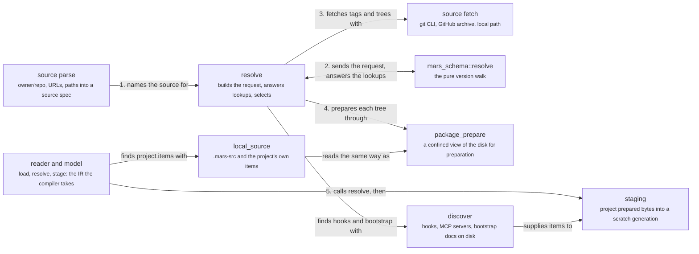

# Sources and resolve

Mars reads packages from git repositories and local paths. This part fetches them, answers the schema crate's version lookups, and turns each package into a prepared form the sync can project.

## parse

Turns a source string into a spec: GitHub shorthand, HTTPS or SSH URLs, local paths.

- Kind: module
- Paths: `src/source/parse.rs`, `src/platform/path_syntax.rs`, `src/source/mod.rs`, `src/source/AGENTS.md`

The classification of a string as path or URL is in `platform/path_syntax.rs`. A marketplace entry is untrusted input to git: argument validation stays at the git invocation as well as in the schema.

## fetch

The adapters that list tags and produce a commit's content directory.

- Kind: module
- Paths: `src/source/git.rs`, `src/source/git_cli.rs`, `src/source/archive.rs`, `src/source/path.rs`
- Docs: [source state machines](../../src/source/.context/state-machines.md)

`git_cli.rs` shells out to `git` (ls-remote, clone, fetch, checkout) through `platform::process`; `archive.rs` downloads and extracts a GitHub archive; `path.rs` canonicalizes a local path. Fetching is cached under the global cache root, and `mars cache` manages it.

## resolve

The binary half of resolution: builds the request for the schema core, answers its lookups with git and the disk, and does what the core leaves to the binary.

- Kind: module
- Paths: `src/resolve/mod.rs`, `src/resolve/answers.rs`, `src/resolve/provider.rs`, `src/resolve/select.rs`, `src/resolve/types.rs`, `src/resolve/requires.rs`, `src/resolve/upgrade.rs`, `src/resolve/publish.rs`, `src/resolve/tests`
- Docs: [resolve state machines](../../src/resolve/.context/state-machines.md)

`CliAnswers` (`answers.rs`) fetches each lookup when asked and memoizes it, so work happens in the order the core asks. A failure kind the core adds needs its mapping here. A later constraint can change an earlier version choice, so resolution restarts; diagnostics must describe the final graph, not a discarded pass. Keep the authored root distinct from the staged package root: relative dependencies use the authored one. `publish.rs` builds the `PublishLens` that `mars build plugin` uses: a consumer view without local or user configuration. `upgrade.rs` computes the version `mars upgrade` would pick, for hints.

## core

The version walk itself, in the schema crate.

- Kind: context
- See: [schema](schema.md#resolve)

## prep

The filesystem adapter for `mars_schema::prepare`.

- Kind: module
- Paths: `src/package_prepare/mod.rs`, `src/plugin_metadata.rs`

`DiskTreeSource` confines reads to the authored root and latches I/O and containment errors, because `TreeSource` has no error channel: take the latched error right after preparation. Classification, normalization and validation are the schema crate's. `plugin_metadata.rs` holds the marker for Mars-owned generated plugin directories.

## discover

Filesystem discovery of the items the schema crate does not read: hooks, MCP servers and bootstrap documents.

- Kind: module
- Paths: `src/discover/mod.rs`, `src/discover/tests.rs`

It walks to a bounded depth and skips dot directories. A duplicate `(kind, name)` in one source is a `DiscoveryCollision`; Mars picks no winner inside a source.

## local

The project's own items: `.mars-src/` and the `[package]` in the project's `mars.toml`.

- Kind: module
- Paths: `src/local_source.rs`, `src/skill_source_name.rs`

`.mars-src/` overrides the declared package. Local items travel as `_self`, a reserved source name, and are installed through the same path as a dependency's. `skill_source_name.rs` names flat-root foreign skills the same way discovery and staging both need.

## staging

Writes each prepared package, its payload files and the overlays into a scratch generation, then publishes it by rename.

- Kind: module
- Paths: `src/staging/mod.rs`, `src/staging/overlay.rs`, `src/staging/publish.rs`
- Docs: [staging context](../../src/staging/.context/CONTEXT.md)

A real sync uses `.mars/.staging.pending`, a dry run a temp directory outside the project. `overlay.rs` applies `[skills.<name>]` overlays after the dialect lift. The pending generation is renamed over `.mars/staging` after apply (`platform::fs::publish_staging_generation`), and the packages' source roots are rebased onto it.

## reader

Runs load, resolve and staging and returns the `ReaderIr` the compiler takes.

- Kind: module
- Paths: `src/reader/mod.rs`, `src/model/mod.rs`

`reader::read` is one function: `load_config`, `resolve_graph` (both defined in `sync/mod.rs`), local item discovery, the error gate, then `staging::materialize_prepared_graph`. `model/mod.rs` is only the `ReaderIr` struct; it is unrelated to `models/`.
