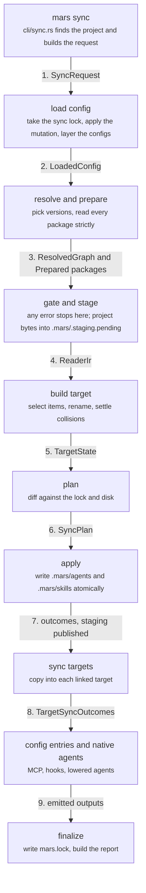

# A sync, step by step

`mars sync` runs one call chain: `sync::execute` reads, then `compiler::compile` plans, applies, copies to targets, writes config entries and native agents, and finalizes.

Resolution failing anywhere stops before anything is written: the only writes before `apply` are the sync lock and the scratch generation. A dry run (`--diff`, `mars validate`) takes the same path with scratch directories and no writes.

## cmd

The command line enters through `cli::dispatch`, which finds the project root and calls `sync::execute`.

- Kind: context
- See: [cli](cli.md#entry)

## load

Phase 1, `sync::load_config`: acquire `.mars/sync.lock`, apply the command's mutation to `mars.toml`, then layer user, project and local configs into `EffectiveConfig`.

- Kind: context
- See: [sync](sync.md#mod)

## resolve

Phase 2, `sync::resolve_graph`: builds the request for `mars_schema::resolve`, answers its lookups by fetching, and prepares each package through `mars_schema::prepare`.

- Kind: context
- See: [sources](sources.md#resolve)

## stage

`reader::read` fails on any error-level diagnostic, finds project-local `_self` items, then `staging::materialize_prepared_graph` projects prepared bytes and overlays into the scratch generation. Recovery commands may stop here with a `RecoveryHalt`.

- Kind: context
- See: [sources](sources.md#staging)

## target

Phase 3, `sync::build_target`: takes the selected items, applies renames, renames cross-source collisions, prunes unmanaged collisions and rewrites frontmatter references.

- Kind: context
- See: [sync](sync.md#target)

## plan

Phase 4, `sync::create_plan`: diffs the target state against the lock and the disk into Add, Update, Conflict and Orphan actions. Frozen mode fails here on any pending change.

- Kind: context
- See: [sync](sync.md#apply)

## apply

Phase 5, `sync::apply_plan`: writes the canonical store atomically, journaling new outputs first. `compiler::compile` then renames the scratch generation over `.mars/staging`.

- Kind: context
- See: [sync](sync.md#apply)

## copy

Phase 6, `sync::sync_targets`: copies from `.mars/` into each linked target, but only over paths the lock says Mars owns there.

- Kind: context
- See: [targets](targets.md#copy)

## entries

After the copy, so a directory exists before a config entry names it: the compiler writes MCP and hook entries, then reconciles and compiles native agent files against the models catalog.

- Kind: context
- See: [compiler](compiler.md#config_entries)

## fin

Phase 7, `sync::finalize`: writes `mars.lock` whatever the targets did, persists dependency model aliases, publishes the journal and builds the `SyncReport`.

- Kind: context
- See: [sync](sync.md#finalize)
