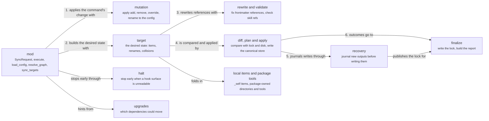

# sync

`src/sync/` holds the phase functions of a sync and the types each hands the next; every mutating command enters here. The driver that calls the later phases is `compiler::compile`.

## mod

The request, the report, the pipeline's entry points and the state each phase passes by value.

- Kind: module
- Paths: `src/sync/mod.rs`, `src/sync/types.rs`, `src/sync/tests.rs`
- Docs: [sync pipeline](../internals/sync-pipeline.md)

`SyncRequest` carries options, a `ResolutionMode` (normal, maximize, frozen) and a `RecoveryPolicy`. `execute` reads (`reader::read`), checks for a recovery halt, then calls `compiler::compile`; `execute_validation` is the same path for `mars validate`. `load_config`, `resolve_graph`, `build_target`, `create_plan`, `apply_plan` and `sync_targets` are defined here but called from the compiler, so the call chain goes `sync` to `compiler` and back. Dry runs must not create project state: a new write phase has to honor dry-run mode.

## mutation

Applies a command's change (`UpsertDependency`, `BatchUpsert`, `RemoveDependency`, `SetOverride`, `SetRename`) to the loaded config under the sync lock.

- Kind: module
- Paths: `src/sync/mutation.rs`

A new filter field in an upsert replaces the whole filter set; none leaves the existing filters.

## target

Builds the desired state of `.mars/`: the selected items, explicit and collision renames, and what is installed per target.

- Kind: module
- Paths: `src/sync/target.rs`, `src/sync/target`

Items come from the schema's `Selection`; this step only checks membership. Two sources wanting one destination are both renamed `__{source}` unless an explicit rename settled it. An item that would overwrite a canonical path Mars neither locked nor recorded as provided is pruned, with a warning. Hook and MCP directories join the state here, so entries can later be withheld when a directory was not installed.

## rewrite

Rewrites skill references in agent frontmatter after renames, and checks them.

- Kind: module
- Paths: `src/sync/rewrite.rs`, `src/sync/validate.rs`

One `RenameIndex` is built from explicit renames and collision renames that survived pruning, then one rewrite pass runs per agent. `validate.rs` reports missing and provider-supplied skill references and dangling config after a rename.

## items

Project-local items and package-owned directories join the dependency target state.

- Kind: module
- Paths: `src/sync/local_items.rs`, `src/sync/package_dir.rs`, `src/sync/package_tools.rs`, `src/sync/ownership.rs`

`_self` items are projected before hashing so the diff compares the installed form. `package_dir.rs` decides which kinds install per target (hooks, MCP servers) rather than once. `package_tools.rs` folds `[package.tools]` into shipped agents. `ownership.rs` answers who owns a canonical destination: the lock, or a provider through `.mars/provided.lock`.

## apply

Compares the target state with the lock and the disk, turns the entries into actions, and executes them against `.mars/`.

- Kind: module
- Paths: `src/sync/diff.rs`, `src/sync/plan.rs`, `src/sync/apply.rs`
- Docs: [conflicts](../internals/conflicts.md)

Two checksums decide: the source checksum (before rewriting) and the installed one. Source changed and local unchanged is an Update; both changed is a Conflict where the source wins with a warning; a lock entry with no target is an Orphan; `--force` shifts the baseline so conflicts overwrite. Frozen mode fails when the plan has changes. Applying is atomic file and directory installs, removals and kept local edits; the config mutation is saved here, after resolution succeeded. It never publishes the staging generation: the compiler does.

## recovery

A write-ahead journal of new canonical outputs, so a failed apply cannot leave finished writes indistinguishable from the user's own files.

- Kind: module
- Paths: `src/sync/recovery.rs`

Every command that writes `mars.lock` (`sync`, `link`, `unlink`, `resolve`) recovers the journal when it loads the lock and publishes through `recovery::publish`; one that does not wedges every later sync. Recovery checks the journal against the prior lock and the filesystem and fails closed on changed content or unsafe paths. Native and config outputs and `--force` adoptions are not journaled.

## halt

The early stop for recovery commands.

- Kind: module
- Paths: `src/sync/halt.rs`, `src/sync/kept_hooks.rs`

When a dependency still has a hook in a removed schema, `upgrade`, `override`, `remove` and `repair` persist only the user's config change and stop before the compiler, so ownership and pruning never see a partial graph. `kept_hooks.rs` keeps what the last sync installed for a dependency hook whose `hook.toml` is now invalid.

## finalize

Writes `mars.lock` and builds the `SyncReport`.

- Kind: module
- Paths: `src/sync/finalize.rs`

The lock is written whether or not a target copy failed, so it matches `.mars/`. It stores dependency-only model alias winners; consumer aliases are overlaid at read time.

## upgrades

Compatible-upgrade hints and the list of dependencies a sync moved.

- Kind: module
- Paths: `src/sync/upgrades.rs`

`--no-upgrade-hint` skips the lookup. `mars outdated` and `mars upgrade <name>` work from the same graph.
