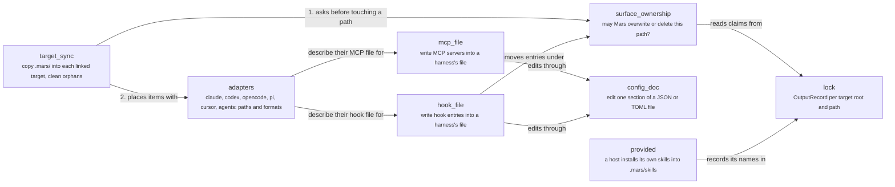

# targets

A target is a harness directory Mars copies into (`.claude/`, `.codex/` and so on). This part holds one adapter per harness, the copy itself, and the rules for what Mars may overwrite or delete there.

## copy

Copies canonical content from `.mars/` into every linked target and removes what Mars no longer installs.

- Kind: module
- Paths: `src/target_sync/mod.rs`
- Docs: [target sync context](../../src/target_sync/.context/CONTEXT.md)

All targets get copies, never symlinks. Errors are per target and do not stop the others. Orphan cleanup is scoped to the target: only paths recorded for that `(target_root, dest_path)` can be removed, so a `.mars` record never authorizes deletes elsewhere. An existing destination with no installed claim is preserved with a warning; `--force` adopts it. A failed removal keeps its claim so the next sync retries.

## own

The single place that decides whether Mars may overwrite or delete a path in a target.

- Kind: module
- Paths: `src/surface_ownership/mod.rs`, `src/surface_ownership/retention.rs`
- Docs: [surface ownership](../../src/surface_ownership/.context/CONTEXT.md)

An `Installed` record authorizes replacement and deletion; `PendingDeletion` authorizes only a deletion retry and must not authorize overwriting content that appeared afterwards. Config entries are owned by entry, matched by content, so a user-edited entry is kept. `retention.rs` plans hook-entry removals. Interrupted-write recovery for these surfaces is an open gap (see `.context` there).

## adapters

One `TargetAdapter` per harness: where an item lands and what its MCP and hook files look like.

- Kind: module
- Paths: `src/target/mod.rs`, `src/target/claude.rs`, `src/target/codex.rs`, `src/target/opencode.rs`, `src/target/pi.rs`, `src/target/cursor.rs`, `src/target/agents.rs`
- Docs: [target adapters](../../src/target/AGENTS.md)

The trait gives a name (`.claude`), a skill-variant key, `default_dest_path` (None means the target takes no such item, and the compiler must skip it) and an optional `McpFile`. `TargetRegistry` in `mod.rs` holds the adapters, so adding a harness means a file here, a registration, and rows in `src/harness/registry.rs` and the compiler's `harness_descriptor`. `agents.rs` is the old `.agents` target, kept for reading what older versions wrote. Hook placement and rendering belong to `mars_schema::hooks`, not here.

## mcp

The one MCP specification per adapter and the one reconcile and validate path that uses it.

- Kind: module
- Paths: `src/target/mcp_file.rs`

`reconcile` removes stale owned entries, writes desired ones and saves once. An empty config file is removed only if reconciliation emptied it. Writes preserve file permissions and go through symlinks.

## hooks

Hook entries in JSON hook files (Claude `settings.local.json`, Codex and Cursor `hooks.json`).

- Kind: module
- Paths: `src/target/hook_file.rs`

Entries are unkeyed array elements, so they use the shared retention plan in `surface_ownership` instead of MCP's keyed reconciliation.

## doc

A config file narrowed to one section.

- Kind: module
- Paths: `src/target/config_doc.rs`

Handles JSON and TOML, preserves the user's key order with ordered JSON editing, and keeps the rest of the file untouched.

## provided

`mars provide`: a host (Meridian, for one) installs the skills it ships into `.mars/skills/` without adding dependencies or changing the package lock.

- Kind: module
- Paths: `src/provided/mod.rs`, `src/provided/entries.rs`, `src/provided/lock.rs`, `src/provided/names.rs`, `src/provided/reconcile.rs`, `src/provided/spec.rs`
- Docs: [provided skills](../../src/provided/.context/CONTEXT.md)

`.mars/provided.lock` records each provider's names; the record authorizes removing or replacing its own names only, and it can have been written by another Mars build, so names must belong to the provider and be single path components. A package lock claim wins over a provider's. The writer refuses a record version it does not know.

## lock

Where ownership claims are stored.

- Kind: context
- See: [config and lock](config-lock.md#lock)
