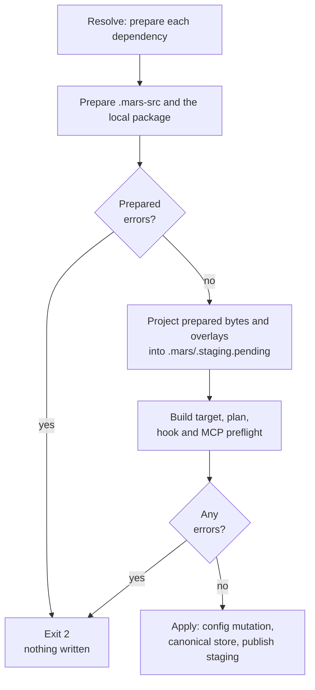

# Sync Pipeline

Every mutating command (`add`, `remove`, `sync`, `upgrade`, `override`, `rename`,
`repair`) enters the same pipeline. The pipeline normally resolves the full
desired state before materializing it. Recovery commands have one intentional
early-return path after resolution: the recovery halt described below may
persist only the user's config mutation.

## Pipeline Overview

The pipeline is implemented as typed phase functions in `src/sync/mod.rs`. Each phase consumes the prior phase's output struct by value (move semantics, no cloning).

```
mars.toml + mars.local.toml
        │
        ▼
┌─────────────────┐
│  1. Load Config │  Acquire sync lock, load config, apply mutations, merge effective config
└────────┬────────┘
         ▼
┌─────────────────┐
│  2. Resolve     │  Fetch sources, discover transitive deps, merge model aliases.
│                 │  PREPARE: each dep, then .mars-src and the local package,
│                 │  through mars_schema::prepare (read strictly, no writes)
└────────┬────────┘
         ▼
┌─────────────────┐
│  Gate           │  Any prepared error fails the sync here, before anything
└────────┬────────┘  is materialized. Then project prepared bytes + overlays
         │           into the scratch generation .mars/.staging.pending
         ▼
┌─────────────────┐
│ Recovery Halt?  │  For recovery commands, persist user intent and return
└────────┬────────┘  if removed-schema hook content is unreadable
         │ continue
         ▼
┌─────────────────┐
│  3. Build Target│  Select the prepared definitions, apply filters, detect
│                 │  collisions. Local (_self) items are projected before
│                 │  hashing, so the diff compares the installed form.
└────────┬────────┘
         ▼
┌─────────────────┐
│  4. Create Plan │  Diff target vs lock + disk → Add/Update/Conflict/Orphan → actions
└────────┬────────┘
         ▼
┌─────────────────┐
│  5. Apply Plan  │  Write resolved content to .mars/ canonical store (atomic writes)
└────────┬────────┘
         ▼
┌─────────────────┐
│  6. Sync Targets│  Copy from .mars/ to each configured target directory
└────────┬────────┘
         ▼
┌─────────────────┐
│  7. Finalize    │  Write lock, persist dep model aliases, build report
└─────────────────┘
```

### Phase handoff structs

| Phase | Struct | Key contents |
|---|---|---|
| 1 | `LoadedConfig` | `Config`, `LocalConfig`, `EffectiveConfig`, `old_lock`, `sync_lock` (a dry run holds it only when `.mars/sync.lock` already exists) |
| 2 | `ResolvedState` | `LoadedConfig` + `ResolvedGraph` + `model_aliases` + the scratch generation |
| 3 | `TargetedState` | `ResolvedState` + `TargetState` + renames + validation warnings |
| 4 | `PlannedState` | `TargetedState` + `SyncPlan` |
| 5 | `AppliedState` | `PlannedState` + `ApplyResult` |
| 6 | `SyncedState` | `AppliedState` + `Vec<TargetSyncOutcome>` |

In a dry run, phase 1 takes the sync flock only when `.mars/sync.lock` already exists (it never
creates it or reclaims a leftover pending generation), and phase 2 puts the scratch generation in a
temporary directory instead of `.mars/.staging.pending`, so a preview (`mars sync --diff`,
`mars validate`, `mars version`'s validation) creates no project paths. Taking an existing lock
keeps the preview from reading `mars.lock` and the intent journal while a real sync rewrites them.

A `DiagnosticCollector` is threaded through all phases. No `eprintln!` in library code — all warnings/info go through structured diagnostics.

## Step Details

### 1. Load Config (`load_config`)

Acquires `.mars/sync.lock` via advisory file locking, then loads `mars.toml` and `mars.local.toml`. If the command includes a mutation and `mars.toml` doesn't exist, an empty config is created (auto-init for `mars add` on a fresh project).

Under the sync lock, applies the command's mutation atomically:

| Mutation | Source |
|---|---|
| `UpsertDependency` | `mars add` |
| `BatchUpsert` | `mars add source1 source2` |
| `RemoveDependency` | `mars remove` |
| `SetOverride` | `mars override` |
| `SetRename` | `mars rename` |

For `UpsertDependency`, filter replacement is atomic: if any filter field is present in the new entry, the entire filter config replaces the existing one. If no filter fields are set (e.g., version bump only), existing filters are preserved.

Then merges `mars.toml` with `mars.local.toml` overrides into `EffectiveConfig`. For each dependency:

- Validates `url` XOR `path` (exactly one required)
- Validates filter combinations (see [configuration.md](../config/mars-toml.md#filter-mode-rules))
- Applies local overrides (path replaces URL, preserves original git spec)
- Computes `SourceId` for each dependency (git URL or canonical path)
- Rejects `_self` as a dependency name (`_self` is reserved for local package items from the current project)

### 2. Resolve (`resolve_graph`)

Fetches sources, resolves concrete versions, and prepares each package.

**Preparation (dependency packages).** After selecting a concrete version and applying `subpath` (or fetching a marketplace plugin's files), the resolver hands the authored tree to `package_prepare::prepare_rooted`, which calls `mars_schema::normalize` and keeps the result, a `Prepared`, on the graph node. The authored tree is never modified. See [Preparation and the gate](#preparation-and-the-gate).

**Algorithm (src/resolve/mod.rs):**
1. Fetch dependencies from EffectiveConfig
2. Read `mars.toml` manifests in source trees to discover transitive dependencies (including transitive skill dependencies pulled in through agent declarations)
3. Intersect version constraints across dependents
4. Select concrete versions
5. Topological sort (Kahn's algorithm: deps before dependents)

**Version selection strategy:**

| Mode | Strategy | Used by |
|---|---|---|
| Normal | Minimum Version Selection (MVS) | `mars sync`, `mars add` |
| Maximize | Newest compatible version | `mars upgrade` |

**MVS** picks the minimum version satisfying all constraints. This is deterministic and conservative: you get exactly what you asked for, not the newest thing available. `mars upgrade` switches to maximize mode to find the newest compatible version.

**Lock replay:** When a lock file exists, the resolver tries to reuse locked commits for sources whose version constraints haven't changed. This makes `mars sync` deterministic after the first install. Normal sync runs a post-resolution compatible-upgrade check; `--no-upgrade-hint` skips that lookup. In `--frozen` mode, lock replay failures become hard errors (the lock must fully reproduce the previous state).

**Source types:**

| Source | Resolution |
|---|---|
| Git with version constraint | List tags → filter by semver constraint → select version → fetch tree |
| Git without version | Fetch HEAD (default branch tip) |
| Git with ref pin | Fetch the specific branch/commit ref |
| Local path | Resolve to canonical path, no version logic |

Additionally, this phase merges model aliases from the dependency tree. Each resolved dependency's `[models]` config is collected in **declaration order** (the order deps appear in the consumer's `mars.toml`, not alphabetical). `merge_model_config()` applies two layers: dependencies first (declaration-order first-wins on sibling conflicts), consumer config on top (always wins). Within transitive subtrees, each parent's manifest declaration order determines its children's ordering. Diamond deps inherit the position of the earliest direct dep that reaches them. See [configuration.md](../config/mars-toml.md#merge-precedence) for the full precedence rules, conflict warnings, and examples.

### Preparation and the gate

Mars reads every package as [schema v1](../config/schema-v1.md) before it writes anything to the project. The reading is `mars_schema::prepare`, the same code the npm package compiles to WebAssembly; the binary only supplies a lazy, package-confined view of the files (`src/package_prepare/`).



What preparation decides for a package root:

| Root | Result |
|---|---|
| `mars.toml` with `[package] schema = 1` | Read strictly |
| `mars.toml` with no `schema` | Upgraded in memory with the `mars migrate` rules; one warning per package names it |
| `mars.toml` with another `schema` | Refused (`field.type`) |
| No `mars.toml` | Translated to schema v1 by the dialect's rules (Claude by default), then read strictly |
| A marketplace | An error that lists its plugins, unless the dependency names one with `plugin` |

The order inside one `mars sync`:

1. **Prepare.** Each dependency is prepared during resolution. The project's own `.mars-src` and `[package]` follow. Preparation reads manifests, definitions and directory listings, never the bytes of payload files.
2. **Gate.** Every error-level diagnostic collected so far (`field.removed`, `field.value`, `field.type`, `field.required`, `tools.list-form`, `yaml.*`, `frontmatter.*`, config errors) fails the sync with exit 2. The only writes before this point are `.mars/sync.lock` and the removal of an interrupted pending generation (a dry run makes neither). A `mars add` rejected here has not written the dependency, because the config mutation is saved only when the plan applies.
3. **Project.** The prepared bytes, the payload files the crate listed, and the binary-owned hook, MCP, bootstrap and plugin-manifest surfaces are copied into a scratch generation. `[skills.<name>]` overlays and dependency renames apply here, after preparation. Nothing outside the scratch tree changes.
4. **Binary and compiler checks.** Building the target, planning, and the hook and MCP preflight report their own errors, and the gate runs after the target is built and again after the preflight, so those errors also fail before apply.
5. **Apply and publish.** The config mutation is saved, the plan is applied to the `.mars/` canonical store, and the scratch generation is copied to `.mars/.staging.pending` and renamed over `.mars/staging`. The next sync that takes the lock removes a leftover pending path.

Warnings never stop a sync: unknown keys (`field.unknown`), the lossiness a target cannot express, and the pre-v1 notice are printed and the run continues. `--diff` runs the same steps and writes nothing.

Other commands read the same `Prepared`. `mars check` and `mars validate` report its diagnostics (validate returns schema errors as report data, never mutating), `mars migrate` writes its normalized bytes back to the authored files, and `mars outdated` reads tags only, so it never classifies a package. An unusable version is refused by sync with its error.

### Recovery halt (reader/compiler boundary)

Upgrade, override, remove, and repair opt into recovery behavior for packages
that still contain unreadable removed-schema hook surfaces. After the reader
resolves, prepares and projects the graph, `sync::execute` checks
`unreadable_hook_surfaces` before calling the compiler.

When blockers exist, Mars persists only the requested `mars.toml` or
`mars.local.toml` mutation (unless `--dry-run`), attaches a `RecoveryHalt` to
the report, and returns. It does not build the target, compile or apply
content, sync targets, or write `mars.lock`. The command exits 2 with the
blocking packages and a suggested next step. Strict `mars sync` does not take
this branch; it enters the compiler and reports the schema error.

### 3. Build Target (`build_target`)

Constructs the desired target state from the resolved graph.

For each source in topological order:

Agents and skills come from each package's `Prepared` result, so no walk selects them here. For project-local (`_self`) items, `staging::materialize_local_prepared` projects the selected definition and its crate-listed payload into the scratch generation before hashing, so the sync diff compares the installed form, not the raw source.
1. **Select** the prepared Agents and skills; the binary discovers only hooks, MCP servers and bootstrap documents itself (`bootstrap/` directories at non-hidden depth up to `MAX_DISCOVERY_WALK_DEPTH = 5`)
2. **Apply filter** (All, Include, Exclude, OnlySkills, OnlyAgents)
3. **Apply rename** mappings from config
4. **Compute source hash** (SHA-256 of source content)

After building all items:
5. **Detect cross-source destination collisions** — dependency agents and skills from different sources that want the same destination path are both auto-renamed with `__{source_name}`; explicit dependency `rename` mappings run first and can prevent or customize the rename
6. **Check unmanaged collisions** — prune items that would overwrite files not tracked in the lock
7. **Rewrite frontmatter** — build one `RenameIndex` from explicit skill renames and automatic collision renames that survived pruning, then apply one rewrite pass per agent; dependency fallback candidates follow mars.toml declaration order (`frontmatter` is the YAML metadata block at the top of each agent Markdown file)
8. **Validate** — validate skill references in agent frontmatter, and warn on `config-rename-dangle` (config-side references to names that renames have replaced)

### 4. Create Plan (`create_plan`)

Computes diff and converts to executable actions.

Compares target state against the lock file and disk to produce diff entries.

Uses dual checksums from the lock:
- `source_checksum`: what the source provided (before any rewriting)
- `installed_checksum`: what mars wrote to disk (after frontmatter rewriting)

The diff matrix:

| Source changed? | Local changed? | Result |
|---|---|---|
| No | No | **Unchanged** (skip) |
| Yes | No | **Update** (clean overwrite) |
| No | Yes | **LocalModified** (keep local) |
| Yes | Yes | **Conflict** → source wins overwrite + warning |
| — | — | **Add** (new item) |
| — | — | **Orphan** (in lock but not in target → remove) |

With `--force`, the baseline for "local changed" shifts to `source_checksum`, so conflicted files are treated as local modifications and get overwritten.

Also injects project-local items under the `_self` source name (`_self` is the reserved local-project source identifier):
- Items from `.mars-src/` are always prepared like a dependency package, regardless of whether `[package]` is present; with no `mars.toml` there, they are read as a pre-v1 Mars tree and upgraded in memory. Nested `.mars-src/**/agents/`, `.mars-src/**/skills/`, and `.mars-src/**/bootstrap/` folders are included when they are in the shallowest discovered package layer.
- Repo-root `agents/`/`skills/` directories are not local discovery roots; published source packages expose `agents/`, `skills/`, and `bootstrap/` convention folders at non-hidden depth up to `MAX_DISCOVERY_WALK_DEPTH = 5` when consumed as dependencies.
- Dot-prefixed directories are skipped during default discovery. Import a foreign hidden layout explicitly with dependency `subpath` (for example `.claude`) and `dialect`.
- If one source exposes duplicate `(kind, name)` items through convention scanning, manifest declarations, or both, discovery fails with `DiscoveryCollision`; sync does not choose a winner inside that source.

### 5. Apply Plan (`apply_plan`)

Executes planned actions against the `.mars/` canonical store:

| Action | Behavior |
|---|---|
| Install | Atomic write (tmp + rename) or atomic directory install |
| Update | Replace with new source content |
| Overwrite | Replace with source content (conflicts: source wins) |
| Remove | Delete file or directory |
| Skip / KeepLocal | No-op, recorded in outcomes |

Project-local (`_self`) items follow the same Install path as dependency items — there is no special handling for them here.

In `--diff` (dry run) mode, actions are computed but not executed.

### 5.1 Config Entry Compilation (`compile_config_entries`)

Runs after the apply plan and before target sync. Compiles MCP server
registrations and lifecycle hooks from all packages in the resolved graph and
writes them to per-target config files.

**Steps:**

1. Discover `mcp/<name>/mcp.toml` items from each package (local first, then
   dependencies in topological order).
2. Discover `hooks/<name>/hook.toml` items from each package.
3. Filter items whose `visibility` is `"local"` (default) when they originate
   from a dependency — only `"exported"` items cross the package boundary.
4. Check env references — warn (or error under `--strict`) for missing env vars.
5. Resolve per-target MCP name collisions:
   - `_self` (local package) wins over any dependency, silently.
   - Among dependencies, earlier `[dependencies]` declaration order wins; a
     warning is emitted naming both sources.
   - Same declaration order: alphabetically-first source name wins; a warning
     is emitted.
6. Order hooks deterministically: package depth → declaration order → `order`
   field → hook name.
7. Validate each per-target native event against the target adapter's
   allowlist. Unknown events hard-error unless that target table sets
   `unchecked = true`; targets without declarative command hooks hard-error.
8. Lower desired entries and derive native lock keys such as
   `hook:PreToolUse:audit`.
9. Compare desired entries against the previous lock and remove stale entries
   before writing replacements. Removal is ownership-gated and hook commands
   are path-matched by name. The same phase performs temporary removal-only
   residue sweeps for legacy OpenCode `opencode.json` hooks and Codex
   `codex_hooks.json` hooks.
10. Write desired entries to target config files via target adapters
    (`.mcp.json`, `settings.local.json`, `hooks.json`, etc.). Non-fatal
    per-target.

In `--diff` (dry run) mode, stale entries are reported as warnings but not
removed; writes are skipped.

See [mcp-and-hooks.md](../config/mcp-and-hooks.md) for the full reference.

### 6. Sync Targets (`sync_targets`)

Copies content from `.mars/` canonical store to each configured target directory (`.agents/`, `.claude/`, etc.). Implemented in `src/target_sync/mod.rs`.

- Targets include the managed root (default: `.agents/`) plus any additional directories added via `mars link` (`settings.targets`)
- All targets get file copies
- Uses `platform::fs` for atomic operations (tmp+rename)
- Orphan cleanup: scoped per target via `output_dest_paths_for_target(target_root)` — only removes paths Mars previously managed **in that target** (`target_root` + `dest_path` on lock `OutputRecord`). A `.mars`-only record does not authorize deletes under `.cursor` or other targets. Untracked collisions are preserved unless `mars sync --force` adopts them (see `src/target_sync/.context/CONTEXT.md`)
- Non-fatal per-target: errors on one target are recorded in `TargetSyncOutcome` but don't stop other targets from syncing

### 7. Finalize (`finalize`)

Writes lock and constructs the final `SyncReport`.

- **Lock write**: constructs new `mars.lock` from resolved graph + apply outcomes (checksums). Keys sorted deterministically for clean git diffs. Lock is written **regardless of target sync outcome** — this ensures the lock always reflects what's in `.mars/`, even if a target sync failed.
- **Model aliases**: persists dependency-only alias winners to committed `mars.lock` (`dependency_model_aliases`). Consumer aliases are not baked into lock state, so `mars models aliases` overlays current consumer config at read time.
- **Validation warnings**: emits diagnostics for missing skill references in agents.
- **Report**: assembles `SyncReport` with apply outcomes, target sync outcomes, diagnostics, and dry-run flag.

## Project-Local Items (`_self`)

Project-local agents and skills are discovered, hashed, and installed into the managed root via the normal sync pipeline — the same install/copy path as dependency items.

**Discovery sources:**

| Source | When included |
|---|---|
| `.mars-src/` | Always; scanned by the same convention walk as dependency packages |

`.mars-src/` is the only project-local source root. Nested `.mars-src/**/agents/`, `.mars-src/**/skills/`, and `.mars-src/**/bootstrap/` convention folders are included when they are in the grounded package layer. Repo-root `agents/` and `skills/` directories remain valid package contents when the project is consumed as a dependency, but `mars sync` no longer scans them as local `_self` items in that same project.

All `_self` items follow the same behavior:
- Shadow external dependency items if names collide (with a warning)
- Cleaned up on the next `mars sync` when removed from source
- Appear in `mars list` output after sync (Mars reads from the lock + `.mars/` cache)
