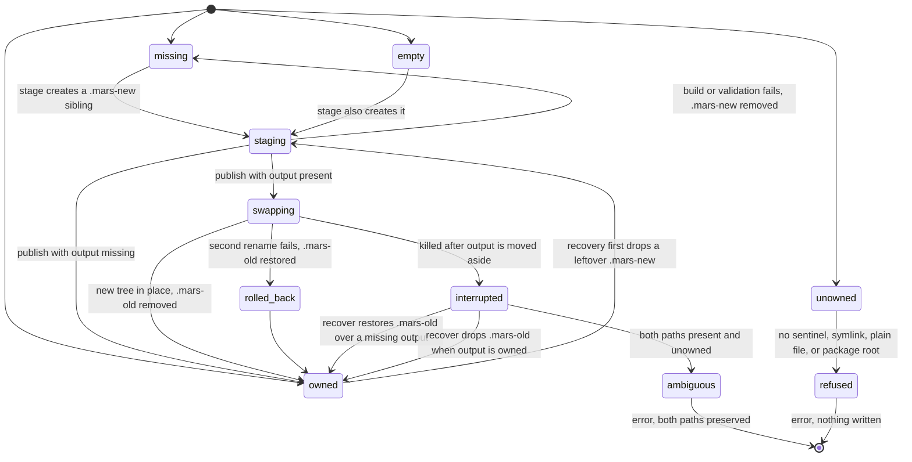
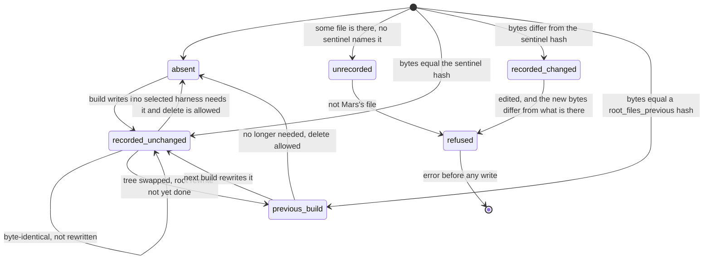
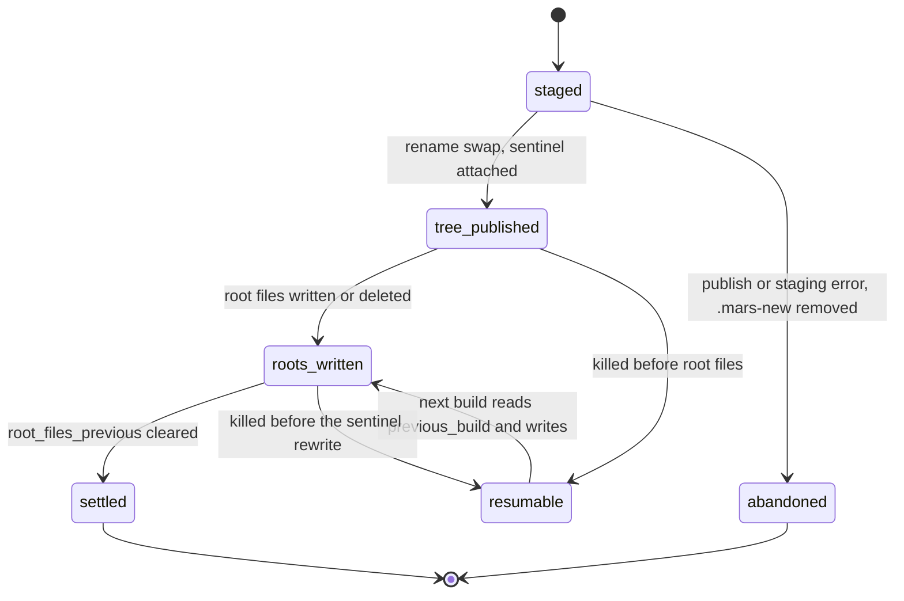
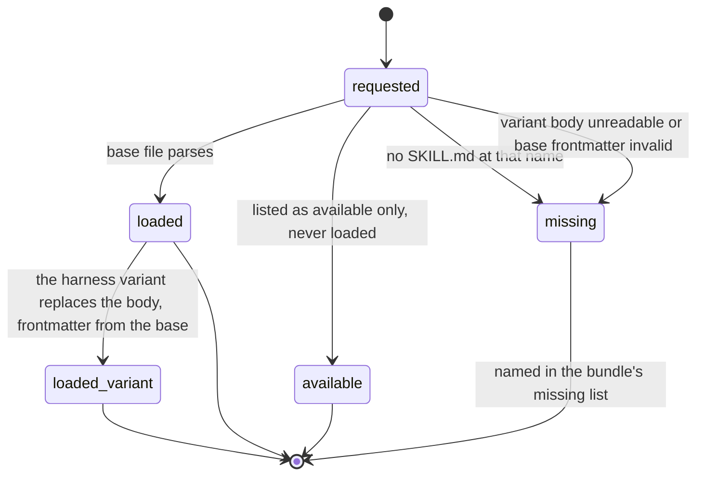

# Build state machines

`src/build` answers questions about a package before a sync runs: a plugin build
(`mars build plugin`), a launch bundle (`mars build launch-bundle`) and the prompt a launch
carries. Most of it is one straight pass; the state is two filesystem lifecycles a plugin build
leaves in the package, and one lookup. The launch policy is in
[policy](../policy/.context/state-machines.md). The index of all machines is
[state-machines/index.md](../../../.context/state-machines/index.md).

## Plugin output tree

The directory `mars build plugin` writes (`[plugin].dir` or `--out`), identified by the
`.mars-plugin.json` marker inside it. Defined in `plugin/output.rs`.

- `TreeState` is `missing`, `empty` (a directory with no entries), `owned` (non-empty and the
  marker parses) or `unowned` (a symlink, not a directory, or non-empty without a readable
  marker). `classify_tree` is the only classifier.
- The siblings `.<name>.mars-new` (staging) and `.<name>.mars-old` (rollback) are named in
  `OutputPaths::new` and are not states in the code.
- `stage` takes the lock, recovers, classifies and refuses an unowned output, creates
  `.mars-new`; the caller writes the trees and hashes the files into the marker
  (`plugin/mod.rs`); `publish_staged_tree_inner` requires `.mars-old` absent, renames the output
  aside, renames staging in, restores on failure and removes the rollback copy. A missing output
  is a plain rename.

An instance of [an atomic replace](../../../.context/state-machines/atomic-replace.md), of
[a marker a crash leaves](../../../.context/state-machines/crash-marker.md) and of
[a lease or lock](../../../.context/state-machines/lease-or-lock.md).

- **The lock is per output identity, in the global cache** (`plugin-output-locks`), not in the
  output. It is an OS lock on a cache file, so two `mars build plugin` runs on one directory
  serialize and the lock never outlives the process.
- **A kill between the two renames leaves the output missing and `.mars-old` holding the previous
  tree.** Recovery restores it and deletes the staged tree, so the build re-runs rather than
  resuming. A kill after the second rename leaves `.mars-old`, and recovery deletes it. Any other
  combination is refused with both paths preserved. `Drop` removes the staging directory
  best-effort, and a later run under the lock retries that before reading anything.
- Recovery runs inside `stage` and in `mars version` (`cli/version.rs`), so a plain build after an
  interrupted run recovers only as a side effect of staging.
- The marker persists `schema_version`, `mars_version`, `version`, `inputs_hash`, `dependencies`,
  `files`, `root_files`, `root_files_previous` and `root_directories`. Nothing else about a build
  survives.
- **Wrong edits**: writing the marker before hashing the tree (a hash then describes a tree that
  changed); creating `.mars-new` without `create_dir` (a leftover directory is silently reused and
  merged into); dropping the `.mars-old` requirement in publish (two rollback copies, and recovery
  cannot tell which is newer); publishing by copying instead of renaming.
- `PluginDirectoryState` in `plugin/inspect.rs` (`missing`, `unowned`, `unchanged`, `changed`)
  describes the same directory with other words, and `inspect_output` maps one onto the other.

## Generated root files

One path `mars build plugin` writes beside the output directory, inside the package root:
`.claude-plugin/marketplace.json`, `.cursor-plugin/marketplace.json` or an npm `package.json`
(`mars_schema::plugin_metadata::GENERATED_ROOT_FILES`). The record is the marker's `root_files`
(what this build wrote) and `root_files_previous` (what its bytes replaced). Defined by
`PluginRootFileState` in `plugin/inspect.rs` and by `plugin/root_files.rs`.
`root_file_state` computes the state over the union of expected, recorded and previous paths.
`changed` means "present but not the hash Mars recorded"; `previous_build` means "holds the bytes
this publication is about to replace", which is not an edit.

An instance of [an ownership record](../../../.context/state-machines/ownership-record.md) and of
[a marker a crash leaves](../../../.context/state-machines/crash-marker.md).

- `plan` decides writes, deletes and directory deletes, and refuses before anything is written if
  `allows_write` or `allows_delete` say no. `apply` writes with `atomic_write_if_changed`, then
  deletes, then removes empty catalog directories, rechecking ownership each time because the tree
  swap already happened.
- **A kill between the tree swap and the root-file write leaves `previous_build` bytes** at a path
  the new marker already lists in `root_files`. `root_files_previous` makes the next build treat
  those bytes as its own instead of a hand edit. Only paths whose bytes really change are recorded
  there, which lets a retired path stop being claimed once its bytes move on.
- `root_files_previous` is cleared by rewriting the marker once the root files are written; if
  that is skipped, the next no-change build rewrites the marker.
- Only hashes persist, never the intended content. `--out` builds record nothing and touch no root
  file.
- **Wrong edits**: writing root files before the tree swap (a kill leaves new root files pointing
  at an old tree); recording every write in `root_files_previous` instead of only replaced ones
  (a byte-identical rebuild becomes "previous", and a later build can delete a file it should
  keep); letting `allows_write` accept a hash that is neither the desired one nor a recorded one
  (a user edit is overwritten).
- The ownership decision is made in three places that each reread the file and compare:
  `allows_write`, `allows_delete` and `Plan`'s loop.

## Plugin publication order

One `mars build plugin` run's progress across two filesystem locations, in
`StagedPluginBuild::publish` (`plugin/mod.rs`); the comment there is the whole machine.

- **Order is the rule.** The first step is one rename swap, so it completes or restores the previous
  tree, and a failure leaves the package's root files untouched. The second step is not atomic
  across paths, which is why `root_files_previous` exists. The third is a single atomic marker
  write. Reversing steps 2 and 3 makes an interrupted build look complete; reversing 1 and 2 makes
  a failed swap leave new root files over an old tree.
- **Step 3 must not depend on anything that can fail independently of step 2**, or the record stays
  stale forever.
- Between steps only the marker persists; the plan is in memory.

## Skill resolution in a launch

One skill the agent profile asks for. `SkillLoadOutcome` and `AvailableSkillOutcome` are in
`prompt.rs`; `compile_prompt_surface` drives `load_skill_document` and `resolve_available_skill`.

- **A variant replaces the body, never the frontmatter.** The profile stays the base file's.
- **Missing is a list in the bundle, not an error.** A load error and a missing file land in the same
  place, one with a warning.
- `loaded_variant` is not visible in the output: `source_path` is the base either way, so a broken
  variant is seen only as a warning.
