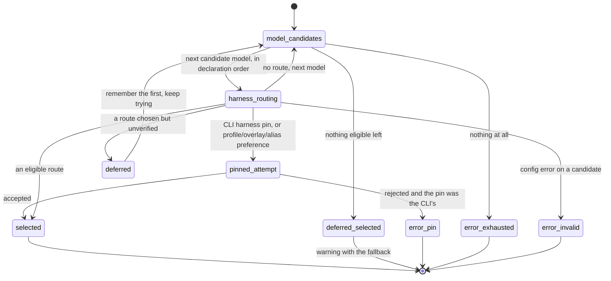
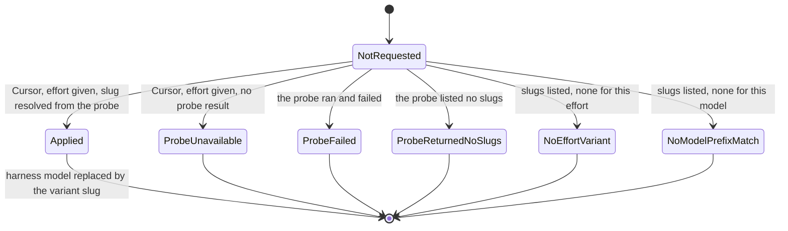

# Launch policy state machines

The index of all machines is [state-machines/index.md](../../../../.context/state-machines/index.md).
The policy layers and their order are in [CONTEXT.md](CONTEXT.md).

## Launch policy

One launch request's model and harness, as two loops: the outer over model candidates, the inner
over harnesses. `resolve_policy` (`mod.rs`) runs the candidates and the loop and then selects;
`resolve_harness` (`harness.rs`) takes the pinned branch (`HarnessAttempt`) or calls
`routing::evaluate_candidates`. Candidate evaluation and acceptance ordering are in
[harness routing](../../../routing/.context/state-machines.md); this machine decides what to try
and what a failure means.

An instance of [an ordered fallback walk](../../../../.context/state-machines/fallback-walk.md).

- **`no-fallback` excludes its own entry, not the chain.**
- **A CLI model pin disables backups.** A CLI harness pin restricts every attempt to that harness
  and, if target scope excludes it, is an error.
- **An unverified route is deferred, not accepted**, and the whole attempt is kept so later
  candidates do not overwrite its settings.
- **Exhaustion is an error.** Nothing is substituted unassessed.
- Nothing persists. The outcome goes into the launch bundle as `routing` and `provenance`.
- `PolicySource` (`mod.rs`) and the routing layer's `RouteSource` have the same variants with a
  `From` impl in both directions; add a variant to both.

## Cursor effort

Whether a requested `effort` reached the Cursor model slug, in `runnable.rs`.

- Every arm except `Applied` falls back to the routed model id unchanged and reports the reason in
  the bundle. There is no retry.
- The probe's own resolution error (`models/probes/cursor.rs`) has overlapping variants, and the
  ladder maps one onto the other.
