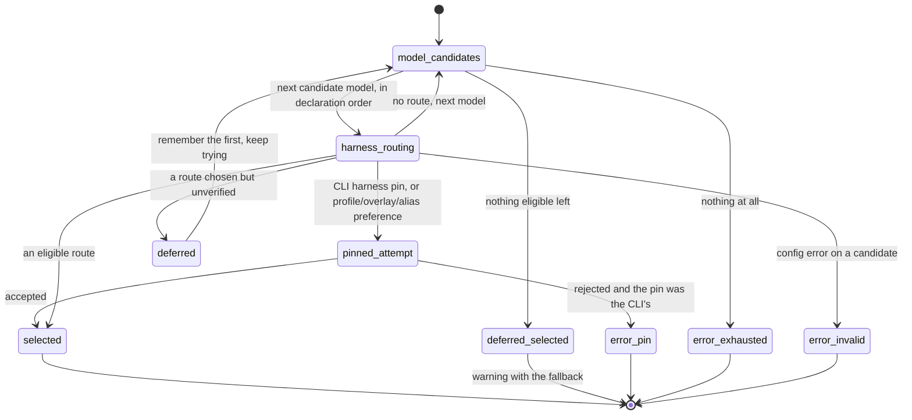
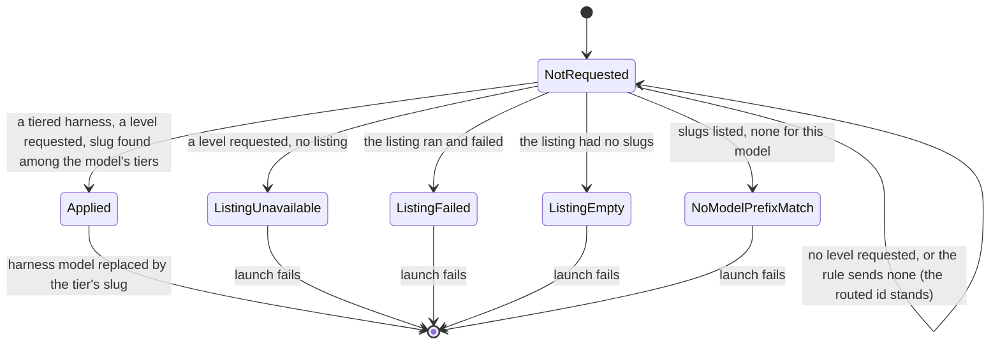

# Launch policy state machines

The index of all machines is [state-machines/index.md](../../../../.context/state-machines/index.md).
The policy layers and their order are in [CONTEXT.md](CONTEXT.md).

## Launch policy

One launch request's model and harness, as two loops: the outer over model candidates, the inner
over harnesses. `resolve_policy` (`mod.rs`) runs the candidates and the loop and then selects;
`resolve_harness` (`harness.rs`) takes the pinned branch (`HarnessAttempt`) or calls
`routing::evaluate_candidates`. Candidate evaluation and acceptance ordering are in
[harness routing](../../../routing/.context/state-machines.md); this machine decides what to try
and what a failure means.

An instance of [an ordered fallback walk](../../../../.context/state-machines/fallback-walk.md).

- **`no-fallback` excludes its own entry, not the chain.**
- **A CLI model pin disables backups.** A CLI harness pin restricts every attempt to that harness
  and, if target scope excludes it, is an error.
- **An unverified route is deferred, not accepted**, and the whole attempt is kept so later
  candidates do not overwrite its settings.
- **Exhaustion is an error.** Nothing is substituted unassessed.
- Nothing persists. The outcome goes into the launch bundle as `routing` and `provenance`.
- `PolicySource` (`mod.rs`) and the routing layer's `RouteSource` have the same variants with a
  `From` impl in both directions; add a variant to both.

## Slug tier effort

Whether a requested effort level reached the model slug of a harness whose slugs carry a tier
(`SlugTiers` on its registry row; Cursor today), in `runnable.rs`. That harness's levels are an
input to the effort rule: the suffixes its listing's slugs carry for the model (Cursor's bare slug
is `medium`), so the rule picks the level and `slug_tiers` only finds its slug. Tiers are read for the base model
(`reasoning::catalog_identity` takes the tier off a slug that carries one) and only when the model
could take an effort: a model that does not reason needs no slug and never fails the launch.

- A request the model's tiers lack does not fail: it moves to the nearest tier and warns, like
  every harness. The only failures are "listing unavailable" and "no slug for this model", and each
  fails the launch with `invalid_execution_policy`.
- With no listing at all (sync with no listing, a plugin build), a tiered harness's set is `Any` and the routed
  id stands.

## Effort resolution

`runnable::resolve_routing` resolves the layers' effort request once the harness model is known:
the catalog row of the provider the harness calls (`models::reasoning::catalog_identity` and
`catalog_row`; one join per harness), then `mars_schema::effort::resolve_effort` over the model's levels and the harness's. A
move is a `launch.warning`. The same row goes into the bundle as `routing.catalog_row`, so
consumers price from it and never re-join. Sync does the same in `profile_for_model`, per harness.
