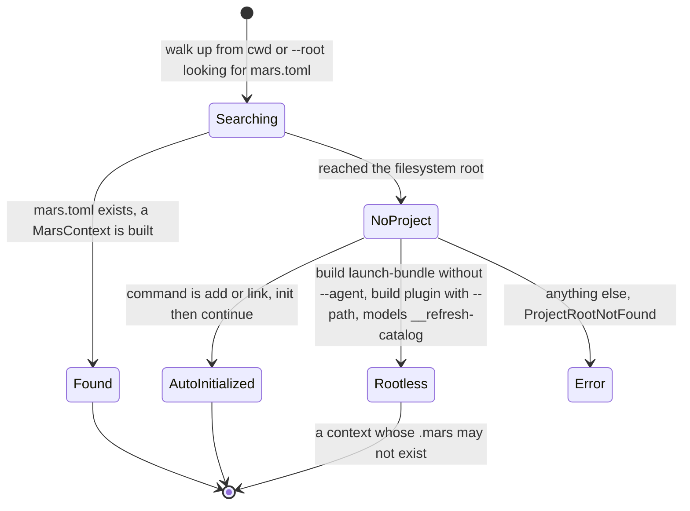
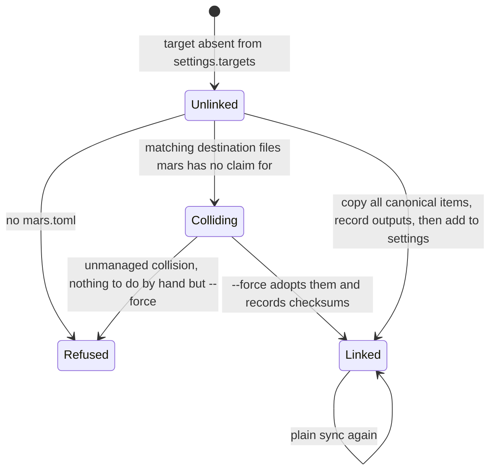
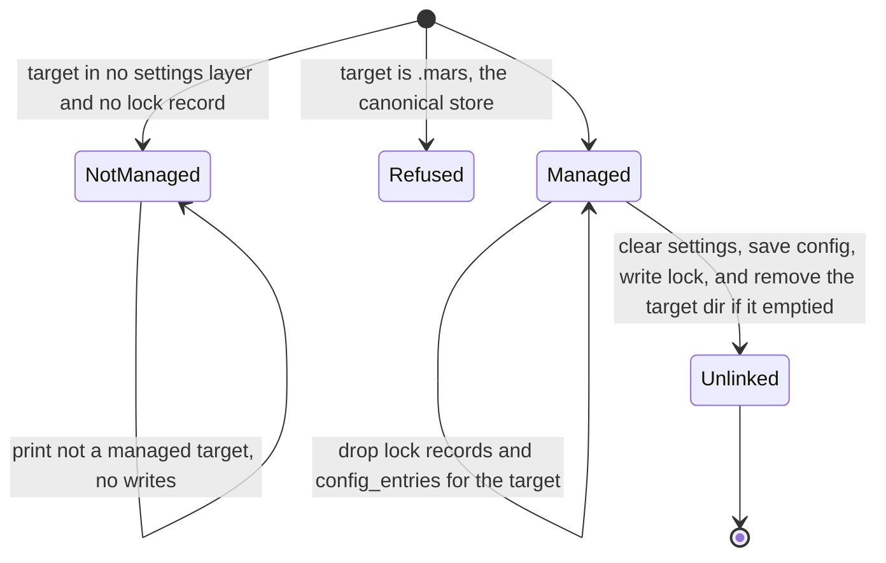
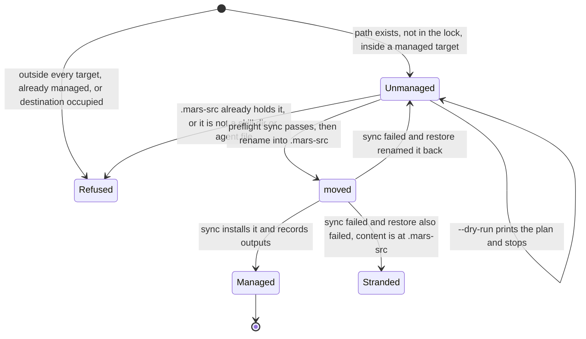
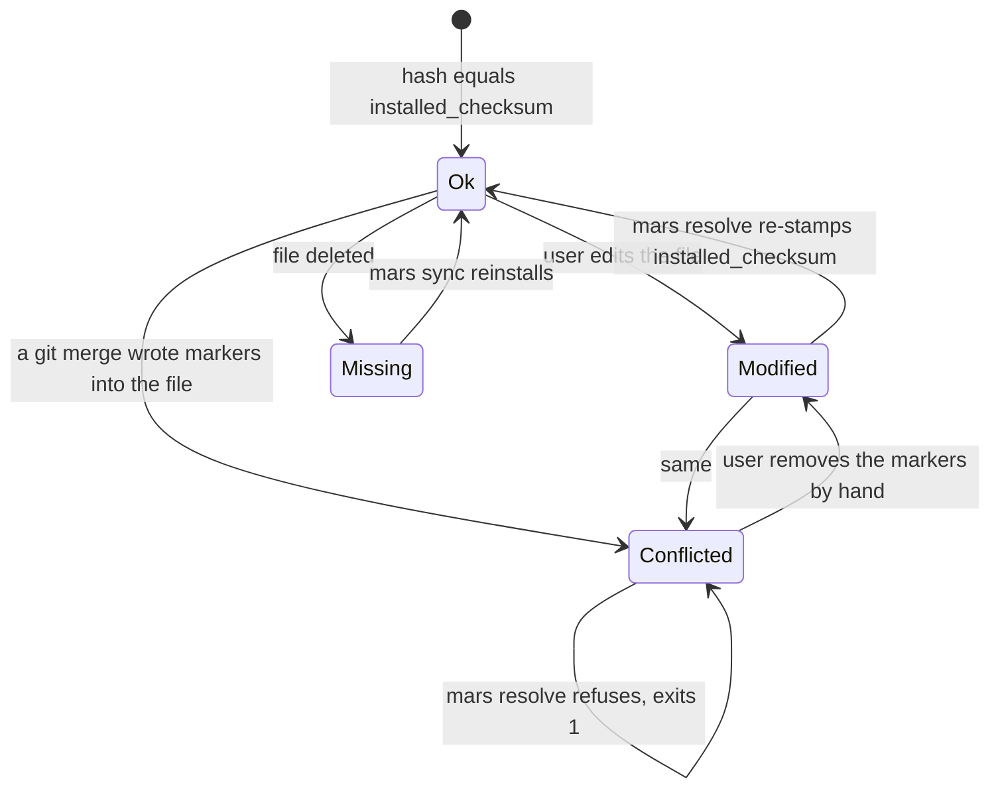
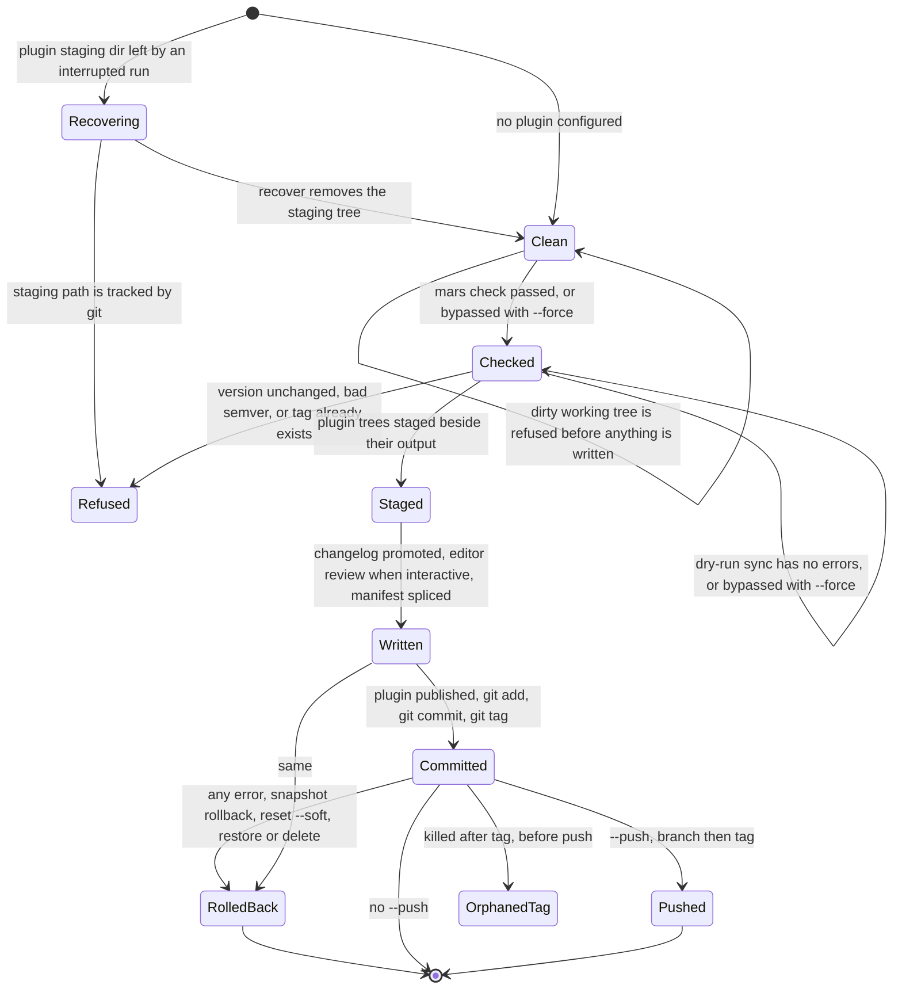

# CLI state machines

Most of the CLI is argument parsing and a call into the sync, resolve or build pipeline. The
machines here are the commands that carry a multi-step change of their own: which project a
command runs against, claiming and releasing a target, adopting a file, resolving conflicts,
releasing and scaffolding. Two authorities sit outside this page and are named once: the lock
(`OutputState`, `ConfigEntryRecord.emitted_json`; see [lock](../../lock/.context/state-machines.md))
and surface ownership (`may_delete`, `resolve_copy`; see
[surface ownership](../../surface_ownership/.context/CONTEXT.md)). The index of all machines is
[state-machines/index.md](../../../.context/state-machines/index.md).

## Project resolution

How `mars` decides the project root for a command, including the two cases where it invents one.
`find_agents_root` and `find_agents_root_from` walk up from the working directory or `--root`
looking for `mars.toml`, with no git boundary. `dispatch_result` applies three `Err` arms, using
`should_auto_init_project` and `can_run_without_project`.

- **A wrong edit changes where files are written**, which is the one thing the CLI can get
  catastrophically wrong. `MarsContext::new` rejects a `.mars/` that resolves
  outside the project root, because Mars deletes and rewrites inside it. Targets are not checked:
  one may be a symlink out of the project, and Mars writes there only what it recorded.
- Commands that own their root bypass the search: `Init`, `Check`, `Cache` and `Provide`. `provide`
  also refuses a `--root` that is not itself a project root.
- `--root` is a walk-up start in most commands and a direct target in `init` and `check`;
  `resolve_cli_path` decides whether a relative argument resolves against the working directory
  or the found root.
- The two predicates repeat the command list in `dispatch_with_root`; a new command that needs
  no project must be added to both.

## Target claim

One target directory going from "not managed" to "managed by Mars": a settings entry, files in the
target and lock records. `mars link` (`link.rs`). The order of writes in `link_target` is files
(`sync_managed_targets`), native agent materialization, the lock (`apply_target_sync_outputs`,
`persist_lock_then_native_agent_manifest`), then `settings.targets`. The collision check runs
twice, before and after native materialization.

An instance of [an ownership record](../../../.context/state-machines/ownership-record.md).

- **A kill after the copies and before the lock write** leaves files the lock does not claim. The
  next `mars link` or `mars sync` adopts those whose content is what it would write, silently, and
  warns `target-unmanaged-collision` on the rest, which the user has to `--force` to adopt.
- **A kill after the lock write and before `config.save`** leaves the lock claiming outputs for a
  target that settings do not list. `unlink` treats a target the lock claims as managed
  (`target::lock_claims`) and cleans it up; `link` finds the claim installed and finishes it.
  The kill after the copies is repaired by the next write: bytes equal to what Mars would write
  are adopted, not treated as the user's.
- `--force` also decides adoption diagnostics: `warn_no_installed_claim_adopted` fires only when a
  claim is missing, so re-linking an already linked target is silent.

## Target teardown

One target directory going from managed to not managed, plus removal of every file Mars recorded
there. `mars unlink` (`unlink.rs`) and a sync that finds a target no config file names (`finalize`) both call `target_sync::removal::remove_served`, which removes recorded paths
deepest first, treats `NotFound` as success, removes empty ancestors, and reconciles hooks
through the `RemovalPlan` and keyed entries through `reconcile_keyed` (one pass per keyed kind
the target declares), the paths sync uses.

- **Order is files, then config, then lock.** (A sync's removal has no settings step: the config no longer names the target, and a kill before the lock write leaves records the next sync removes the same way.) A kill between files and lock leaves records for
  paths that no longer exist; `cleanup_orphans` counts an absent recorded path as a confirmed
  deletion, so the next sync drops them. A kill between `config.save` and `lock::write` leaves a
  target out of settings that still has lock records, the mirror of what `link`'s crash leaves;
  the next `unlink` finishes it through `lock_claims`.
- **A target is managed if mars.toml, mars.local.toml or the lock names it** (`target_was_managed`).
  `unlink` edits both settings files; the user config can't list targets (its loader drops
  `targets`). An unmanaged target is not touched at all, even if files exist
  there: it prints and exits 0.
- `settings_updated` and `target_was_managed` are two bools that can disagree (settings changed
  for a target that was not managed); both are set from the same retain and clear block.

## Item adoption

One unmanaged file or skill directory under a target becoming a Mars-owned item: moved into the
local source root, then synced. `mars adopt` (`adopt.rs`). `build_plan` decides the kind by shape
(a directory with `SKILL.md`, or a `.md` under `agents/`) and refuses if the destination exists.

- **The move is not staged.** `move_item` is a bare `rename` into `preferred_local_source_root`.
  Killed between that rename and the sync, the user's file exists only under `.mars-src/` with no
  lock record and nothing at its original path. The rollback covers a sync error, not a kill.
- **A cross-device rename is refused with a message, not copied**, because a copy would leave two
  copies.
- Adopt keeps no intent file of its own; the only persisted state is the sync's lock records.

## Item conflict

Whether one canonical item under `.mars` matches its installed checksum, has been edited, or has
conflict markers in it, and the `mars resolve` loop that walks items back to installed.
`has_conflict_markers` (`conflict_markers.rs`) parses `<<<<<<<`, `=======` and `>>>>>>>` pairs.
Consumers are `list --status` (`missing`, `conflicted`, `ok`, `modified`), `doctor` (an error)
and `resolve`.

- **Mars never creates a conflicted item.** No writer emits conflict markers; the state comes from
  a git merge in the user's repository. Mars observes and resolves it, and does not drive it.
- `mars resolve` (deprecated in 0.39.0, removed in the next minor) re-stamps `OutputRecord::mark_installed` for each item whose markers are gone and
  whose hash differs from the record, then writes the lock once if anything changed. Killed
  before that, nothing changed.
- `list --status`, `doctor` (`TargetDivergence`) and `target_sync` (`resolve_copy`) each
  classify an item's disk state themselves.

## Release

One `mars version` run: bump, plugin build, changelog, commit, tag, optional push (`version.rs`,
`run`). Each step leaves a visible mark when it stops.

- **Gates run in order**: `require_clean_working_tree` (the plugin staging path is exempt as
  "interrupted Mars state"), `recover(output)`, `require_package_check`, `require_validate_pass`,
  `parse_release_version`, `resolve_next_version`, `ensure_tag_not_exists`, `stage_plugin`.
  `--force` bypasses only the two checks.
- **`ReleaseSnapshot::capture` records HEAD, the touched paths and created directories before
  the writes.** `rollback` resets to HEAD, unstages, deletes or restores each path from `HEAD`
  and removes created directories. `MarsError::ReleaseRollback` is returned when both the release
  and its rollback fail.
- **Ordering is the invariant.** `update_changelog_if_present` (which may open `git var
  GIT_EDITOR`), then `update_package_manifest` (splices two value spans without re-rendering, so
  CRLF and formatting survive), then `staged_plugin.publish`, and only then commit and tag. A
  failure in any step rolls all of them back; a kill does not.
- **After a kill each intermediate is a real state.** Files bumped and changelog promoted with no
  commit is a dirty tree, which the next run refuses. A commit with no tag, or a tag with no push
  (`OrphanedTag`), is not detected; the next run's `ensure_tag_not_exists` refuses the same
  version.
- **The plugin staging tree is the only crash state with recovery**: `recover(output)` at the
  start of the next run, and the "is it tracked by git?" refusal that protects a tree the user
  committed by hand. The path comes from `recovery_staging_path` in
  [the plugin output tree](../../build/.context/state-machines.md).

## Project scaffold

One directory becoming a Mars project, `mars init` (`init.rs`). `initialize_project` creates
`.mars`, writes `mars.toml` if absent (`ensure_consumer_config`), then creates and persists
the target in `settings.targets` when one is given. Auto-init in `dispatch` uses the same function.

```mermaid
stateDiagram-v2
  [*] --> Bare
  Bare --> HalfInit: .mars created, mars.toml not yet written
  HalfInit --> Initialized: mars.toml written, target directory created and added to `targets`
  Bare --> Initialized: mars.toml already there - already_initialized = true; no target leaves settings as they are
  Initialized --> Initialized: re-running is a no-op, then --link targets are linked
```

- **`HalfInit` is a real state.** A kill between `create_dir_all(".mars")` and the `atomic_write` of
  `mars.toml` leaves an empty `.mars` that `doctor` reports as "no compiled store yet"; the next
  `init` finishes the job. A failed `mars add` that auto-initialized can leave it too.
- **`already_initialized` means only "mars.toml existed".** It says nothing about `.mars`.
- `init` is idempotent and `--link` runs after initialization, so `mars init --link .claude` runs
  the target claim above as a nested step.
