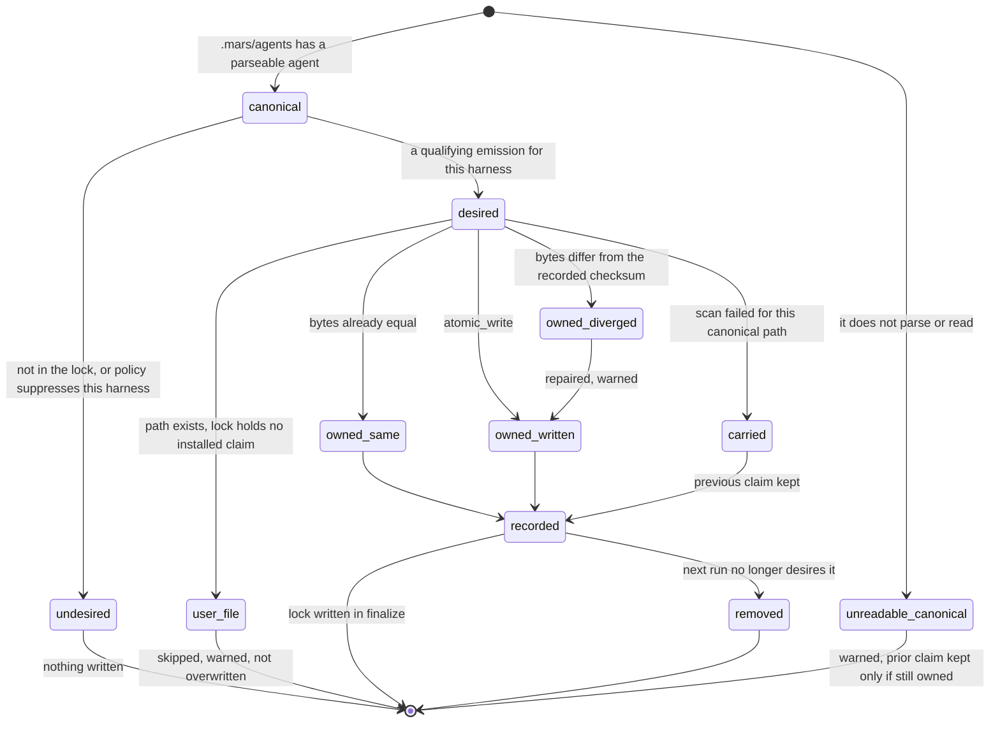
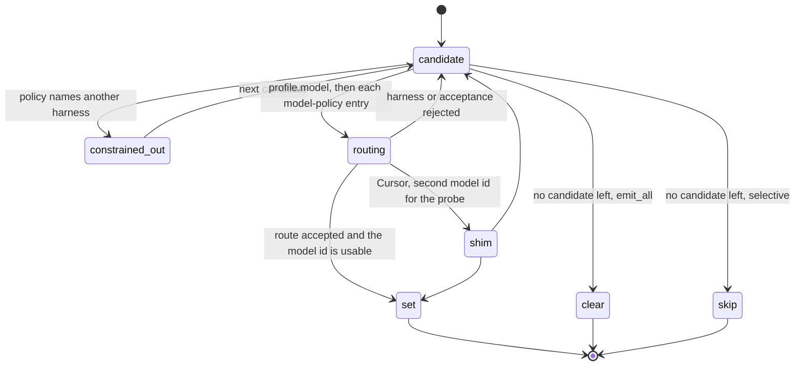

# Compiler state machines

`src/compiler` reads the resolved graph and turns it into files: canonical content in `.mars/`,
target copies, native agent files, and hook and MCP entries in a harness's own config. What is
state here is two filesystem lifecycles (native agent files claimed by the lock, hook entries in
someone else's JSON) and one resolution pass (which model a native agent file gets). The index of
all machines is [state-machines/index.md](../../../.context/state-machines/index.md).

Order of one sync inside `compile` (`mod.rs`):

1. `build_target` writes every normalized package tree into `.mars/.staging.pending`.
2. `create_plan`, the frozen gate and the hook preflight run; nothing is mutated yet.
3. `apply_plan` writes canonical files, then `publish_staging_generation` swaps the generation
   into `.mars/staging` and source roots are rebased onto it (see the
   [staging generation](../../platform/.context/state-machines.md)).
4. `sync_targets` copies into `.claude/`, `.codex/` and the rest.
5. `compile_config_entries` reconciles hook and MCP entries.
6. `run_native_agent_post_sync_lifecycle` reconciles, then compiles, native agent files.
7. `finalize` (`src/sync/finalize.rs`) writes the lock, then the native agent manifest.

Steps 3 to 7 touch the filesystem outside `.mars/.staging.pending`, and each is a machine in this
page or the [sync phases](../../sync/.context/state-machines.md).

## Native agent files

An agent file Mars writes into a harness's own directory (`agents/<name>.md`, or `.toml` for
Codex). It lives outside target sync, so only the lock owns it. Defined in `native_agents.rs`:
`scan_mars_agents` finds the canonical agents and records `failed_canonical_paths` for files it
cannot read; `desired_native_agent_outputs` computes the desired set;
`run_native_agent_post_sync_lifecycle` resolves overlays once, then runs
`reconcile_native_agent_surfaces` (removals), then `compile_native_agents` and
`emit_lowered_native_agent` (writes). On disk, `surface_ownership::copy_decision` gives the pair
(file exists, lock has an installed claim). `recorded` is a `CompiledNativeOutput`.

An instance of [an ownership record](../../../.context/state-machines/ownership-record.md).

- **Native files are written before the lock.** A kill in between leaves files with no installed
  claim. The next sync treats them as someone else's and warns instead of overwriting. That is
  deliberate, but `user_file` is a dead end that only a human or `--force` clears.
- **Removal happens before compile inside one pass.** A kill after removal and before the lock
  write leaves the lock claiming files that are gone; reconcile treats that as `absent` and drops
  the claim without error.
- **A failed scan does not prove removal.** Prior claims for those canonical paths are carried
  forward, but only while the post-apply ownership view still owns the same canonical path, so a
  rename or delete still prunes.
- **Wrong edits**: recording a native output the file does not exist for (the next run removes it
  and reports a removal that never happened); compiling before reconciling (removals delete a
  file that was just rewritten); skipping the `contains_output` gate so a canonical agent Mars did
  not install gets a native file.
- Persisted: only the lock's per-output installed checksum and the derived
  `.mars/native-agents.json`. Dry runs write and record nothing.

## Native model decision

Which model string goes into one native agent file for one harness (`Set`), or that the file is
emitted with no model (`Clear`), or not emitted at all (`Skip`). `NativeModelDecision` is in
`native_agents.rs`, over `NativeModel` (`agents/lower_policy.rs`). `decision_for_profile` walks
the candidates; `route_candidate` (memoised per run) calls `route_candidate_uncached`,
`route_model_ids`, acceptance and `native_model_id`. The routing evaluator is `crate::routing`
(see [harness routing](../../routing/.context/state-machines.md)).

An instance of [an ordered fallback walk](../../../.context/state-machines/fallback-walk.md).

- **One concrete model per file, or none; never a token the harness cannot run.** When routing
  accepts a token but OpenCode has no provider/model slug, `native_model_id` returns `None`: the
  token is rejected and the next candidate is tried. A bare model id is never written for
  OpenCode.
- **`Clear` and `Skip` differ.** `Clear` writes the agent without a model; `Skip` withholds the
  file. `qualifying_agent_emissions` is where `Skip` becomes "no artifact". With nothing left,
  `EmitAll` clears and `EmitSelective` skips.
- Nothing is persisted. The decision is recomputed every run; the memo is keyed on (token,
  harness, Cursor effort). Effort resolves per target harness: the same Agent can send `low` to Claude and `minimal` to Codex.
- The plugin build resolves a model separately in `src/build/plugin/model.rs`
  (`NativeModel::Set` or `Clear`, with no routing and no `Skip`). A change to what a model token
  means here has to be made there too.

## Hook and MCP config entries

One harness's shared config file (`hooks.json`, `opencode.json`, `config.toml`) with Mars entries
merged into it, plus the lock's per-entry record. Defined in `config_entries/mod.rs`. Per target
root: desired records are planned in memory (from `lower_merge_outputs` and
`mcp_file::render_all`), `unchanged_records` decides what to leave alone, `RemovalPlan` removes,
and the lock's `config_entries` hold what was recorded. Dry runs stop after planning with
previews. File-placement hooks (OpenCode, Pi) are a second branch: files recorded in the lock and
deleted when no longer desired, if `may_delete` says Mars wrote them.

```mermaid
stateDiagram-v2
  [*] --> planned: every target lowered, nothing written
  planned --> unchanged: desired records equal lock records and the file holds them in order
  planned --> removing: records differ, or an entry was edited or moved
  unchanged --> [*]: left alone, file not rewritten
  removing --> removal_failed: hook removal errors
  removing --> removed: nothing yet for a target that gets a write; the removal runs inside the write
  removal_failed --> blocked: write permit withheld
  removed --> writing
  blocked --> [*]: info diagnostic, next sync retries
  writing --> recorded: merge file loaded, stripped, appended and saved once, records updated
  recorded --> [*]: lock written in finalize
```

The permit rules are in [hook-entry removal](../../surface_ownership/.context/state-machines.md);
the entries themselves in [MCP server entry and hook entry](../../target/.context/state-machines.md).
An instance of [an ownership record](../../../.context/state-machines/ownership-record.md).

- **Removal must complete before any write for that target.** A partial merge leaves the file
  holding old and new entries, and Codex keys trust on position.
- **A removal that fails keeps the prior record and suppresses the write.** Dropping the permit
  appends new entries beside the ones that could not be removed.
- **Do not rewrite an unchanged merge file.** It moves every entry, and Codex skips hooks it has
  not re-trusted (`hook_file::trust_positions` snapshots positions before and after).
- **Removal is one entry at a time and tolerates a missing entry**, warning `config-divergence`.
  A crash after the file's save and before the lock write looks exactly like a user edit on the
  next sync, and the new entry is appended again: a duplicate, a known gap that the config-entry
  journal closes. Equal content in the file is never taken as Mars's own. Removal and append
  share one load and one save (`hook_file::replace`), so no crash leaves the file between them
  and no other writer of the same physical file, such as an MCP entry through a symlink alias,
  runs between the load and the save. MCP reconcile runs before the hook write for that reason.
- **Every write goes through `atomic_write_preserving_permissions`** (`config_doc::write_through`),
  so a killed process leaves the old file.
- Persisted: `ConfigEntryRecord::emitted_json` per key in the lock, the exact entries, so removal
  finds them by value, not by name. The MCP source of a recorded server is not kept, which is why
  a failed scan keeps every recorded server.
