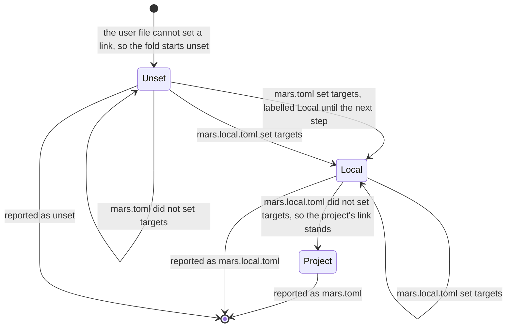

# Config state machine

The index of all machines is [state-machines/index.md](../../../.context/state-machines/index.md).
The layers and their precedence are in [CONTEXT.md](CONTEXT.md).

## Target provenance

Which config file set `targets`. `layering.rs` composes the user
`config.toml`, then `mars.toml`, then `mars.local.toml` (`overlay_settings`).
`TargetSource { field, origin, path }` in `targets.rs` records which file and key produced the
winning value, and `effective_project_config` in `mod.rs` turns the origin into a path.

- **Each layer computes provenance from the layer below it, and the fold keeps only the last
  step's answer.** That is correct only because the last step's base is always the project's own
  settings: a `targets` in `mars.toml` is re-read as `TargetOrigin::Project` at the
  `mars.local.toml` step, so the reported path is `mars.toml`.
- **That rests on another module.** `config/user.rs` takes `targets` out of the
  user file and reports it as an unread key, so the user layer can never set a link. If the user
  file read it, this machine would report `unset` for a link the user did set.
- **`TargetOrigin::Local` means "not the project file"**, not `mars.local.toml` specifically.
  No `TargetOrigin` value could name the user file.
- `TargetSource.path` is `None` until `effective_project_config` fills it, so a `TargetSource` read
  anywhere else has a dead `path` field.
