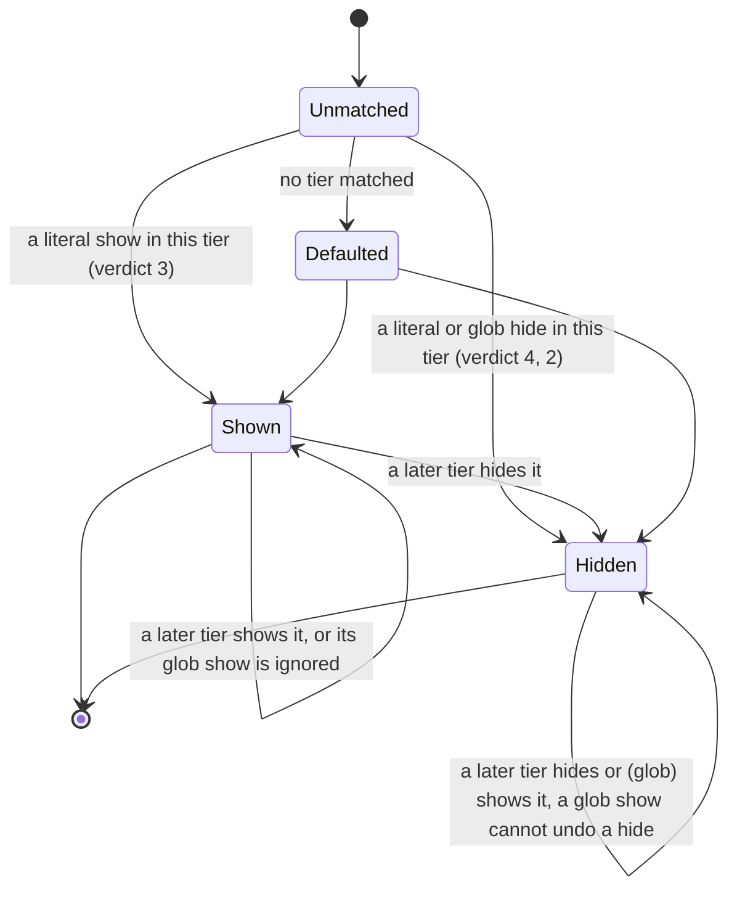

# Curation state machine

The index of all machines is [state-machines/index.md](../../../.context/state-machines/index.md).
Curation is display-only: no routing consumer imports it.

## Curation fold

Whether one possible model row is shown, across config tiers (`mod.rs`). `Decision::Unmatched` is
the start; each tier can move a row to `Shown` or `Hidden`; a `default_for_unmatched` second pass
decides the leftovers.

- **Precedence is four integers computed inline**: hide-literal 4, show-literal 3, hide-glob 2,
  show-glob 1, with 1 additionally refused once the state is `Hidden`. Nothing names those ranks;
  reordering the `.map(|rule| if rule.rule.glob { 2 } else { 4 })` expressions silently changes
  which rule wins.
- **Tier reachability is a separate rule.** `reachable()` drops every tier before the last one
  that does not inherit, so `inherit = false` in `mars.local.toml` hides the project and user
  files entirely.
- **The default is decided after the fold, from a different question**: the last tier with a
  `default`, else hidden when a non-user tier has any show rules, else shown. Two places decide a
  row's visibility, and only one of them is the fold.
