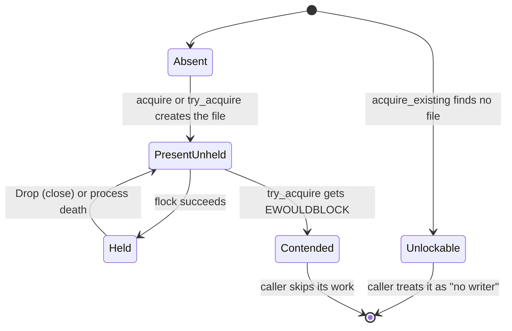

# Filesystem state machines

The index of all machines is [state-machines/index.md](../../../.context/state-machines/index.md).

## `.mars/sync.lock`

Whether a Mars process is changing this project. The file is only the carrier; the state lives in
the OS lock (`flock` on Unix, `LockFileEx` on Windows), not in the bytes. `FileLock` has three
entry points: `acquire` creates the file and blocks, `try_acquire` creates it and does not block,
`acquire_existing` never creates. Users of `.mars/sync.lock` are sync's `load_config`,
`cli/link`, `cli/unlink`, `cli/resolve_cmd` and `provided/reconcile`.

An instance of [a lease or lock](../../../.context/state-machines/lease-or-lock.md).

- **`try_acquire` must create.** A caller that cannot open the file has to error, not report
  contention, or it skips its work forever. `is_lock_held` checks one OS error code to tell "held"
  from "broken file".
- **`acquire_existing` is the dry-run rule.** A preview serializes with a real sync but never adds
  `.mars/sync.lock` to the project. "File exists" does not mean the lock was ever held, and a dry
  run in a never-synced project sees `None`.
- **The file is opened read and write.** NFS emulates `flock` with `fcntl` locks, which refuse an
  exclusive lock on a read-only handle.
- The file is never deleted. After the first real sync it is durable project state.
