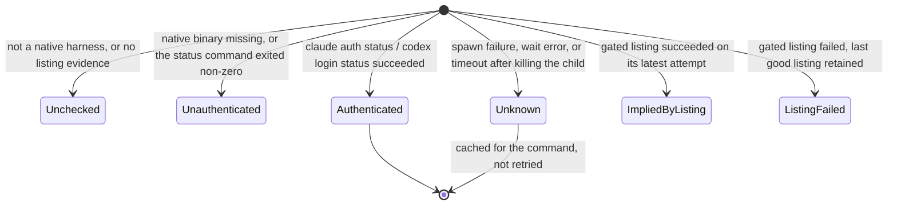
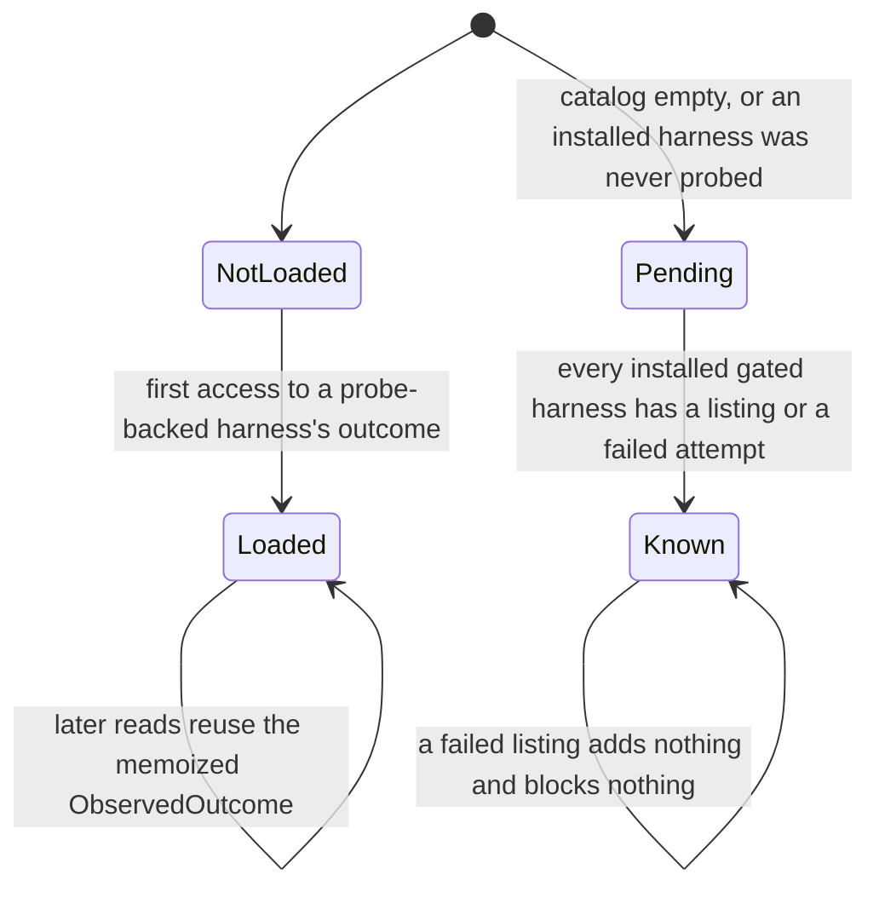

# Harness state machines

The index of all machines is [state-machines/index.md](../../../.context/state-machines/index.md).
What the module decides is in [CONTEXT.md](CONTEXT.md).

## Harness auth evidence

What Mars knows about whether one harness route is usable right now: a six-state `AuthState`
(`host.rs`), computed per command, cached in memory and never written to disk. The native states
come from `native_auth_state` and `run_status_command` (2s timeout,
`MARS_NATIVE_HARNESS_AUTH_TIMEOUT_SECS`). The three listing-derived states are produced in
`routing/mod.rs` from `ListingEvidence`, which pairs `succeeded` with `latest_attempt_ok` so a
failed refresh does not erase last-good support.

- **`is_runtime_evidence` treats `Authenticated` and `ImpliedByListing` as equal strength**:
  credentials configured, not proven valid or funded. Marking `ListingFailed` as evidence, or
  making `Unknown` mean "not logged in", breaks that first.
- **`NativeAuthCache` memoizes per command and caches `Unknown` too**, so a backup route or another
  alias does not retry a slow probe.
- **The status child is spawned with stdin, stdout and stderr nulled.** On timeout it is killed
  and reaped before `Unknown` is returned, so there is no zombie and no answer.

## Probe loading and known providers

Which harness probes one command has loaded, and whether the provider list is trustworthy yet: two
facts on `CapabilitySession` (`host.rs`). Executable checks run eagerly in `collect`; each
probe-backed harness's listing outcome is loaded on first use (`outcome(harness)`), memoized in a map
keyed by `HarnessId`, and read by every caller as the common `Listing` view. A native harness
has no probe and reads as `CachedProbeOutcome::Unavailable`. `known_providers`
(`known_providers.rs`) returns `None` while the answer could still be wrong.

An instance of [a lazy cache entry](../../../.context/state-machines/lazy-cache-entry.md).

- **`known_providers` does not load.** An unloaded outcome counts as `ProbeListing::NeverProbed`
  and the answer is `None` (pending), so a diagnostic can never trigger a probe. `ProbeListing` is
  `NeverProbed | Failed | Listed`.
- **An excluded harness is never probed, and is not the same as a missing binary.** The rule from
  [AGENTS.md](../AGENTS.md) is enforced here.
- The session holds no state across commands. The disk half is the
  [probe cache](../../models/probes/.context/state-machines.md).
