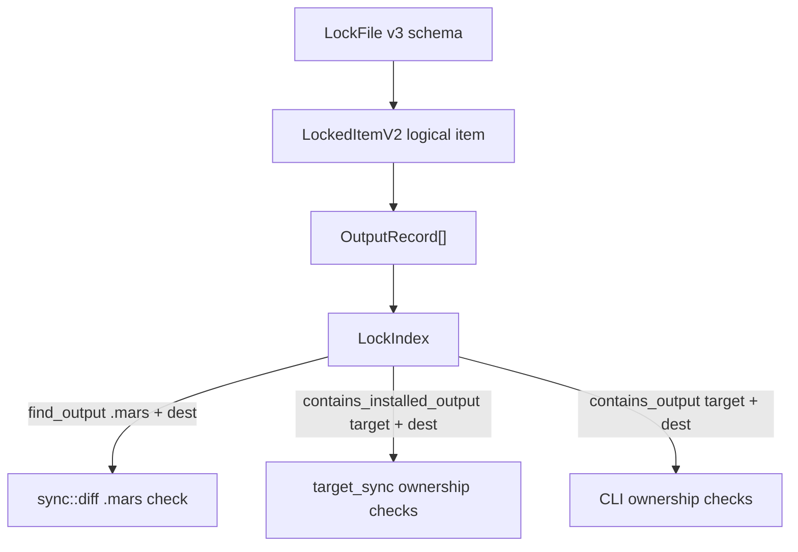

# src/lock/ — Target-Scoped Lock Outputs

`mars.lock` is the ownership registry for package-installed content. Lock v3 stores one
logical item with one or more output records. Every output record is scoped by
the target root that received it.

Canonical ownership is decided by one rule, which lives in
`docs/internals/lock-file.md#canonical-ownership`: a destination under `.mars/` is Mars-owned when
`mars.lock` claims it **or** `.mars/provided.lock` lists it. This crate answers the first half
(`LockIndex`); `sync::ownership::Ownership` is the one place that combines both.

## Contracts

### Output identity is `(target_root, dest_path)`

`OutputRecord` has a path identity and an explicit lifecycle claim:

| Field | Meaning |
|---|---|
| `target_root` | Directory Mars materialized into, such as `.mars`, `.codex`, `.pi`, `.agents` |
| `dest_path` | Path relative to that target root, such as `skills/planning` |
| `state = "installed"` + `installed_checksum` | Mars asserts that these exact bytes are installed at the path |
| `state = "pending-deletion"` | Mars asserts only authority to retry deletion; no checksum exists |

The pair `(target_root, dest_path)` is the stable identity of an installed
output. `dest_path` alone is not unique once a project has multiple targets.

Native targets can lower the same source skill differently. A single skill can
therefore have multiple valid installed checksums:

```toml
[[items."skill/planning".outputs]]
target_root = ".mars"
dest_path = "skills/planning"
state = "installed"
installed_checksum = "sha256:canonical..."

[[items."skill/planning".outputs]]
target_root = ".pi"
dest_path = "skills/planning"
state = "installed"
installed_checksum = "sha256:pi-projected..."
```

Pending deletion is deliberately part of the same type because it changes the
meaning of an existing path-ownership record. The enum makes a checksum
unavailable in that state, so disk-content consumers must handle the lifecycle.

A v2 lock (Mars 0.23 and earlier) has no such distinction: its checksum may be installed
content or a retry tombstone, and nothing on disk settles which. Mars 0.25 does not
promote it. `load_with_diagnostics` keeps its dependencies and aliases, drops the items and
config entries, and warns once, so the sync never fails; the files it described count as
local content until `--force` adopts them. Dropping is safe because it can only leave
files behind, never delete one. A config-entry record without `emitted_json` is dropped
with a warning for the same reason: with no recorded content mars cannot tell its own
entry from the user's.

Canonical write intent is separate from installed/deletion authority.
`sync/recovery.rs` uses a versioned `.mars/pending-canonical.json` journal, bound
to the prior lock's bytes. Journal entries are keyed by physical destination,
not logical item; shared read/write validation checks each path and kind, and
rejects overlap with the journal itself. It validates matching regular outputs into an
in-memory lock; retry intent retains verified current bytes alongside planned
replacement bytes until finalization. It does not checkpoint the lock early, so
failed repair preserves corrupt lock evidence. No lock schema or `_self` identity
change is required.
During a destination move, recovery can retain multiple canonical paths for one
logical item. Final lock construction and the temporary native-emission view
share physical-path removal after carry-forward/upserts. Removing an obsolete
path must not erase a surviving canonical/native record for the logical item,
and skipped outputs must not resurrect removed paths. Same-path deletion claims
are replaced by verified installation; native and other-path claims survive.
Native/config transaction recovery remains tracked in #149.

### Marketplace plugin dependencies record two commits

A dependency with `plugin = "<name>"` installs one plugin of a Claude marketplace. Its
`[dependencies.<name>]` entry keeps the fields every source has, which describe the marketplace
(`url` or `path`, `version`, `commit`), and adds:

| Field | Meaning |
|---|---|
| `plugin` | The plugin installed; part of the entry's identity, like `subpath` |
| `content.url`, `content.subpath`, `content.commit` | Where the plugin's files came from |

A plugin in the marketplace's own repository repeats the marketplace's `url` and `commit` in
`content` with its path as `subpath`; a plugin in another repository records that repository, the
`git-subdir` path, and the commit fetched. `content.url` is canonical like `url`, so it identifies
the repository but is not what is fetched: the fetch URL comes from the marketplace entry.

Both fields are optional and skipped when absent, so the lock stays version 3 and every lock
without marketplace plugins is byte-identical. Nothing but `src/resolve/plugin.rs` reads
`content`: sync replays `content.commit` only while the marketplace is at the locked `commit` and
the entry names the same repository and path, upgrade resolves it anew, and a change of repository
or path is reported as `plugin-source-moved`.

### `LockIndex` is the read seam

`LockFile` preserves the persisted schema. `LockIndex` provides hot lookup
views over that schema:

| Method | Use |
|---|---|
| `find_output(target_root, dest_path)` | Diff, mutation, collision, and carry-forward checks for one concrete target |
| `contains_installed_output(target_root, dest_path)` | Checks that require an installed-content claim; canonical ownership adds provided destinations on top, so callers deciding that go through `sync::ownership::Ownership` |
| `contains_output(target_root, dest_path)` | Checks where either installed or pending-deletion authority is sufficient, chiefly deletion |
| `find_by_dest_path(dest_path)` | Broad/legacy lookup where target root is intentionally irrelevant |
| `contains_dest_path(dest_path)` | Broad/legacy existence check |

New code that reasons about disk content under a target root should start with
the target-scoped methods. Unscoped methods are safe only when the caller is not
deciding ownership, modification status, or mutation permission for a concrete
target path.

### Canonical sync diff reads canonical outputs

Phase 4 sync diff compares the `.mars/` canonical store against the old lock.
It must use `.mars` output records:

```text
disk: .mars/skills/planning
lock: target_root = ".mars", dest_path = "skills/planning"
```

Comparing `.mars/skills/planning` to a `.pi` or `.codex` output checksum is
incorrect because those outputs may be valid target-specific projections. The
symptom is a false `disk-lock-divergent` / local-modified warning immediately
after a clean sync.

### Linked-target mutation uses the same identity

Linked-target deletion, overwrite, and orphan cleanup use the same
`(target_root, dest_path)` ownership contract. See
`../../target_sync/.context/CONTEXT.md` for the mutation-side rules.

## Architecture



The lock module should not know how each target lowers content. It only records
the outputs and provides target-scoped lookup semantics. Compiler and target
sync code decide what bytes to produce; lock lookup decides which recorded
checksum applies to the target being inspected.

## Rationale

The schema models per-target outputs. One bug class comes from
flattening those outputs into a `dest_path -> output` map and letting duplicate
paths overwrite each other. Sorting can make a later target win, so canonical
diff may read a linked/native target checksum even when `.mars` is clean.

Keeping the schema unchanged and fixing the ephemeral index preserves lock-file
compatibility while making the read model match the schema model.

## Patterns

- Use `CANONICAL_TARGET_ROOT` when the caller is checking `.mars/`.
- Use the configured target name when checking a linked/native target.
- Use `canonical_flat_items()` for `.mars`-only orphan scans.
- Use `flat_items_for_target(target_root)` for target-scoped listing.
