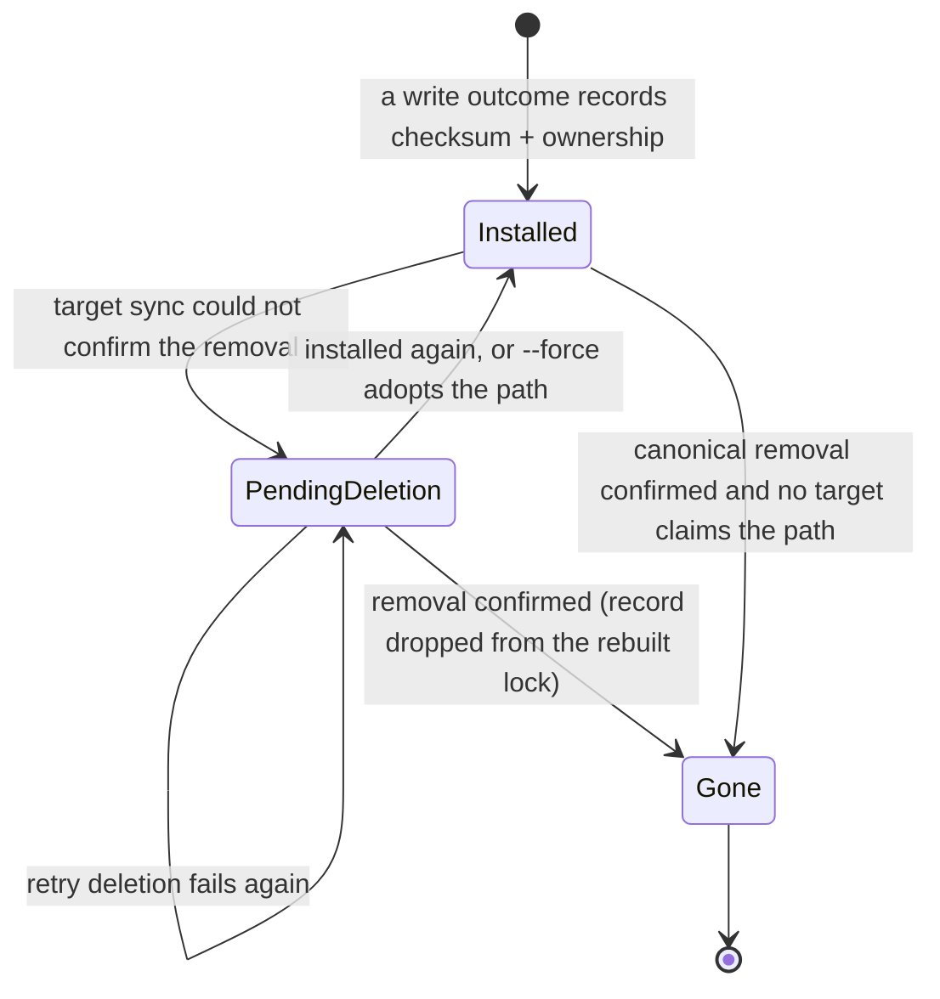
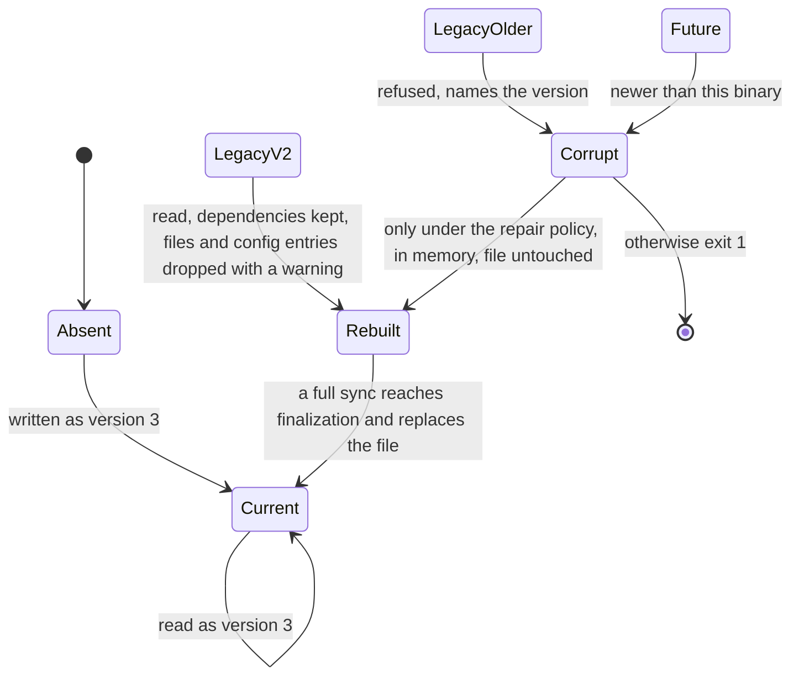

# Lock state machines

`mars.lock` is the ownership registry: it decides what Mars may overwrite or delete. These
machines are the state of one recorded output and of the file itself. The index of all machines is
[state-machines/index.md](../../../.context/state-machines/index.md).

## Lock output record

One installed path in one target, as `mars.lock` records it (`OutputState` in `mod.rs`, serialized
as `state = "installed" | "pending-deletion"`). A `PendingDeletion` is a tombstone: Mars tried to
remove the path and could not confirm it.

- Created `Installed` by `OutputRecord::installed`, through `upsert_target_output` and
  `upsert_native_output_on_owner`, from `apply_target_sync_outputs`, `apply_compiled_native_outputs`
  and `mars resolve`.
- Becomes `PendingDeletion` in `retain_unremoved_noncanonical_outputs` when a target sync could
  not confirm a removal.
- Leaves the lock when the removal is confirmed (`apply_target_sync_outputs`, or `finalize`'s
  `retry_tombstone_removals`), or goes back to `Installed` when the item is installed again.

An instance of [an ownership record](../../../.context/state-machines/ownership-record.md).

- **A tombstone grants deletion only.** `surface_ownership::may_delete` accepts both states;
  `resolve_copy` accepts only `Installed`. Admitting a tombstone to
  `installed_checksum_for_output` lets a retry overwrite bytes that appeared after the failed
  removal.
- **`--force` restores the state to `Installed`.** It is the only way a tombstoned path becomes
  writable again without a fresh install.
- **Lookups are scoped by `(target_root, dest_path)`.** A `.mars` record never authorizes a
  `.claude` mutation.
- **Three ownership predicates exist on purpose**: `LockIndex`, `sync::ownership::Ownership` and
  `surface_ownership`. Each counts a different proof (journal-narrow, lock-or-provided, lock-only);
  merging them changes what is proof. See [invariants](../../../.context/invariants.md).

## `mars.lock` schema lifecycle

Which shapes of the lock file Mars accepts, and what it keeps from each.
`load_with_diagnostics` decides: absent gives `LockFile::empty()`; `version: 3` is parsed, with
config entries that have no recorded `emitted_json` dropped and warned about (`split_unrecorded`,
`orphaned_entries_warning`); `version: 2` keeps dependencies and aliases only and warns
(`v2_lock_dropped_warning`); an older version, a newer version or an unparsable file is `Corrupt`.
A second axis on `Corrupt` is whether the command opted into `RecoveryPolicy::Repair`, which
rebuilds in memory and leaves the file alone. `lock::write` always re-stamps `LOCK_VERSION`, sorts
keys, then `atomic_write_if_changed`.

- **Repair must not touch the file before finalization.** A kill mid-repair leaves the corrupt
  lock where it was, which is the evidence.
- **A dropped claim is never inferred back.** Files whose ownership a v2 lock cannot prove stay
  counted as local content and are adopted only with `--force`.
- **Config-entry records without `emitted_json` are dropped, not guessed**, because Mars cannot
  tell its own entry from the user's.
- Reading an older shape is an invariant ("Compatible upgrades"), so a new reader of an old shape
  must not drop history the old reader kept.
- `load_with_diagnostics`, `load` and `load_for_runtime_aliases` each do part of the version
  detection; a new accepted version has to be added to each.
