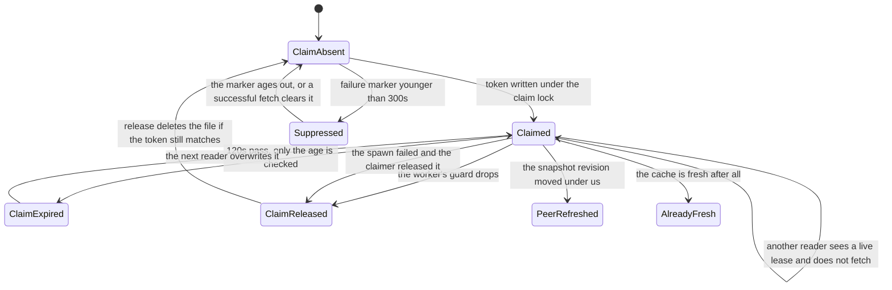

# Models state machines

The index of all machines is [state-machines/index.md](../../../.context/state-machines/index.md).
The per-harness probe caches are in [probes](../probes/.context/state-machines.md); the module's rules
are in [CONTEXT.md](CONTEXT.md).

## Model catalog snapshot and refresh claim

The on-disk catalog, its freshness and who may refresh it. It is the most stateful thing in the
resolve and models area. **One snapshot per user**, in the Mars cache root (`MARS_CACHE_DIR`), next
to the git cache: every project and every Mars build on the machine shares it, so the claim, the
cooldown and the revision are per machine. Each project still decides *when it asks* for a refresh
(`models_cache_ttl_hours`) and *what it reads* (`catalog_providers`, applied when the snapshot is
read; the snapshot itself holds every provider and the raw models.dev provider key).

| File (in the Mars cache root) | Holds | Written by |
|---|---|---|
| `models-catalog-v{SNAPSHOT_SCHEMA}.json` | the catalog, `fetched_at`, and a monotonic `revision` | `write_snapshot`, atomic |
| `.models-cache.lock` | nothing; the flock for read-modify-write | `refresh_with_fetcher` |
| `.models-cache.refresh-claim` | `{token, at}`: who is fetching, since when | `claim_refresh`, atomic |
| `.models-cache.refresh-claim.lock` | nothing; the flock for claim read, compare and delete | `refresh_claim_is_owned`, `release_refresh_claim` |
| `.models-cache.last-fail` | `{at, reason}`: the last failure, for the cooldown | `write_fetch_fail_marker`, atomic |

- **The schema version is in the file name.** A build that reads another version finds no file, as
  the probe cache does, so builds sharing a machine never rewrite each other's format. Bump
  `SNAPSHOT_SCHEMA` only when an older build could not read the new file.
- **A machine with no snapshot is seeded** from the project's old `.mars/models-cache.json`,
  marked stale (no `fetched_at`, revision 0) and never written back: it serves an offline first run
  and is replaced by the first successful refresh. Nothing writes the per-project file.
- **The worker is rootless** (`models __refresh-catalog` takes the TTL, revision and claim token
  only) and fetches every provider.

An instance of [a lease or lock](../../../.context/state-machines/lease-or-lock.md).

- **The lease is what makes a killed process survivable.** `REFRESH_CLAIM_LEASE_SECS` (120) is
  greater than `CATALOG_HTTP_DEADLINE_SECS` (60), asserted at compile time. A claim left by a kill
  blocks refreshes for at most 120 seconds and never needs recovery code. Changing either constant
  without the other reintroduces "a dead process holds the cache forever".
- **Ownership is checked by token, not by file existence** (`refresh_claim_is_owned`), so a worker
  that outlived its lease cannot delete its successor's claim. The worker rechecks before fetching
  (`run_worker`) and returns quietly when it lost.
- **`revision` is the anti-clobber guard.** A worker is spawned with the revision it saw; if the
  snapshot moved, `refresh_with_fetcher` returns `AlreadyFresh` without writing. Removing that
  check lets a slow worker overwrite a newer catalog, and the `checked_add(1)` keeps the counter
  monotonic.
- **An unreadable claim reads as absent.** `read_refresh_claim` returns `Ok(None)` on a parse
  failure. That is safe only because the file is written atomically.
- **The failure marker is best effort.** `write_fetch_fail_marker` logs and continues; a failed
  write means no cooldown and the next run fetches again.
- A cold cache in `Background` mode does not go background: `ensure` falls through to a foreground
  fetch, which is why the first `mars models` call blocks on the network.
- `RefreshOutcome` (6 variants) and `BackgroundRefresh` (4) describe one decision, "serve what we
  have, and say why the fetch did or did not happen". `Stale { refresh: SpawnFailed }` and
  `StaleFallback` are one outcome reached two ways, with two different warning sentences.
