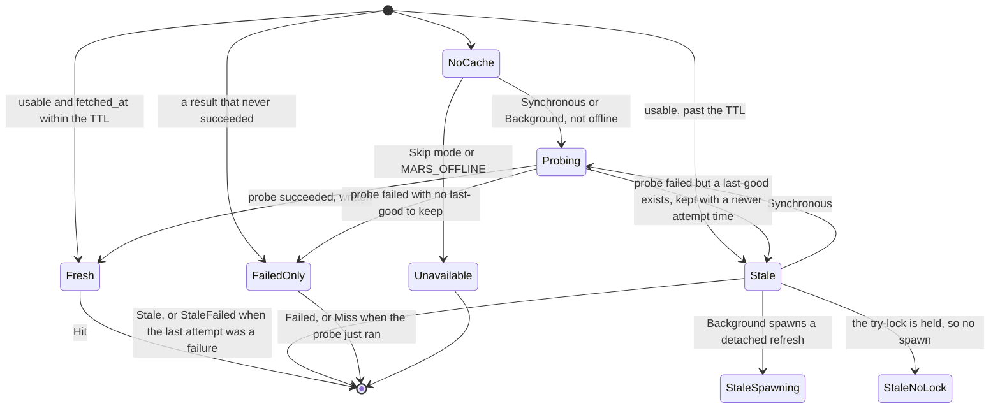

# Probe cache state machine

The index of all machines is [state-machines/index.md](../../../../.context/state-machines/index.md).
The module's rules are in [CONTEXT.md](CONTEXT.md).

## Probe cache

One harness's cached model listing: fresh, stale or failed. One machine in `cache.rs` serves
the four `CachedProbe` impls in `pi.rs`, `opencode.rs`, `cursor.rs` and `agy.rs`; the refresh decision is
`probe_refresh.rs`. The record is one JSON file per harness in the **global** cache,
`availability/{pi,cursor-probe,opencode-probe,antigravity-probe}.json`, each beside its own lock
(`.pi.lock`, `.cursor-probe.lock`, `.opencode-probe.lock`, `.antigravity-probe.lock`):

| Field | Meaning |
|---|---|
| `fetched_at` | when a *successful* listing was stored; `0` when the stored result is a failure |
| `last_attempt_at` | when any attempt finished, success or not |
| `last_error` | why the last attempt failed |
| `result: Option<...>` and `model_probe_success` | the last listing, successful or not |
| `schema_version` | a mismatch makes the whole file read as absent |
| `harness` | written for all four, not checked on read; kept because older builds read a `pi.json` without `harness: "pi"` as a miss |

Derived, never stored: usable (`result` present and successful), fresh (`fetched_at` within
`MARS_PROBE_CACHE_TTL_SECS`, default 60), and `latest_attempt_ok`
(`last_attempt_at <= fetched_at`).

An instance of [a lazy cache entry](../../../../.context/state-machines/lazy-cache-entry.md) and
of [a lease or lock](../../../../.context/state-machines/lease-or-lock.md).

- **A failed attempt never replaces a usable last-good listing.** Every write, foreground probe
  or `__refresh-probe` worker, goes through `persist_probe_attempt`. With a usable last good it
  keeps `fetched_at` and `result` and sets `last_attempt_at = max(now, fetched_at + 1)`, so the
  failure shows through `latest_attempt_ok` even within the same second as the last success. With
  none, it stores the failed result with `fetched_at: 0`.
- **The locks are best effort and taken differently.** The background trigger uses
  `FileLock::try_acquire` and skips. The synchronous path uses `acquire` and, when it cannot open
  the lock at all, returns stale evidence instead of writing. Removing that guard lets a probe
  overwrite the listing a background worker is writing.
- **Nothing is journaled.** Every write is an `atomic_write` of the whole record and the read is
  tolerant (`read_cache`), so a truncated file is a miss, not an error.
- `pi` also requires `error.is_none()` in `is_usable`; the other two check only
  `model_probe_success`. It is the one place the harnesses differ there.
- `CachedProbeOutcome<R>` (6 variants, one generic type) is a view, not a state: `cache_status` maps `Stale` and
  `StaleFailed` to the same `"stale"`, and `latest_attempt_ok` is recomputed from two timestamps.
