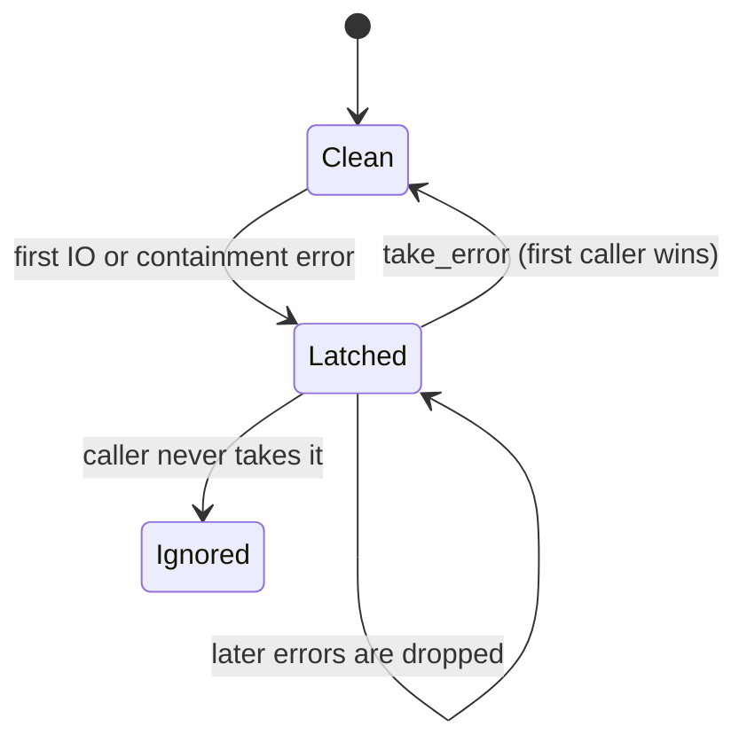

# Package preparation state machines

The index of all machines is [state-machines/index.md](../../../.context/state-machines/index.md).

## Latched read error

A failed read inside a `TreeSource` call, which has no error channel (the trait is shared with the
WASM build). `DiskTreeSource` holds `error: RefCell<Option<MarsError>>`. `latch` keeps the first
error and ignores later ones; `take_error` clears the slot. Any `path`, `confined` or read failure
latches, and the callers must call `take_error` right after preparation.

- **First error wins.** `latch` refuses to overwrite. Keeping the last one reports a follow-on
  failure instead of the containment violation.
- **`take_error` is destructive and unchecked.** A second caller gets `None`. The doc comment on
  `DiskTreeSource` states the rule and nothing enforces it; the two call sites in this module are
  the whole contract.
