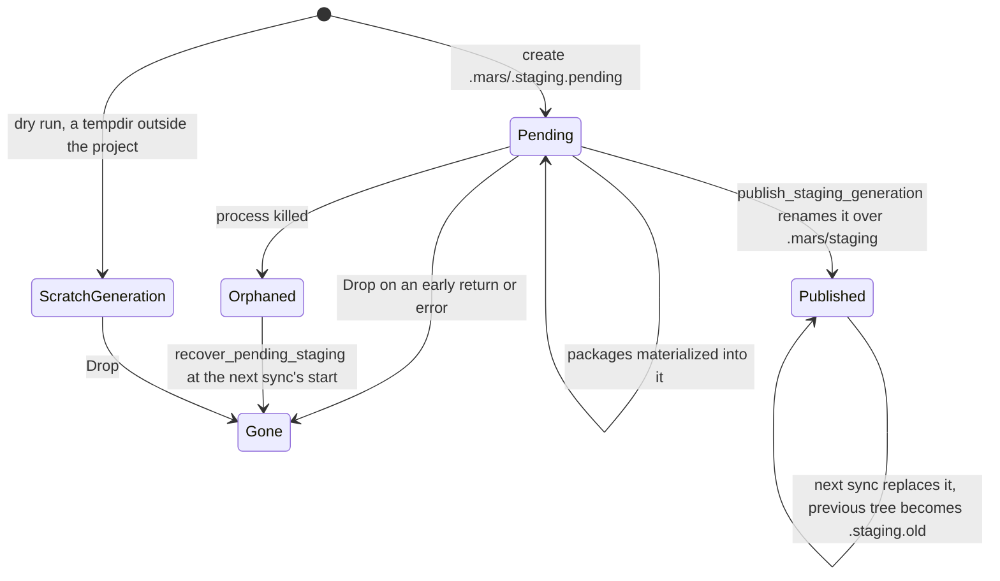

# Platform state machines

The index of all machines is [state-machines/index.md](../../../.context/state-machines/index.md).

## Staging generation

The projected package trees of one sync: scratch until the compiler's diagnostics pass, then
published by rename. `fs.rs` holds it: `PENDING_STAGING_GENERATION` (`.staging.pending`),
`PendingStagingGeneration` with `GenerationLocation::Project | Scratch`, the published path
`.mars/staging`, and `.mars/.staging.old`, which `replace_generated_dir` creates. `create` is the
non-dry-run constructor, `scratch` the dry-run one; `Drop` removes the pending tree;
`recover_pending_staging` deletes a leftover at the next sync's start (in `load_config`); the
compiler calls `publish_staging_generation` after `apply_plan`.

An instance of [an atomic replace](../../../.context/state-machines/atomic-replace.md) and of
[a marker a crash leaves](../../../.context/state-machines/crash-marker.md).

- **Dry runs get a tempdir, never the project path.** `resolve_graph` picks by
  `request.options.dry_run`, which keeps `mars sync --diff` from creating `.mars`.
- **The generation outlives `apply_plan`.** Apply copies out of it, and the later config-entry
  and native-agent stages read it through `package_root`, rebased onto the published path in
  `compile`. Publish happens only after the diagnostic gate and never in a dry run.
- **The name is reserved and single-owner.** `publish_staging_generation` refuses any source
  other than `.mars/.staging.pending`, so a caller cannot publish a tree another process still
  owns. The sync lock is what makes "another process" impossible.
- **Recovery is a delete, not a resume.** Reusing an existing `.staging.pending` instead of
  deleting it first inherits a half-built tree.
- **A kill between the two renames of `replace_generated_dir` leaves `.mars/staging` absent** and
  the old tree in `.staging.old`. The next sync deletes the leftover pending tree and the next
  publish deletes `.staging.old`; nothing restores the old tree. That is survivable only because
  nothing reads `.mars/staging` across runs: only the writer and the in-run rebase join that path.
  A reader that looks at it between runs would see it missing after such a kill.
- **Skill installs have their own stage marker.** `atomic_install_dir` copies into a `tempfile`
  directory named `.tmpXXXXXX` under `.mars/skills` and renames it.
  `recover_interrupted_skill_installs` sweeps exactly `.tmp` plus six alphanumerics
  (`is_tempfile_name`); a different tempfile naming convention silently stops the sweep, and
  widening the test to any dot-directory deletes installed skills.
- Which generation is current is not persisted. It is inferred from the directory names.
