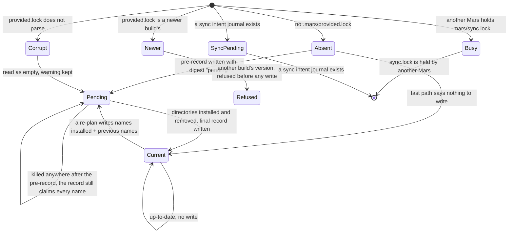

# Provided state machines

The index of all machines is [state-machines/index.md](../../../.context/state-machines/index.md).
What `mars provide` is for is in [CONTEXT.md](CONTEXT.md).

## Provided lock record

`.mars/provided.lock` records, per host, a version, a digest and the skill names that host
installed. `PENDING_DIGEST = "pending"` (`lock.rs`) is a durable staging marker inside that
record, and it is the whole crash-safety story. `Status` (`mod.rs`) is the outcome of one run and
is not a state.

An instance of [a marker a crash leaves](../../../.context/state-machines/crash-marker.md).

- **The pre-record covers planned and previously recorded names** (`reconcile.rs`). That makes a
  crash after a removal but before the final write safe: the next run still has authority to
  remove a name the host dropped meanwhile.
- **"pending" can never be mistaken for current**, because no computed digest equals it
  (`matches_source`). Hashing to a value that could be `"pending"`, or writing the final digest
  first, turns a crash into a stuck record with no way to tell "done" from "half done".
- **Corrupt is recoverable, newer is not** (`Unusable::for_write`). Adoption against the files on
  disk recovers ownership a corrupt record lost; overwriting a newer build's record loses its
  state.
- **Names are validated on read.** One path component, and the `<skill>__<provider>` suffix must
  match the provider, so a corrupt or hostile record cannot point a removal outside
  `.mars/skills`.
- **Two write paths, one lock.** The unlocked fast path is read-only and only ever says "nothing
  to do"; every write happens under `.mars/sync.lock`. Both passes call the same `assess` and
  `plan`, which keeps `up-to-date` from meaning something different from what a write would do.
- The sync intent journal (`.mars/pending-canonical.json`) and the `pending` digest are two ways of
  saying "a writer died partway": a file, and a value inside the record.
