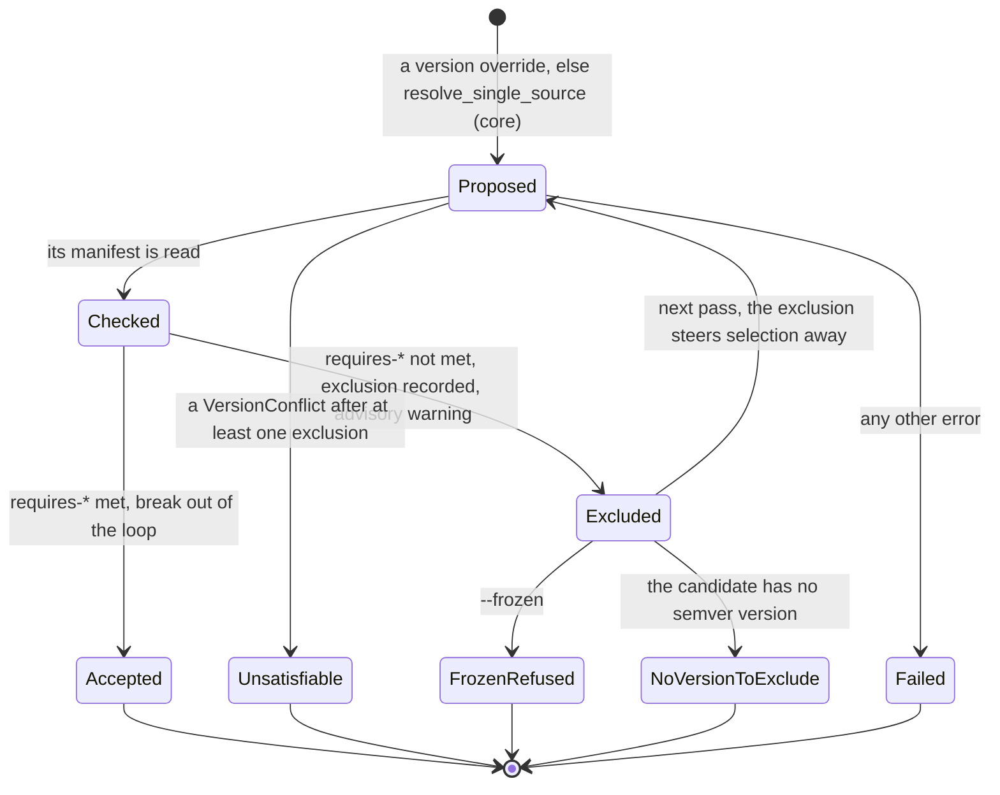
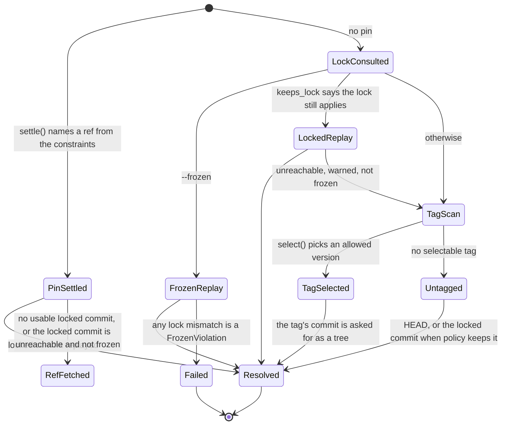

# Resolve state machines

Resolution turns a package request into a source at a version and a commit, with a documented
order of attempts. The machines are in `mars_schema::resolve` (`package.rs` the walk, `version.rs`
the ladder, `plugin.rs` the marketplace root), which asks an `Answers` for tags, refs and trees and
never fetches; this crate's `CliAnswers` answers each lookup when it is asked and memoizes it. All
three machines are in memory: a killed resolve leaves the locks and caches untouched, and
`mars.lock` is written later. The index of all machines is
[state-machines/index.md](../../../.context/state-machines/index.md). The pure choice among tags
is in the [schema crate](../../../crates/mars-schema/.context/state-machines.md).

## Package resolution

One source within one resolve pass, and the pass that restarts. A name is `Resolving` from the
moment it starts (`Pass::started`) until it is in the registry, which happens before its own
subtree is walked; a name in the registry is `Resolved` for every later request, a cycle's
included. A restart builds a fresh `Pass`, so the registry, the id index, the constraints and the
notes all go; only `Run`'s `overrides`, `history` and `exclusions` survive into the next pass.
`overrides` and `exclusions` are keyed by `SourceId`: a choice or an engine exclusion made for one
source says nothing about another source that a later pass gives the same name. A `Chosen` override
carries the notes its choice reported (a stale lock row, an engine fallback), because the next
pass reuses the choice without choosing again and a diagnostic belongs to the graph it describes;
it is reused only while it meets every constraint on the name (`reusable_choice`), else dropped.

```mermaid
stateDiagram-v2
  [*] --> Unstarted: a Dependency names the source
  Unstarted --> Resolving: not in the map, mark it before the engine loop
  Resolving --> Resolving: reached again while waiting on an answer, returns
  Resolved --> Resolved: reached again, by a sibling or a cycle; the resolved ref already satisfies the constraint
  Resolved --> Restart: reached again and a different ref wins
  Resolved --> Failed: reached again and no version meets every constraint
  Resolving --> Resolved: registered, then its manifest dependencies are resolved
  Restart --> Unstarted: the pass is thrown away and rebuilt with the new override
  Restart --> Oscillation: the same ref comes back for this source
  Unstarted --> Failed: any error
  Resolving --> Failed: any error
  Resolved --> [*]
  Failed --> [*]
  Oscillation --> [*]
```

- **Anything that must survive a restart goes through `overrides`, `history` or `exclusions`.**
  Everything else is rebuilt.
- **A cycle is a request like any other.** A package re-reached while its subtree is walked is
  already registered, so `recheck` holds it to the new constraint: a version that does not meet it
  restarts or fails as a conflict. Only a name still waiting on an answer returns without a check
  (nothing is registered to check against). Resolving a registered name again recurses forever on
  a dependency cycle.
- **The restart is the only way a chosen version changes mid-run.** It is requested with
  `Stop::Restart` after the new `Chosen` is stored in `pass.restart`; the outer loop takes it
  out and fixes it in `overrides`. A restart wanted after an open need ends the pass instead
  (`Stop::EndPass`), because the open answers may change the graph.
- **Only work before the first open need may fail.** `fail` turns into `Stop::Skip` once an
  answer is open, so a failure on a branch a later restart would drop is never reported; a `Skip`
  ends only its own branch.
- **Oscillation is checked per source by exact ref equality** (`version`, `commit`, `origin`). Only
  the source that restarted is checked, so two sources trading refs are not caught.
- **Wrong edits**: removing the `Resolved` early return re-resolves every resolved source once per
  request, and `mars add` fetches the same repository N times. Removing its constraint check
  turns a needed restart into a silently stale version. Comparing refs by commit alone in
  `same_resolved_ref` misses a tag move at the same commit.
- `recheck` only judges a git source; a path source re-entered after registration returns `Ok(())`.

## Engine-requirement fallback

`requires-mars` and `requires-meridian` in a candidate's `package` table: a candidate whose
requirements the running binaries do not meet is refused and the next candidate is tried. The
state is the exclusion map, keyed `(SourceId, version)` and kept on `Run` across passes. `mars upgrade`'s scan uses the same mechanism with a local set
(`upgrade.rs`).

An instance of [an ordered fallback walk](../../../.context/state-machines/fallback-walk.md).

- **The exclusions outlive the pass**, so a version refused in one pass is not re-fetched in the
  next.
- **`Accepted` after a refusal is sticky.** `ctx.set_version_override` stores it, so a restart
  reuses that exact ref instead of re-deriving it.
- **An `expect` asserts that an unsatisfiable-selection error always has an excluded candidate
  left that satisfies the current constraints.** `engine_unsatisfiable_error` returns `None` when
  every exclusion for the source fails some constraint collected so far. A diamond that adds a
  tighter constraint after a version was excluded therefore panics instead of reporting a version
  conflict. This is the one place where a resolution failure becomes a panic.
- **The scan is bounded by versions, not by count.** Each pass excludes one version, so the loop
  ends when `select` returns none. Nothing caps the number of fetches except the size of the tag
  list.
- Each refusal emits `requires-mars-fallback` (advisory), `requires-mars-lock-fallback` when the
  locked version was the refused one, and nothing else: the `EngineFallback` records are built after the last pass from the
  exclusion map, for the packages the final graph kept, newest skipped version first.

## Source version and commit

One call to `resolve_single_source` (`version.rs`) walks a fixed ladder; the state is which rung
answered. The plugin variant (`plugin.rs`) has the same ladder one level in: `Sha`, then the
replayed content commit, then `ref` or HEAD, with `--frozen` insisting on the replay.

An instance of [an ordered fallback walk](../../../.context/state-machines/fallback-walk.md).

- **A fallback is a warning, not a failure, except under `--frozen`**, where every fallback rung
  is an error. Codes: `locked-commit-unreachable`, `locked-ref-selector-mismatch`,
  `stale-lock-source-identity`, and `potential-version-drift` (settled graph only: the core adds it after the last pass).
- **Only `Missing` drops a lock.** `CliAnswers` answers a tree `Missing` when the fetches succeeded
  and `git rev-parse --verify --quiet <commit>^{commit}` finds no such commit in the clone (the
  one exit, 1 with no output, git gives for an absent object); an export that fails on a commit
  that is there (a smudge filter, a full disk) is `Failed`, like every other error, a network or auth failure included, is `Failed` and stops the run.
  Mapping every git error to "unreachable" re-resolved to a new commit on a network blip, which is
  how a sync silently moved a package forward. A failure returns the `MarsError` the answer
  stored, so the text and exit code are the fetch's own.
- **`locked_commit_unreachable` is in memory only.** It stops the second replay attempt in the same
  call; nothing remembers it across runs.
- Four blocks do "try the locked thing, fall back, warn" with the same shape and the same warning
  text (the ref pin, the tag ladder and the untagged case in `version.rs`, and one in `plugin.rs`). They differ
  in whether the warning is advisory (`warn` or `warn_advisory`).
