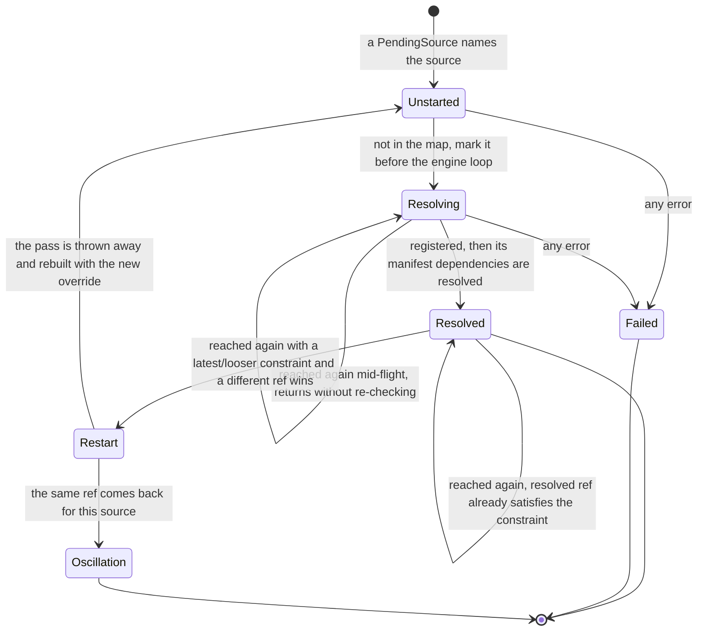
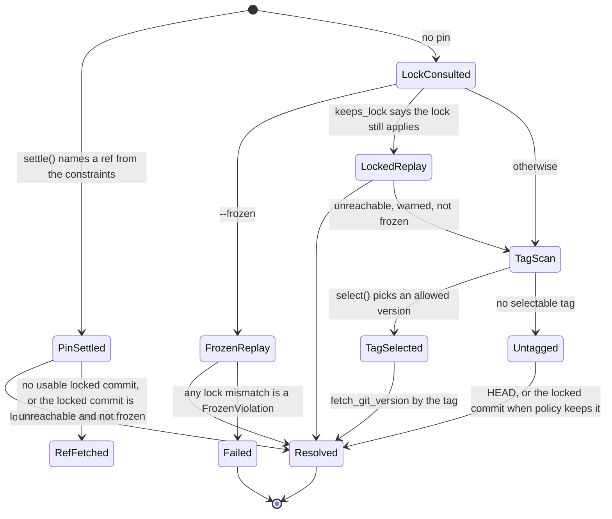

# Resolve state machines

Resolution turns a package request into a source at a version and a commit, with a documented
order of attempts. All three machines here are in memory: a killed resolve leaves the locks and
caches untouched, and `mars.lock` is written later. The index of all machines is
[state-machines/index.md](../../../.context/state-machines/index.md). The pure choice among tags
is in the [schema crate](../../../crates/mars-schema/.context/state-machines.md).

## Package resolution

One source within one resolve pass, and the pass that restarts. `PackageResolutionState`
(`package.rs`) is `Resolving` while the source's own subtree is walked and `Resolved` once it is in
the registry; the absence of an entry is the third state, `Unstarted`. A restart builds a fresh
`ResolverContext` (`mod.rs`), so `package_states`, the registry, the id index and the constraints
all go; only `version_overrides`, `restart_history` and `exclusions` survive into the next pass.

- **Anything that must survive a restart goes through `version_overrides`, `restart_history` or
  `exclusions`.** Everything else is rebuilt.
- **`Resolving` is a cycle break, not an error.** A package re-reached while in flight returns
  `Ok(())` with nothing registered yet; its constraint was already recorded. Making that branch
  resolve again recurses forever on a dependency cycle.
- **The restart is the only way a chosen version changes mid-run.** It is requested by returning
  `MarsError::ResolutionRestartNeeded { package }` after storing the new ref, its rooted tree and
  its hook surface in `ctx.pending_restart`. The outer loop takes both out together and fails
  with "missing pending restart payload" if only one is set.
- **Oscillation is checked per source by exact ref equality** (`version`, `version_tag`, `commit`,
  `tree_path`). Only the source that restarted is checked, so two sources trading refs are not
  caught.
- **Wrong edits**: removing the `Resolved` early return re-resolves every resolved source once per
  request, and `mars add` fetches the same repository N times. Removing its constraint check
  turns a needed restart into a silently stale version. Comparing refs by commit alone in
  `same_resolved_ref` misses a tag move at the same commit.
- `Resolved` is consulted only for `SourceSpec::Git`; a path source re-entered after registration
  goes through the `needs_check == false` path and returns `Ok(())` anyway.

## Engine-requirement fallback

`requires-mars` and `requires-meridian` in a candidate's `package` table: a candidate whose
requirements the running binaries do not meet is refused and the next candidate is tried. The
state is the exclusion set, `EngineExclusions`, keyed `(source, version)` and threaded through
every recursive call. `mars upgrade`'s scan uses the same mechanism with a local set
(`upgrade.rs`).

An instance of [an ordered fallback walk](../../../.context/state-machines/fallback-walk.md).

- **The exclusions outlive the pass**, so a version refused in one pass is not re-fetched in the
  next.
- **`Accepted` after a refusal is sticky.** `ctx.set_version_override` stores it, so a restart
  reuses that exact ref instead of re-deriving it.
- **An `expect` asserts that an unsatisfiable-selection error always has an excluded candidate
  left that satisfies the current constraints.** `engine_unsatisfiable_error` returns `None` when
  every exclusion for the source fails some constraint collected so far. A diamond that adds a
  tighter constraint after a version was excluded therefore panics instead of reporting a version
  conflict. This is the one place where a resolution failure becomes a panic.
- **The scan is bounded by versions, not by count.** Each pass excludes one version, so the loop
  ends when `select` returns none. Nothing caps the number of fetches except the size of the tag
  list.
- Each refusal emits `requires-mars-fallback` (advisory), `requires-mars-lock-fallback` when the
  locked version was the refused one, and one `EngineFallback` record for the resolver to
  reconcile. `rejected` duplicates the exclusion map to rebuild the same failures for
  diagnostics.

## Source version and commit

One call to `resolve_single_source` (`version.rs`) walks a fixed ladder; the state is which rung
answered. The plugin variant (`plugin.rs`) has the same ladder one level in: `Sha`, then the
replayed content commit, then `ref` or HEAD, with `--frozen` insisting on the replay.

An instance of [an ordered fallback walk](../../../.context/state-machines/fallback-walk.md).

- **A fallback is a warning, not a failure, except under `--frozen`**, where every fallback rung
  is an error. Codes: `locked-commit-unreachable`, `locked-ref-selector-mismatch`,
  `stale-lock-source-identity`, and `potential-version-drift` (settled graph only).
- **`LockedCommitUnreachable` means "git or HTTP said no", not "the commit is gone".** In
  `source/git.rs`, `fetch_commit` maps any `GitCli` error to it, and a 404 on the archive does
  too. A network outage therefore reads as an unreachable lock and re-resolves to a
  new commit, which is how a sync silently moves a package forward.
- **`locked_commit_unreachable` is in memory only.** It stops the second replay attempt in the same
  call; nothing remembers it across runs.
- Four blocks do "try the locked thing, fall back, warn" with the same shape and the same warning
  text (the ref pin, the tag ladder and the untagged case in `version.rs`, and one in `plugin.rs`). They differ
  in whether the warning is advisory (`warn` or `warn_advisory`).
