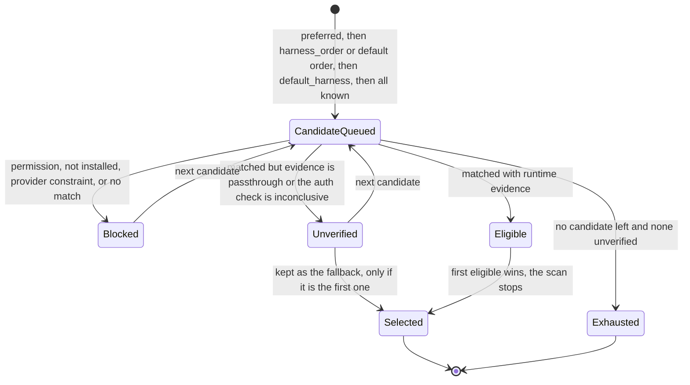

# Routing state machines

The index of all machines is [state-machines/index.md](../../../.context/state-machines/index.md).
The evaluator's rules are in [CONTEXT.md](CONTEXT.md).

## Harness routing scan

Which harness candidate the evaluator has accepted for one model (`mod.rs`, `acceptance.rs`). The
state is per candidate, derived on demand from four fields (`installed`, `skip_reason`, `auth`,
`match_evidence`), and the scan is the machine around it. The candidate order is the preferred
harness, then `harness_order` or the default order, then `default_harness`, then all known.

An instance of [an ordered fallback walk](../../../.context/state-machines/fallback-walk.md).

- **Order is preference, never permission.** The candidate list is built from four sources and
  deduped by name, first mention winning, so a harness named both on the command line and in
  `harness_order` keeps the CLI's `RouteSource`.
- **`Eligibility` is computed, not stored.** Four fields must agree and the rules are in one
  function, but `accept_assessment`, `from_routing_trace` and `listing_issues` each rebuild a
  verdict from the same fields, so the rules can drift.
- **Exhaustion is an empty string, not a state.** On failure `trace.harness` is left `""`, and
  `exhaustion_reason` is set only in the constrained case. Consumers (`cli/models.rs`,
  `build/policy/harness.rs`) detect exhaustion with `is_empty()`, and `accept_route` on such a
  trace reports `HarnessNotInstalled { harness: "" }`, which is a misleading reason for "no harness
  matched".
- **The unverified fallback is a separate outcome that no consumer distinguishes.** The trace
  looks selected, `selected_by_preference` is false, and `match_evidence` came from the fallback.
  `accept_route` then accepts or rejects by `MatchPolicy`, so the same "unknown" trace is accepted
  by one caller and rejected by another.
- **`preferred_supported` short-circuits the scan** only for a preference that did not come from
  `--harness` (source is not `RouteSource::Cli`) and only when the auth check did not fail. A
  CLI-named harness is never selected by preference; it wins only by being first eligible.
