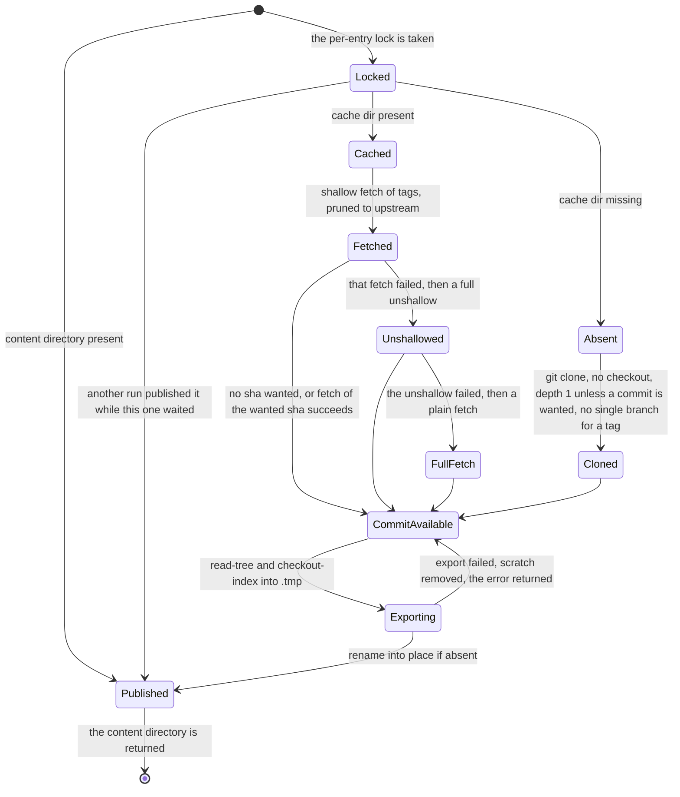
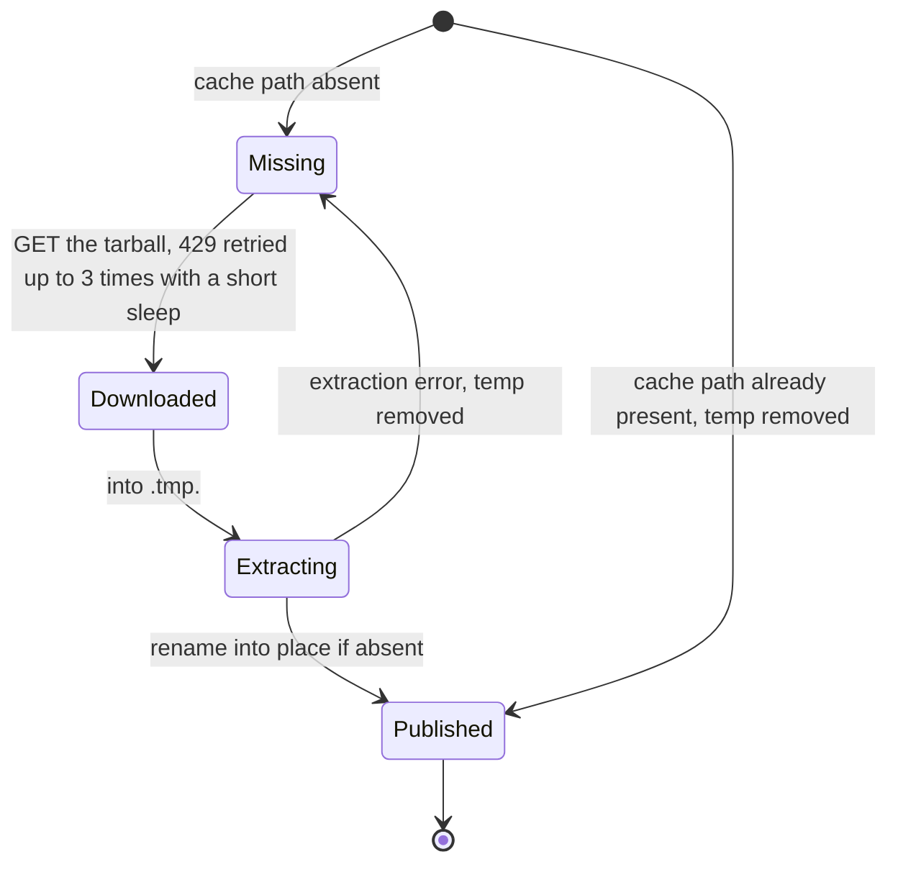

# Source cache state machines

Package sources are cached under the global cache (`~/.cache/mars/cache`, or `MARS_CACHE_DIR`).
In both machines a cache directory is the state: its presence decides what happens next. The index
of all machines is [state-machines/index.md](../../../.context/state-machines/index.md).

## Git cache entry

A repository in the global cache, cloned and fetched (`git_cli.rs`), and the content directory
exported from it for one commit. The clone under `git/` holds objects and is never read as a
working tree; each commit's files go to their own directory under `archives/` (`<url>@<commit>`,
the same place a GitHub tarball goes), so a later fetch of another commit cannot change what an
earlier one returned. A per-entry lock is taken first, after a check that the content directory is
already there. The lock file is `cache_path.with_extension("lock")`, which swaps the text after the
last `.` in the entry name, so entries on one host (`github.com_...`) can share one lock. It still
serializes correctly; it costs concurrency, not correctness, and a slow clone of one GitHub
package blocks every other GitHub fetch in the same process tree.

An instance of [a lazy cache entry](../../../.context/state-machines/lazy-cache-entry.md) and of
[a lease or lock](../../../.context/state-machines/lease-or-lock.md).

- **The clone's presence is treated as validity.** A process killed in the middle of `git clone`
  leaves a directory that the next run reads as `was_cached` and fetches into. Usually git repairs
  it; nothing detects the case where it does not, and nothing but a human deleting
  `~/.cache/mars/cache/git/<entry>` recovers it. There is no marker for a completed clone. The
  content directory has no such problem: it appears by one rename.
- **The scratch directory is named by the entry, not the process.** `<key>.tmp` is safe to reuse
  because the lock is held for the whole export; a run killed mid-export leaves one directory that
  the next run for that commit clears.
- **Nothing reads the clone's working tree or its index.** `read-tree` rewrites the index on every
  export. Reading files out of `git/<entry>` instead of the content directory brings back the bug
  where two dependencies on one repository at different versions installed one version's files.
- **`not_an_option` guards every URL, tag and sha.** Removing a call lets a dependency run a
  command through `--upload-pack`.

## Archive cache entry

A GitHub tarball in the global cache: absent, half-extracted or published (`archive.rs`). Used for
`https://github.com/...` sources, so one source can reach either this machine or the git one,
depending on the URL form. The bytes come from `https://github.com/<owner>/<repo>/archive/<sha>.tar.gz`;
a 404 for a locked commit becomes `LockedCommitUnreachable` in `git.rs`, which feeds the
[source version ladder](../../resolve/.context/state-machines.md).

An instance of [a lazy cache entry](../../../.context/state-machines/lazy-cache-entry.md) and of
[an atomic replace](../../../.context/state-machines/atomic-replace.md).

- **The temp directory is keyed by process id and never swept.** `<key>.tmp.<pid>` is removed on
  error and on a publish collision, but a kill between extraction and publish leaves it for good:
  a later run has a different pid and never looks. Nothing walks `archives/`.
- **Publish is "if absent", not "replace".** A second process that lost the race drops its copy
  and uses the winner's (`CachePublishResult` in `platform/fs.rs`).
