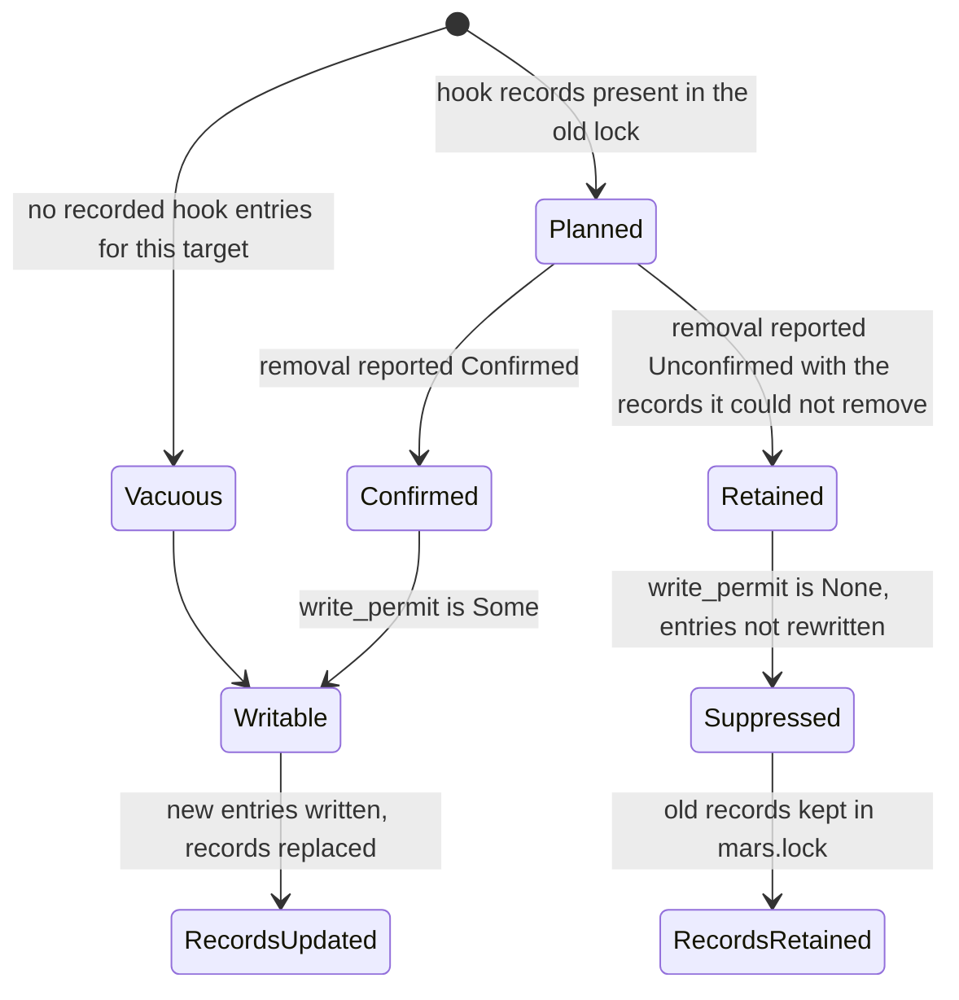

# Surface ownership state machines

The index of all machines is [state-machines/index.md](../../../.context/state-machines/index.md).
What the module decides is in [CONTEXT.md](CONTEXT.md).

## Hook-entry removal

A target's recorded hook entries during the config-entry phase. They are removed whole before
being rewritten, so the removal result decides whether the write may happen at all.
`RemovalPlan::build` and `execute` (`retention.rs`) run the removal; the closure that does it
lives in `compiler/config_entries`. `RemovalReport::Confirmed | Unconfirmed { message, retained }`
folds into the private `RemovalOutcome`, and `RetentionPlan::write_permit` turns that into
`Some(WritePermit)` or `None`. `into_retained_records` returns the records a failed target keeps.

- **A permit is a single-use token bound to one target.** `WritePermit::bind_hooks` and
  `bind_file_hooks` derive the mutation path from the permit, so a caller cannot point the write
  at another target.
- **Unconfirmed removal must suppress the write, not just warn.** The old entries are already gone
  from the file, and rewriting would create entries the lock does not own.
- **Only a confirmed target reports stale keys removed.** Otherwise a failed target loses its
  retry authority.
- **The closure's failure must carry the whole `prior_records` map back.** `into_retained_records`
  re-inserts it into the lock.
