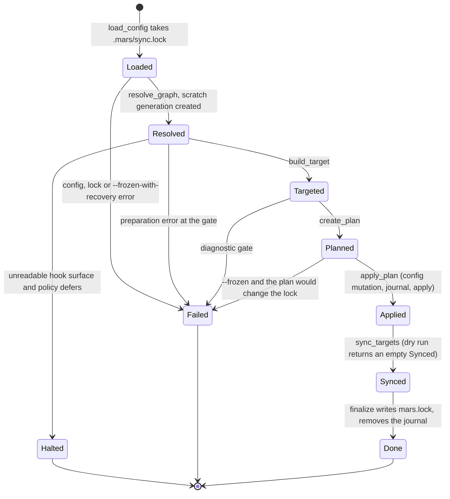
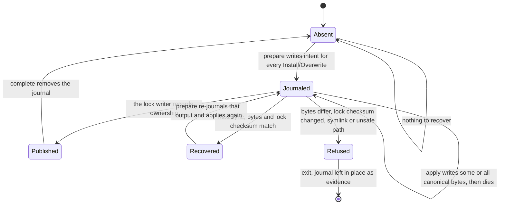
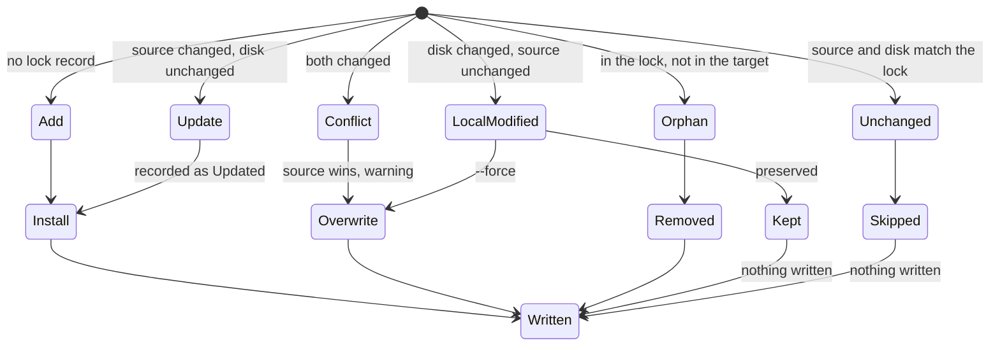
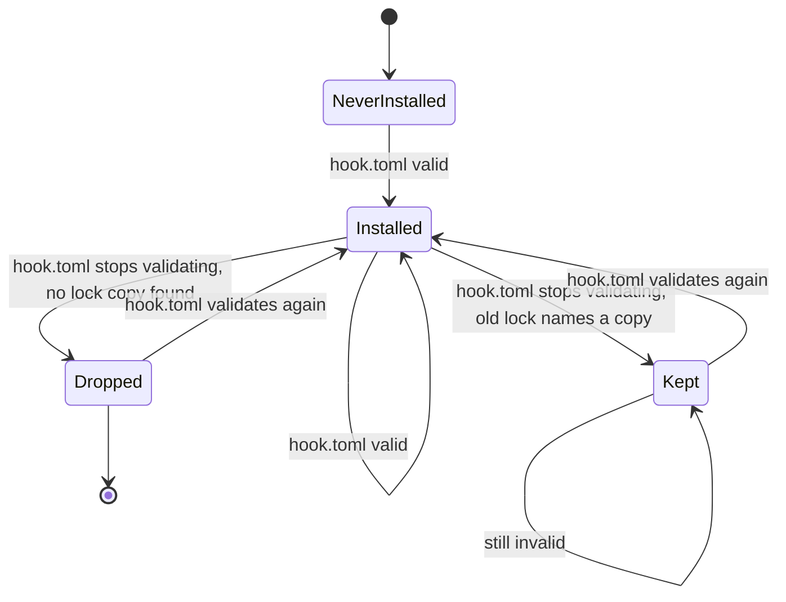
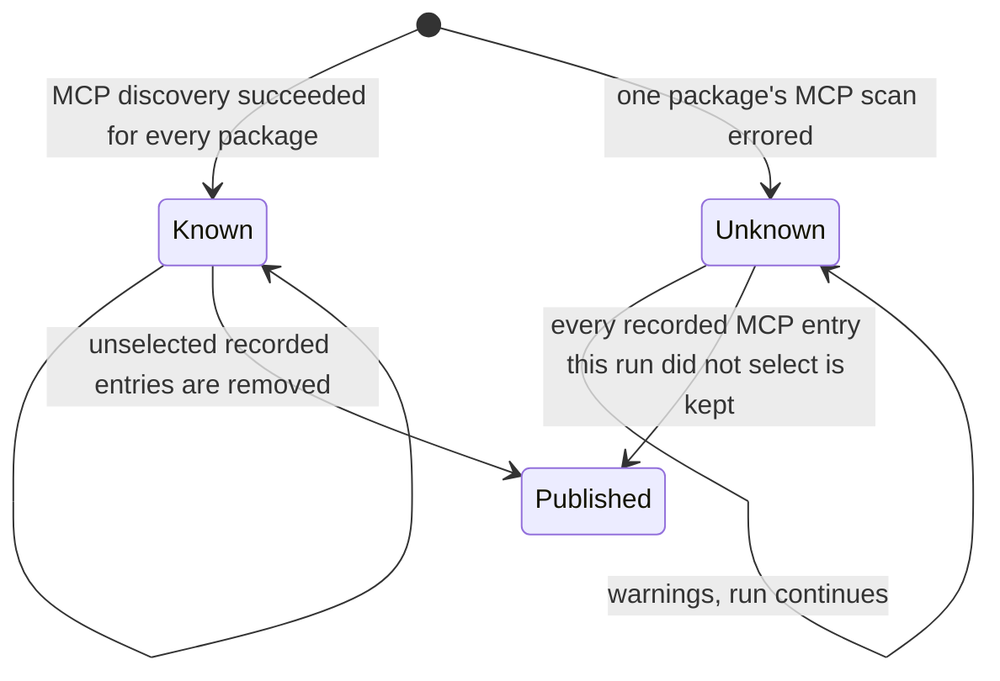

# Sync state machines

One `mars sync` is one durable transaction: resolve and stage a package tree, diff it against
the lock and the disk, write the canonical store, copy to the targets, publish ownership to
`mars.lock`. Mars can be killed at any instant of it. These machines are the state of that
transaction and of what a kill leaves behind. The index of all machines is
[state-machines/index.md](../../../.context/state-machines/index.md); the phases are described in
[sync-pipeline.md](../../../docs/internals/sync-pipeline.md).

## Sync pipeline phases

One `mars sync`-family command, from config load to the written lock. The states are Rust types,
not a field: each phase consumes the previous struct by value, so "which phase am I in" is the
type of the value in hand. `LoadedConfig`, `ResolvedState`, `TargetedState`, `PlannedState`,
`AppliedState` and `SyncedState` are in `mod.rs`, moved by `load_config`, `resolve_graph`,
`build_target`, `create_plan`, `check_frozen_gate`, `apply_plan` and `sync_targets`. `compile` in
`src/compiler/mod.rs` wires the chain, and `finalize` finishes it. The diagnostic gates run
after `build_target` and after the hook and MCP preflight, before any write.

- **Every phase before `apply_plan` is read-only.** The only writes before the gates are
  `.mars/sync.lock`, removing a leftover `.staging.pending`, and removing skill temp
  directories (`.mars/skills/.tmpXXXXXX`), all in `load_config`. A write in `build_target` or
  `create_plan` breaks "resolve first, then act".
- **The dry-run branch is a mode on each phase, not a separate pipeline.** It uses scratch
  staging in `resolve_graph`, `dry_run_action` instead of `execute_action`, no
  `recovery::prepare`, no staging publish, and no lock write or `recovery::complete` in
  `finalize`. A new write phase that forgets the flag writes in `mars sync --diff`.
- **`apply_plan`'s order is load-bearing**: validate every destination, persist the user's config
  mutation, journal canonical writes, write bytes. The config mutation is persisted first on
  purpose and is never rolled back.
- **The lock is held for the whole pipeline** by a keepalive field, so a second Mars blocks at
  `load_config` rather than interleaving.
- **`sync_targets` is non-fatal by design.** `finalize` writes the lock whatever the targets did.
- **Partial apply is real.** `apply::execute` returns at the first failing action, so later
  actions never run and earlier ones stay on disk with the old lock. The write journal exists to
  describe that half-applied world.
- Nothing about the phase is persisted. The on-disk evidence is `.mars/sync.lock`,
  `.mars/.staging.pending`, `.mars/pending-canonical.json`, the written outputs and
  `mars.lock`; a crash leaves whichever of those had happened.

## Canonical write journal

A canonical write that may have happened but is not in `mars.lock` yet:
`.mars/pending-canonical.json`. The state is the file's existence and contents. `WriteIntent`
holds `version`, `lock_checksum`, and `outputs` mapping each destination to one or two
`PendingWrite`s (decoded from `LockedItemV2`, accepting only a single canonical `Installed`
output). `prepare` writes or extends it, `recover` reads it and folds matches into `old_lock`
in memory (in `load_config`), `complete` deletes it (in `finalize`). All are in `recovery.rs`.

An instance of [a marker a crash leaves](../../../.context/state-machines/crash-marker.md).

- **Journal before bytes, ownership before journal removal.** Swap either and a kill leaves an
  unowned installed file or a lost claim. `finalize` removes the journal after the lock write.
- **Recovery fails closed.** A mismatched checksum, a changed `mars.lock` (`lock_checksum`), a
  symlink anywhere on the path (`output_exists`) or a non-regular entry are errors, not "no
  output". The error text tells the user to relocate the conflicting file.
- **Published ownership wins over stale intent**: `index.contains_installed_output` skips the
  entry. Without that, the run that already wrote the lock is read as unfinished.
- **`--force` adoption is not journaled.** A path that already existed and is not in the journal
  is skipped, because its bytes were not written by this transaction. After a failed apply it needs
  `--force` again.
- **`--frozen` refuses to proceed when recovery found something**, because publishing would
  change the lock.
- Only canonical `.mars/` outputs are journaled. Native target outputs and config entries are
  not, so an interrupted target copy has no recovery.
- The journal is JSON with `deny_unknown_fields` and `version: 1`, re-encoded from
  `LockedItemV2` so the encoding stays compatible while multi-output records are rejected.
  `recover` takes the version whose bytes are on disk (`versions.iter().rev().find`).

## Per-path classification

One destination path inside a single sync. Three enums describe the same outcomes, each rebuilt
a phase later: `DiffEntry` (`diff.rs`, from `compute`), `PlannedAction` (`plan.rs`, from
`create`) and `ActionTaken` (`apply.rs`, from `execute_action` and `dry_run_action`). The diagram
shows the outcome each entry leads to.

- **`--force` is a baseline change, not an extra overwrite.** `expected_disk_checksum` becomes
  `source_checksum`, so an edited file reads as "local changed" and is overwritten rather than
  merged. Changing that silently discards or resurrects user edits.
- **An identical-bytes `Update` still happens when the source changed.** Bytes can match while
  ownership moves to another source; skipping it drops the claim.
- **`Conflict` is not a merge.** Source wins with a `conflict-overwrite` warning, and nothing
  reads the conflicting local bytes.
- **A `Kept` hook directory must not be an `Orphan`.** The kept set excludes those paths from the
  orphan sweep, so an invalid dependency hook keeps its install.
- In a dry run `installed_checksum` is `None` ("Can't know without actually installing"), so
  anything that later trusts a dry run's checksum trusts nothing.

## Invalid dependency hook

One dependency hook across syncs, when its `hook.toml` stops validating. It is spread over the
lock (`source_path`), `TargetState.kept_hooks` and the diff. `KeptHook` (`kept_hooks.rs`) is
decided in `settle` from the `InvalidDependencyHook` the target builder raises, and
`record_hook_source_paths` in `finalize` stamps `source_path` every sync.

- **A kept hook's directories are never copied from the invalid source.** Only the lock's record
  is retained. Copying source bytes would install a hook whose config Mars refused.
- **`source_path` in the lock is the identity, not the name.** A `hook.toml` that stops reading no
  longer says its name. A lock written before the field existed falls back to the names the file
  declares.
- Kept directories become `DiffEntry::Unchanged` and their entries survive the config-entry phase.
- The project's own hooks are strict (an error); dependencies keep. That asymmetry lives in the
  [config-entry phase](../../compiler/.context/state-machines.md).

## MCP scan failed

Whether the MCP servers of a dependency are known this run: one bool,
`TargetState::mcp_scan_failed`, set to true when a package's MCP discovery errors, read by
`compiler/config_entries`. It goes false to true once and never back, and nothing persists it.

- **`Unknown` must be read as "keep", not "nothing selected".** The config-entry phase re-inserts
  every recorded `mcp:` entry from the old lock that the run did not render. Without it, one
  unreadable package deletes servers other packages installed.
- The bool is run state, so it can never justify a durable claim; it only suppresses removal for
  this run.
