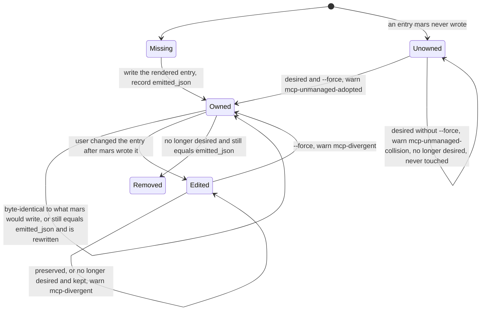
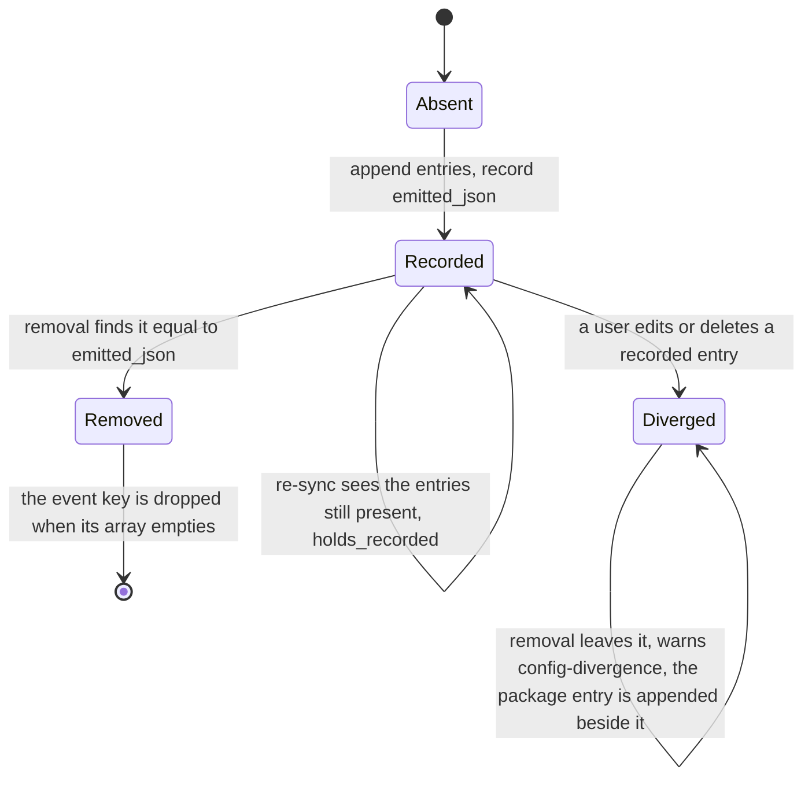
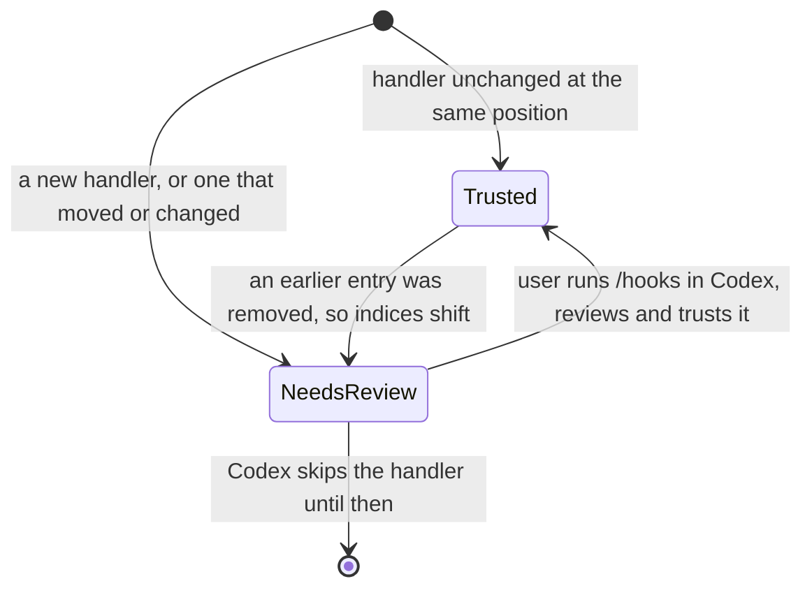

# Target config-file state machines

Mars shares MCP and hook config files with the user, so what Mars may change is decided entry by
entry against what the lock recorded. These machines are those entries. The compiler's per-target
pass that drives them is in [config entries](../../compiler/.context/state-machines.md). The
index of all machines is [state-machines/index.md](../../../.context/state-machines/index.md).

## MCP server entry

One entry in a target's MCP config file (`.mcp.json`, `.codex/config.toml`, `.cursor/mcp.json`
and others), and whether Mars may overwrite or remove it. Ownership is the comparison of the entry
on disk with the JSON Mars recorded when it wrote it (`ownership` in `mcp_file.rs`).
`try_reconcile` runs the whole file: the removal pass removes only `Ownership::Owned` entries,
and the write pass has a four-way decision and keeps the previous record when it does not write,
so a preserved entry keeps its claim. A failed scan keeps every prior record.

An instance of [an ownership record](../../../.context/state-machines/ownership-record.md).

- **The file is deleted only if this reconcile changed it and left it empty.** An untouched empty
  file may be the user's.
- **The file write is atomic through symlinks with permissions preserved** (`Doc::save`,
  `write_through` in `config_doc.rs`). The lock records are written afterwards, by the caller. If
  the file write fails, `reconcile` returns the previous records and `changed: false`, so the next
  sync retries instead of orphaning entries.
- A file that will not parse keeps every prior record and reports one warning; the machine has
  no "unreadable" state of its own and borrows `kept`.
- Persisted: `ConfigEntryRecord.emitted_json` per `mcp:<name>` key. In memory: `prior`, `kept`,
  `changed`.

## Hook entry

One entry in a hook config file (the `hooks` object of `.claude/settings.local.json`,
`.codex/hooks.json`, `.cursor/hooks.json` or the plugin tree). Hooks are unkeyed array elements,
so ownership is content equality against the recorded array, and writing is remove-then-append
instead of keyed replace. Defined by `load`, `write`, `replace`, `holds_recorded` and `remove_recorded` in
`hook_file.rs`; the single-use removal that reports what it could not confirm is in
[hook-entry removal](../../surface_ownership/.context/state-machines.md).

An instance of [an ownership record](../../../.context/state-machines/ownership-record.md).

- **Divergence is per entry, but reported per hook.** `remove_entries` removes each expected entry
  still present and returns `(removed, missing)`; `missing > 0` gives one `config-divergence`
  warning for the whole hook, and nothing marks which entry was lost.
- **Remove-then-append is one load and one save.** `replace` strips the recorded entries and
  appends on one document. A kill leaves the old file or the new one; nothing else writes the
  file between the load and the save. A removal alone (`remove_recorded`, for `mars unlink`)
  saves only when something went, so otherwise the file's mtime is untouched.
- **No entry is adopted by content.** `write` and `replace` append every entry, even one the file
  already holds: equal bytes do not prove Mars wrote them, and a later removal would delete a
  user's entry. A sync killed after the save and before `mars.lock` therefore appends a
  duplicate on retry. Known gap; the config-entry journal closes it.
- **A malformed file is never overwritten.** `load` validates the shape and refuses anything but
  `hooks: {event: [...]}`.
- Persisted: `ConfigEntryRecord.emitted_json` per `hook:<event>:<name>`.

## Codex hook trust

Whether Codex will run a hook handler. Codex gates every handler on its own trust review, keyed by
position `(event, matcher group, handler index)` and content. Mars owns no trust state and only
infers "this one needs review" from a before and after snapshot. `trust_positions` reads the file
into `(event, group, handler) -> [matcher, handler]`; `untrusted_positions` is the diff; the
consumer is `warn_untrusted` in the compiler's config entries, which emits
`codex-hooks-need-trust`.

- **The transition to `Trusted` happens outside Mars.** `trust_positions` and
  `untrusted_positions` are observations. Only events the target's `reads` predicate accepts are
  counted, because Codex ignores other keys.
- **"Untrusted" is a positional diff.** Restructuring an unrelated earlier hook re-flags every
  later handler even though nothing changed for the user.
- Nothing is on disk. A killed sync leaves whatever the file has, and the next sync's before and
  after diff reports the same handlers again.
