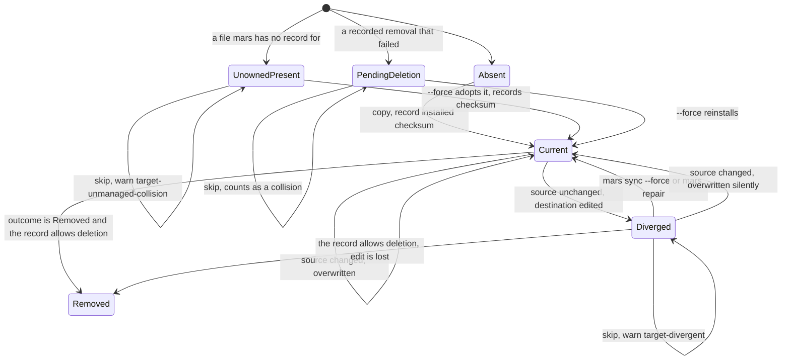
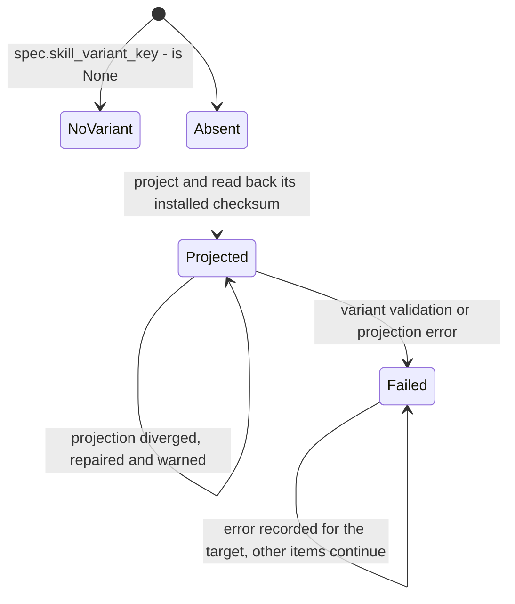

# Target sync state machines

The index of all machines is [state-machines/index.md](../../../.context/state-machines/index.md).
The ownership rules this page leans on are in [CONTEXT.md](CONTEXT.md).

## Managed target output

What is at one destination inside a managed target (`.claude/skills/x`, `.codex/agents/y.md`), and
whether Mars may write it. `sync_one_target` walks every outcome and decides per destination. The
five states are read off three inputs and not stored: whether the destination exists
(`surface_ownership::target_dest_exists`), whether the lock holds an installed checksum for
`(target, dest)` (`copy_decision`, where `PendingDeletion` does not count), and whether the
destination's hash equals the recorded or the desired checksum
(`dest_matches_recorded_or_desired`).

An instance of [an ownership record](../../../.context/state-machines/ownership-record.md).

- `wants_copy` and `managed_dest_is_current_or_stale` (locals of `sync_one_target`) and
  `should_copy_to_target` are three parts of the same decision, evaluated in sequence.
- **A diverged destination is not protected from a source change.** If the canonical `.mars` copy
  changed, the default arm copies over the edit with no ownership check beyond
  `should_copy_to_target`. The edit is preserved only in the `ActionTaken::Skipped` arm, when the
  source did not change. So "sync keeps your edit" means "until upstream changes". `doctor`
  describes this by item kind (agents and skills overwritten, hooks kept); the code's rule is by
  whether the source changed, and hooks go through the merge path, not this one.
- **Removal ignores content.** `remove_target_path_if_managed` checks only `may_delete`, so a
  `Removed` outcome deletes an edited destination. That is deliberate for canonical items, and it
  is the one place an edit is not even warned about.
- **Crash window.** `sync_one_target` writes files (`atomic_copy_file`, `atomic_copy_dir`, skill
  projection) and only reports `synced_outputs`; the caller writes the lock afterwards. Killed
  between, the target holds files with no record, which the next run sees as `UnownedPresent`:
  a collision warning and a skipped copy, not corruption. `cleanup_orphans` treats an
  already-absent recorded path as a confirmed deletion, so the reverse half-write (record present,
  file gone) heals on the next run.
- Per-target errors are collected, not propagated (`sync_managed_targets`), so one target's
  failure leaves the others' writes in place with a single lock write at the end.

## Native skill projection

A skill copied into a target that projects skill variants (`.claude`, `.codex` and others), where
the target's copy is generated from the canonical skill plus `variants/<key>/` and can differ from
a byte copy. It follows the same loop as above with a different test: "matches the lock" is not
enough. `sync_one_target` and `copy_item_to_target` choose the projection by
`kind == Skill && native_skill_variant_key.is_some()`; the dry-run preview
(`preview_native_skill_repairs`) computes the same state without writing.

- **A projection that cannot be prepared only pushes to `errors`.** The canonical item is not
  installed for that target and nothing else is marked.
- **The repair is unconditional and idempotent.** `SKILL.md` is written atomically and the record
  follows, so a killed run leaves a projection the next run recomputes rather than trusts.
